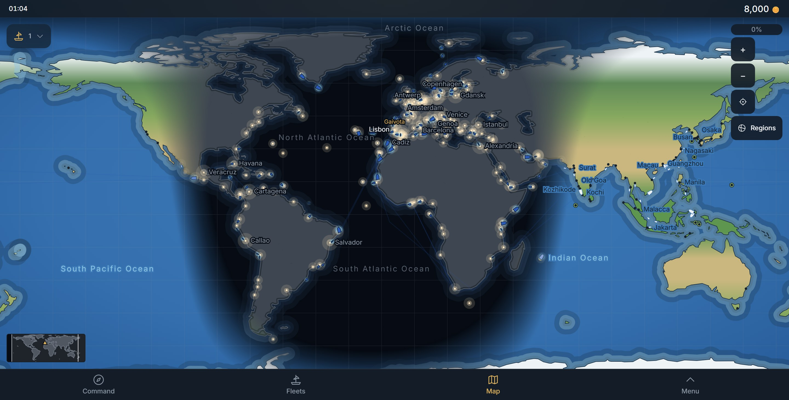
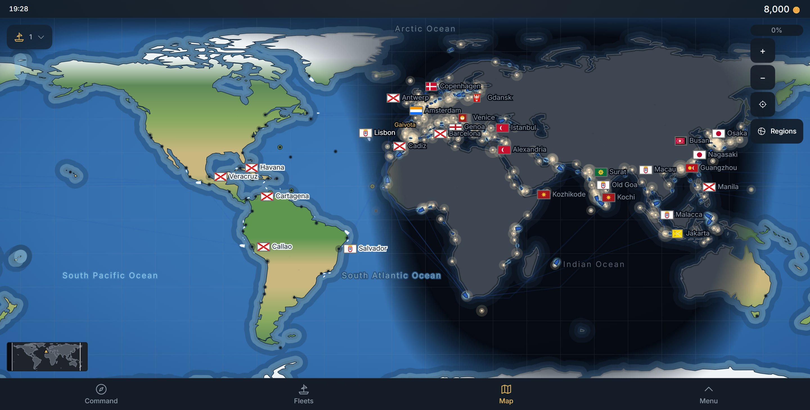
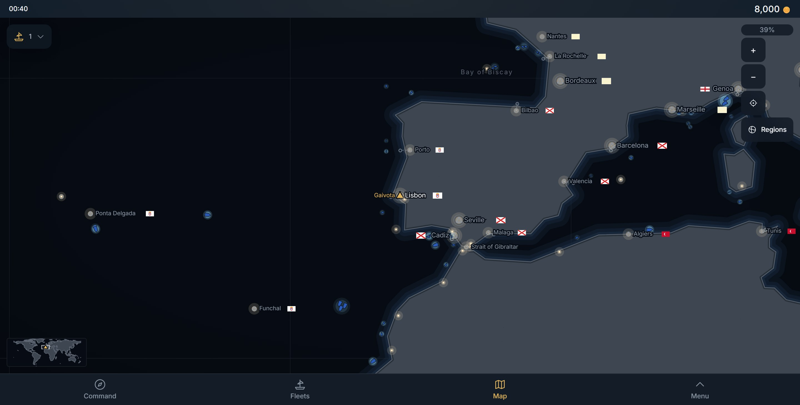
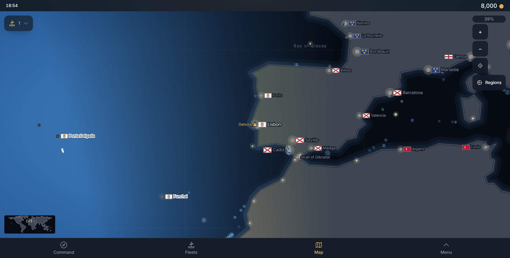
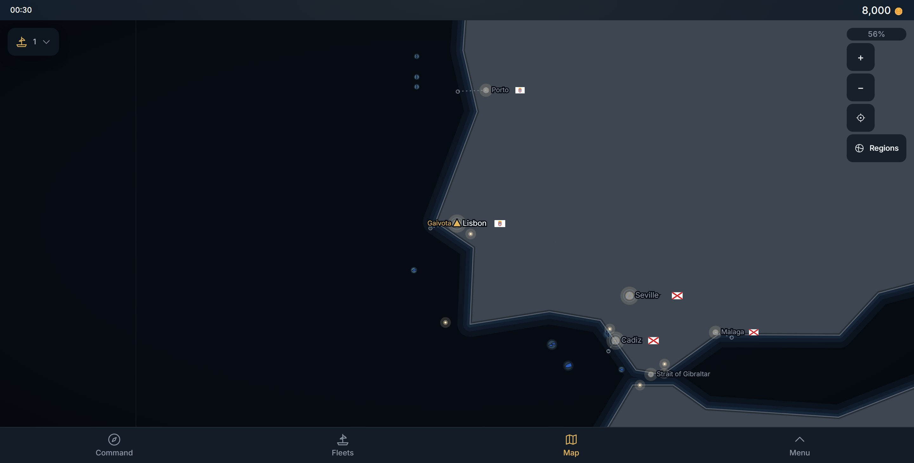
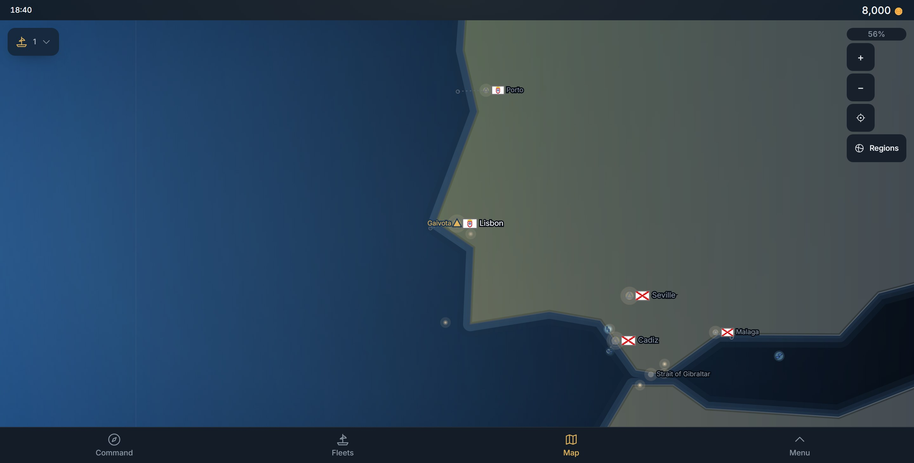
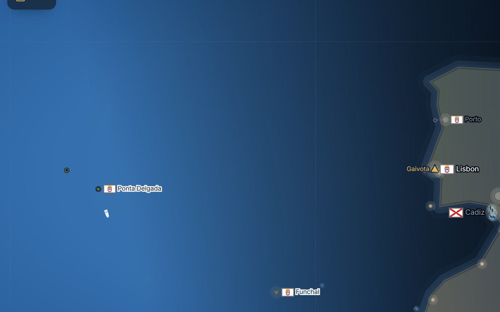

# 2026-10-18 — the flags, legible — `osn-flags-2` (client only)

The owner, on his live Chrome (DPR 2, 1440×731): the flags "aren't there"; "france flag looks shit";
"the flag is too far away from the name of city, it looks unnatural"; "make the city name in light
touching zone black. give black light blink in cities like in night".

Shipped in three pieces:

1. **#227 — France** (live 15:10 UTC): `public/flags/FRA.svg` is now an original CC0 drawing of the
   banner of the royal arms, *azure, three fleurs-de-lis or*, drawn large for 12–20 px.
2. **#228 — every flag legible where the game draws it.**
3. **This PR (map)** — flag before the name and snug, at every zoom including the world view; a tap on
   the flag-and-name unit opens the city; black names on the day side; the day lamp.

## 2. Every flag legible

**Measured first.** Each of the 23 files was drawn at 18×12, 21×14 and 27×18 CSS px at DPR 1 and 2,
on the pale and the dark surfaces, and its RGB spread taken. Four were near-blank:

| flag | σ at 14 px before | what it looked like | done |
|---|---|---|---|
| FRA | 12–27 | a cream chip | #227: blue banner, three large gold fleurs |
| MAR | 15–29 | a red chip (thin gold lines) | gold lines ~3× thicker |
| AYU | 0 | a plain red chip — reads as a broken box | a white elephant on the red ensign (original, CC0) |
| PRT | ok, but tiny | a 6 px shield on white | shield drawn 15 % larger |

After (border excluded, `tests/flags.spec.ts`): the lowest is MAR at 41 (DPR 1) / 49 (DPR 2); old
France measures 30 and fails the ≥ 35 floor, which is the regression the check exists for.

**An edge in every file.** Each flag ends in a 1.5 px mid-grey (`#6f6f6f`) hairline along its own
outline (`vector-effect="non-scaling-stroke"`), so England, Japan and Portugal read on the pale
panels and Sweden or France on the night chart. It replaces the CSS `drop-shadow` filter `Flag` drew,
so the chart's names (which cannot carry that filter cheaply) get the same edge from the same file.

**Bigger.** `FLAG_SIZES` 12/14/18 → **14/16/20** px (caption/body/title).

**The merchant's sheet** carries her company's flag **before her name, at the title size** (20 px), as
your fleet's tray already did; it was a 12 px chip on the line below.

| | before | after |
|---|---|---|
| all 23, at 12/14/18 px, DPR 2 |  |  |
| merchant's sheet |  |  |
| city panel |  |  |

**Ship marks on the map** carry no flag: 800+ merchants at sea already take their nation's ink with
Regions on, and a flag on each hull at 13 px was clutter for no new fact. Decided, not skipped.

**Verified once:** `tsc -b`, `eslint`, `flags.spec.ts` (the file and variance tests); the merchant
and city shots are from the local build at DPR 2.

## 3. The map: flag before the name, snug, at every zoom; black names by day; the day lamp

**Flag first and snug** (the owner: "the flag is too far away from the name of city"). #198 drew the
flag at the name's *outer* end of the planned box, and the box is a monospace estimate while the face
is a sans, so a word's slack stood between "Seville" and its flag. Now the flag is always at the box's
left edge and the name is set from it: the gap is `FLAG_GAP_EM` (0.33 em ≈ 3.5–4 px) at every zoom.
`FLAG_HEIGHT_EM` 0.95 → **1.25** (a 13 px flag beside a 10.5 px name, 15 px beside a great harbour).

**A tap on the unit opens the city.** #198 kept the name on the mark's side because taps on a slid
name fell into open water. Fixed the other way: `LabelsLayer` records each drawn harbour name's box
(`src/chart/placedNames.ts`) and `hitTest` takes those boxes first — a tap anywhere on flag or letters
is that harbour. Driven: a tap 2 px from the right end of "Lisbon" opened Lisbon.

**At every zoom, the world view included.** The `showQuietPorts` gate on the flag is gone.

**Cheap: one `<symbol>` per nation.** `src/chart/flagSymbolStore.ts` fetches each nation's bundled
file once (the same file `Flag` draws), prefixes its ids, and `MapFlagDefs` puts one `<symbol>` per
nation in the chart's `<defs>`; every name places a `<use>`. No per-label `<image>` decode.

**Black names on the day side** (the owner: "make the city name in light touching zone black"). A
harbour name's ink is `chart-day-mark` (near-black) on a pale halo (`--color-chart-day-name-halo`,
#eef3f5) where the Sun is up, and its night ink on the night sea's halo where it is down. The switch
is a **step at `--night` 0.5** — the terminator — for ink and halo together: a ramp gave grey on grey
in the twilight band ("Ponta Delgada" was illegible; measured, then changed). The `--night` is the one
the Sun already sets (`src/chart/sun.ts` `nightStyle`); no second day/night rule.

**The day lamp** (the owner: "give black light blink in cities like in night"): my reading — the
daytime counterpart of a harbour's night light, a dark glow (`chart-day-mark` at 38 % × daylight) at
the light's glow radius that breathes slowly (4.2 s), each harbour on its own phase. It is out at
night. A smooth breath on 252 harbours repaints the whole sheet every frame, so it is **stepped**:
`steps(12)` and phases in whole steps, so every lamp changes on the same 350 ms beat (~3 repaints/s).
The owner should confirm this is what he meant — see the terminator shot.

### Screenshots (DPR 2, 1440×731, the local build)

| | before (main) | after |
|---|---|---|
| world view (0 %) |  |  |
| 39 % |  |  |
| 56 % (opening) |  |  |

Both sides of the terminator at 39 % (Ponta Delgada and Funchal on the day side, black on pale; Lisbon
and east on the night side): 

Names carrying flags, same views: world 28/28 (before 0/28), 39 % 17/18, 56 % 5/6 (the unflagged one
is your fleet's name).

### Frame rate (pan at the world view, DPR 2, headless Chromium on this PC, 4 rounds each, fps)

| build | as built | day lamp still | flags hidden | both |
|---|---|---|---|---|
| main (before) | 20.8 · 20.2 · 21.1 · 20.1 | — | — | — |
| this PR | 20.3 · 20.3 · 20.0 · 19.8 | 23.5 · 24.2 · 23.2 (one 9.6 outlier) | 18.4 · 19.7 · 20.6 · 18.9 | 22.1 · 22.8 · 22.1 (one 9.7) |

The flags at the world view cost nothing measurable. The stepped day lamp costs ~3 fps of ~23 in
this software-rendered harness; the build as shipped pans at the same rate as main. These are
relative numbers on a loaded machine, not the owner's GPU Chrome.

**Verified once:** `tsc -b`, `eslint`, `tests/flags.spec.ts` (7 passed: files, planner, tap boxes,
variance, 1440 and 390 drives with the world view and the snug-gap check, desk), `tests/map.sun.spec.ts`
(9 passed).
