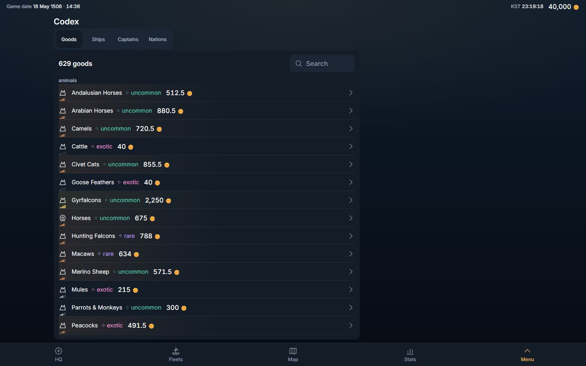
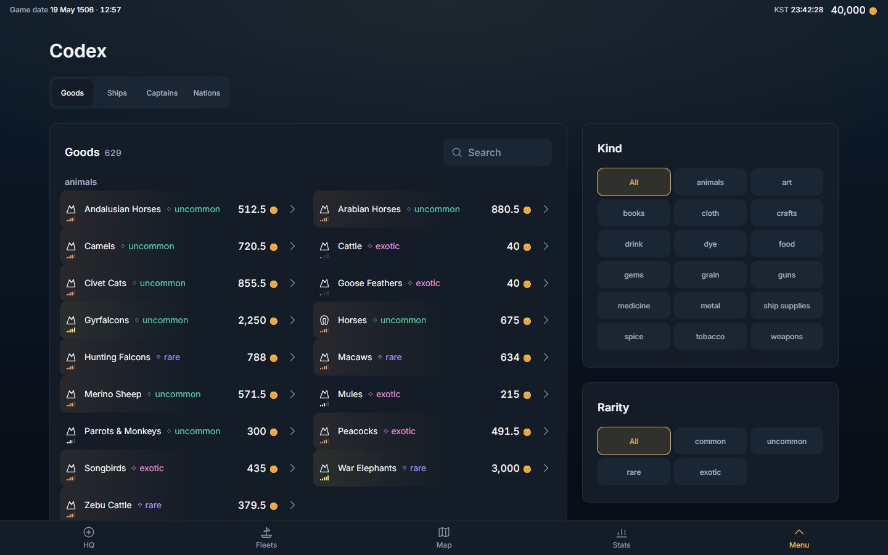
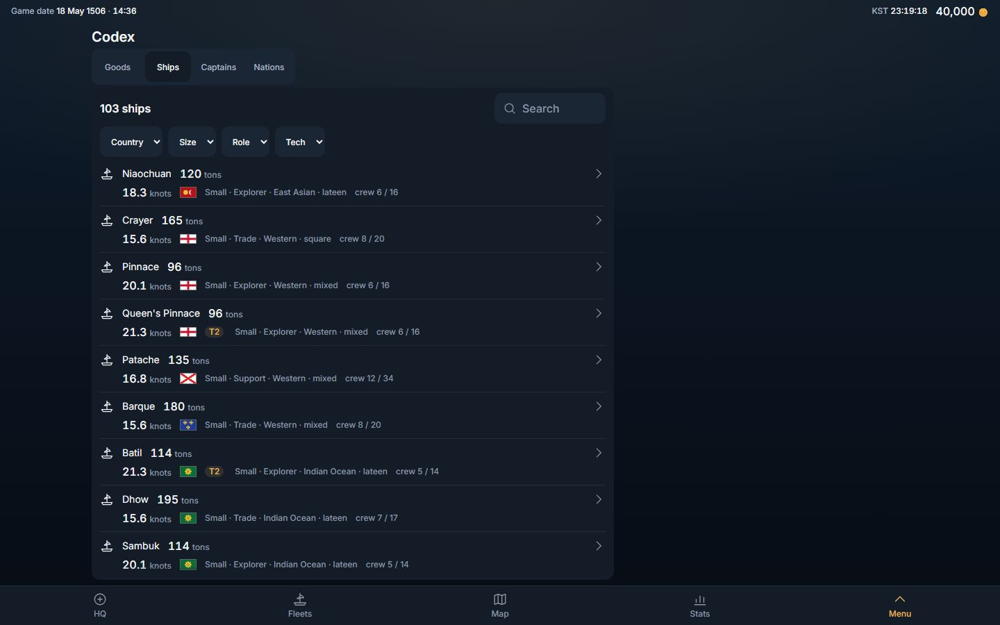
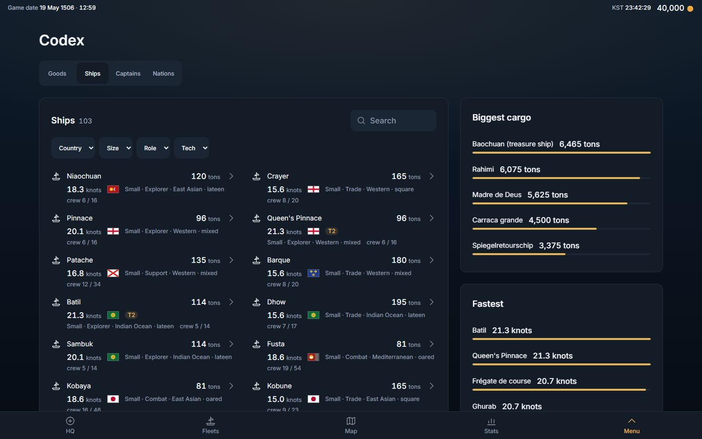
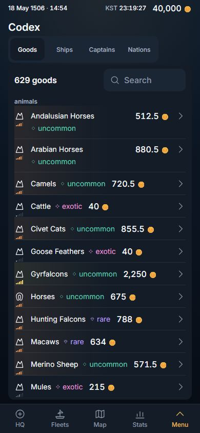
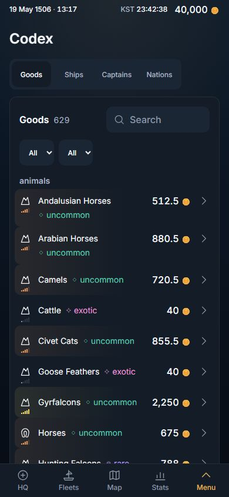
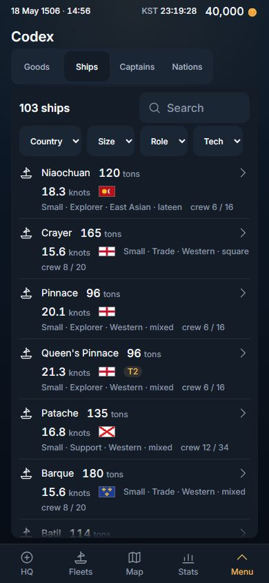
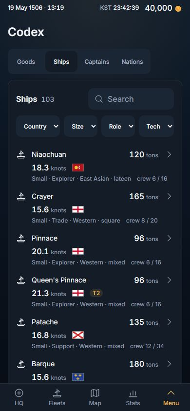

# Codex, redesigned: the page pattern, second screen (2026-11-02)

Owner, 2026-11-02, verbatim (row 267): *"i want you to redesign the looks of the game. for example stats, it looks so wrong. The past was better. right now everything is on left, too packed. this was a mistake"*.

Stats took the page first (PR #466, `docs/dev-log/2026-11-02-stats-design.md`) and is THE PATTERN; the Codex is the second screen on it, in the order that log proposes (Codex, History, Rank, Routes, HQ, Fleets, Map). This slice is client-only (no migration, no server change, no read changed) and composes what Stats built — `Sheet layout="page"`, `PageSplit`, `Card`, `ListPanel look="card" columns="fit"`, `RankBars`, `FilterBar`'s chip grid, the page-context `Tray` — and adds no primitive. No other screen moved by a pixel: the one shared edit is a constant moving house (§3).

## 0. The answer in six lines

1. **The width is used.** The Codex is the centred page container (content at most 1,280 px; margins 16 · 24 · 32 · 40, 80 each side at 1,440) and, from 1,024, **MAIN | SIDE** on every face — the side column is the tray's column and is always used.
2. **Every face has a second block, and it stands in the side.** Goods: the KIND and the RARITY as choice grids, every choice on the glass (the past's eighteen kind chips, which the past-vs-now analysis names among what made the past better; a drop-down hides the choice behind a press). Ships: *Biggest cargo* and *Fastest* — five hulls each, as ranked bars. Captains: *By grade* and *By role* — the roster's shape as ranked bars. Nations: the Great powers in the main card, the Local rulers in the side card. The boards follow the filters: a filter that leaves twelve hulls ranks those twelve.
3. **The list is a card with room.** One card a face, its title and count and the search on one line, the filters (Ships, Captains) under it, rows 52 px on a phone and 60 from 1,024 with whitespace and no rule between them, the figure on the row's right edge, rows in as many columns of at least 20 rem as the card holds (1 on a phone, 2 in the 840-px main at 1,440), the kind headings spanning the columns; the page scrolls — **no list scrolls inside itself** (the 629 goods were 28,088 px inside a 653-px panel).
4. **A real hierarchy.** Page title 30 px (24 on a phone); card titles 18 (16); row labels 14 with their figure in 16 at the row's edge; the rows 60 px, not 44 (a nation's row was 33).
5. **A press SELECTS.** A kind pressed in the side narrows the list and moves nothing else (measured: the side's cards and the search hold their boxes to the pixel; on a phone the kind is a picker in the list card's header, the same state); a row pressed opens its tray, which **slides over the side column** — the same x and width, from the one `--page-side` the grid and the tray share — and nothing behind it moves.
6. **Nothing removed.** Every face, the search, the Ships' and Captains' pickers (their `filter-pick-*` ids are what `captains.codex.spec` drives), the kind headings, the great/rulers split, every tray row and test id — all there; `tests/codex.design.spec.ts` asserts the list (U3).

Pictures (1,440 × 900 and 390 × 844, English, canary world, DPR 1; the BEFORE shots are the build of origin/main `856a9830`):

| | BEFORE (origin/main 856a9830) | AFTER |
|---|---|---|
| Goods, 1,440 |  |  |
| Ships, 1,440 |  |  |
| Goods, 390 |  |  |
| Ships, 390 |  |  |

## 1. The four faces

- **Goods** — MAIN: *Goods · 629*, the search on its title line (and, below 1,024, the kind and the rarity as two pickers in the card's header — the same compact `FilterBar` the Ships and Captains faces use, driven by the same state as the side's grids), the goods under their kind headings in two columns at 1,440 (one at 1,024 and on a phone), one figure a row (the base price, at the row's right edge), the rarity word beside the name, the class meter under the mark as before; a row opens the good's tray (kind, rarity, class, base, weight, spoils, the cultures that refuse it — unchanged). SIDE (from 1,024, sticky): *Kind* — All and the seventeen kinds as a three-across choice grid; *Rarity* — All and the four tiers. The filters narrow the list; the headings say the kind once per group across every column.
- **Ships** — MAIN: *Ships · 55* with the four pickers (country · size · role · tech) in its header, a row a class (name, hold; speed, country, tech, size · role · family · rig, crew on the facts line), two columns at 1,440; a row opens the class's tray (unchanged). SIDE (sticky; after the list on a phone): *Biggest cargo* and *Fastest* — the five biggest holds and the five fastest hulls among the rows the filters leave, ranked bars with the figure in tons / knots (`formatTons`, `formatKnots`: WORDS law 2, a unit spelled).
- **Captains** — MAIN: *Captains · 105* with the three pickers (grade · role · job) in its header, a row a captain (name, bonus; grade, job, signed, level, port on the facts line), two columns at 1,440; a row opens her tray (grade, job, traits, speaks, wage, port, nation, working for, blurb — unchanged). SIDE (sticky; after the list on a phone): *By grade* (best first, the served `grade_ord`) and *By role* (biggest first) — how many of the rows on the face carry each, ranked bars.
- **Nations** — MAIN: *Great powers · 10*, the search on its title line, large flags, two columns at 1,440; SIDE: *Local rulers · 13*, one column. Read-only rows (a nation has no detail), 60 px, a capital or *no capital named* at the row's edge.

The faces are the one `Segmented` under the title, as Stats has it. The search clears when the face changes, as before.

## 2. What was folded, and the one shared edit

- **`ALL` moved to the design system** (`src/components/ui/filterState.ts`, exported through `index.ts`). ShipsFace and CaptainsFace each spelled `const ALL = 'all'` and the Goods face's two new choices would have been the third copy — and Stats' `statsFilters.ts` exported the same name, which `tests/duplication.spec.ts` ("two modules never export the same name") would have refused. The id of the choice that narrows nothing is filter machinery with two screens calling it, so it lives beside `oneOf` and `useFilterChoice`; the four Stats faces import it from `../../components/ui` instead of `./statsFilters` (an import line each — no pixel moved; `tests/stats.filters.spec.ts` green). **§7B for it:** the concept is "the all-choice id"; it lives with the filter state because that is what reads and remembers a choice; the second caller is this screen (the third will be History's kind filter); the wrong shape would be a screen spelling `'all'` by hand — `duplication.spec`'s export rule catches a second export, and a bare string is on the reviewer.
- **A card list's title keeps 8 rem** (`src/components/ui/ListPanel.tsx`, `look="card"`, `min-w-32` on the title line). Found by the law at 320 × 640: beside the 176-px search the Nations card's title was squeezed to 68 px, "Great powers" wrapped and its count "10" ran 5 × 17 px under the search field (law (b), a text on a control). The header line already wraps, so a control that does not fit beside 8 rem of title now drops under it; the title is never the thing that gives way. On Stats nothing moves: its card lists' trailing controls (a sort picker, ~100 px) fit beside 8 rem at 320 (`tests/stats.design.spec.ts` green on this build, §5). **§7B:** the concept is "the title line of a card list never collapses"; it lives in the one card-list recipe; every card list is its caller; the wrong shape would be a per-screen width on the trailing control, which the next screen would copy.
- **`readDesign` gained `block`** (`tests/design.fixture.ts`, additive): the text span widened to the edges of the page's `[data-card]` / `[data-list-panel]` boxes. Law (a) as Stats wrote it reads the rightmost TEXT, and Stats reaches its right margin only by the "Updated" line of its title bar; the Codex's rightmost text is a kind cell's centred word (1,314 at 1,440) or a board's figure hugging its label (1,076), while its cards stand at 1,360. A card at the margin is content at the margin, so the Codex's (a) reads `block`; `span` is untouched and the Stats laws still read it. On origin/main the block is the one list panel, 132..884 — (a) is red there by either reading (§5).
- **`optionsOf` folded** into `src/features/compendium/codexFilters.ts`: ShipsFace and CaptainsFace each had their own (one with a `(value, item)` label, one with `(item)`; one with a default order), the Goods face would have been the third. One signature now. It stays in the screen (its header names Stats' `countriesOf` as the second caller and says where it moves then).
- **Deleted:** the four `codex.count*` dictionary keys (English and Korean) — the card's title is the face's word and its count a figure, as every Stats list; the old `ListPanel look="panel"` composition in the four faces; `tests/codex.unfold.spec.ts` (replaced, §4).
- **New words** (English · Korean): *Biggest cargo* · 최대 적재, *Fastest* · 최고 속력, *By grade* · 등급별, *By role* · 역할별. Four card titles; names, not sentences. Everything else is an existing key.

## 3. Phones

One column, and **the list comes first** (the review of the first cut: with the Kind and Rarity grids first, the two filled the whole first glass at 390 × 844 and "Goods 629" stood at its bottom edge — the Codex's purpose is the list). Below the split there is no side: the Goods' kind and rarity are two pickers in the list card's header (`useWide()`, the same 1,024 px as the page's MAIN | SIDE; one state drives the grid above it and the picker below), and the Ships' and Captains' boards stand after their list, as the Nations' rulers do. Law (g) holds it: at 390 × 844 and 320 × 640 the first row of every face stands on the first glass (Goods 69 px under the glass's edge at 390 and 327 at 320 on the first cut, Ships 247 / 573, Captains 65 / 299; 0 now). Cards stack with 16 px of padding; rows 52-60 px; the page scrolls. Controls are 44 px; nothing scrolls sideways; the document is flat (the Sheet is the scroller).

<!-- measured:start -->
## 4. Measured, BEFORE → AFTER

Headless Chromium, English, dark scheme, DPR 1, the canary world, one persistent page per build, both builds served by `vite preview` on `localhost` (BEFORE = origin/main 856a9830 on port 4174, AFTER = this branch on 4173), the four faces at the five glasses. "Text span" is the leftmost..rightmost visible text of the Codex sheet (x in px, its share of the glass, and the band empty at its right); "block" is the text widened to the cards' edges (`tests/design.fixture.ts` `block`, what law (a) reads — see §5). Rows are the face's rows (`good-tile`, `ship-tile`, `officer-tile`, `nation-row`); "rules" are rows drawing a bottom rule; "cards" are `[data-card]` / `[data-list-panel]` surfaces; "inner scrollers" are boxes other than the sheet that scroll inside themselves. The raw JSON of both runs is in this PC's scratchpad.

### 1,440 × 900

| face | text span BEFORE | text span AFTER | block AFTER | title | row height (min) | row width (max) | rules | cards | inner scrollers | side | sheet height / glass |
|---|---|---|---|---|---|---|---|---|---|---|---|
| Goods | 132..512 (26 %, 928 px empty) | 80..1314 (86 %, 126 px empty) | 80..1360 (89 %, 80 px empty) | 20 → 30 | 44 → 60 | 728 → 395 | 628 → 0 | 1 → 3 | 1 → 0 | — → 416 | 811 / 811 → 20,070 / 811 |
| Ships | 132..700 (39 %, 740 px empty) | 80..1231 (80 %, 209 px empty) | 80..1360 | 20 → 30 | 66 → 86 | 728 → 395 | 102 → 0 | 1 → 3 | 1 → 0 | — → 416 | 811 / 811 → 4,854 / 811 |
| Captains | 132..409 (19 %, 1,031 px empty) | 80..1076 (69 %, 364 px empty) | 80..1360 | 20 → 30 | 60 → 60 | 728 → 395 | 104 → 0 | 1 → 3 | 1 → 0 | — → 416 | 811 / 811 → 3,562 / 811 |
| Nations | 132..409 (19 %, 1,031 px empty) | 80..1335 (87 %, 105 px empty) | 80..1360 | 20 → 30 | 32 → 60 | 728 → 395 | 21 → 0 | 1 → 2 | 1 → 0 | — → 416 | 811 / 811 → 1,094 / 811 |

### 1,280 × 800

| face | text span BEFORE | text span AFTER | block AFTER | title | row height (min) | row width (max) | rules | cards | inner scrollers | side | sheet height / glass |
|---|---|---|---|---|---|---|---|---|---|---|---|
| Goods | 52..432 (30 %, 848 px empty) | 40..1199 (91 %, 81 px empty) | 40..1240 (94 %, 40 px empty) | 20 → 30 | 44 → 60 | 728 → 371 | 628 → 0 | 1 → 3 | 1 → 0 | — → 384 | 711 / 711 → 20,106 / 711 |
| Ships | 52..620 (44 %, 660 px empty) | 40..1143 (86 %, 137 px empty) | 40..1240 | 20 → 30 | 66 → 86 | 728 → 371 | 102 → 0 | 1 → 3 | 1 → 0 | — → 384 | 711 / 711 → 5,014 / 711 |
| Captains | 52..329 (22 %, 951 px empty) | 40..988 (74 %, 292 px empty) | 40..1240 | 20 → 30 | 60 → 60 | 728 → 371 | 104 → 0 | 1 → 3 | 1 → 0 | — → 384 | 711 / 711 → 3,562 / 711 |
| Nations | 52..329 (22 %, 951 px empty) | 40..1215 (92 %, 65 px empty) | 40..1240 | 20 → 30 | 32 → 60 | 728 → 371 | 21 → 0 | 1 → 2 | 1 → 0 | — → 384 | 711 / 711 → 1,094 / 711 |

### 1,024 × 768

| face | text span BEFORE | text span AFTER | block AFTER | title | row height (min) | row width (max) | rules | cards | inner scrollers | side | sheet height / glass |
|---|---|---|---|---|---|---|---|---|---|---|---|
| Goods | 16..396 (37 %, 628 px empty) | 32..959 (91 %, 65 px empty) | 32..992 (94 %, 32 px empty) | 20 → 30 | 44 → 60 | 544 → 562 | 628 → 0 | 1 → 3 | 1 → 0 | — → 352 | 679 / 679 → 38,654 / 679 |
| Ships | 16..570 (54 %, 454 px empty) | 32..923 (87 %, 101 px empty) | 32..992 | 20 → 30 | 66 → 66 | 544 → 562 | 102 → 0 | 1 → 3 | 1 → 0 | — → 352 | 679 / 679 → 7,208 / 679 |
| Captains | 16..293 (27 %, 731 px empty) | 32..768 (72 %, 256 px empty) | 32..992 | 20 → 30 | 60 → 60 | 544 → 562 | 104 → 0 | 1 → 3 | 1 → 0 | — → 352 | 679 / 679 → 6,670 / 679 |
| Nations | 16..293 (27 %, 731 px empty) | 32..971 (92 %, 53 px empty) | 32..992 | 20 → 30 | 32 → 60 | 544 → 562 | 21 → 0 | 1 → 2 | 1 → 0 | — → 352 | 679 / 679 → 1,082 / 679 |

### Phones (390 × 844 · 320 × 640)

| face · glass | text span BEFORE | text span AFTER | title | row height (min) | row width (max) | rules | cards | inner scrollers | sheet height / glass |
|---|---|---|---|---|---|---|---|---|---|
| Goods 390 | 16..330 (81 %) | 16..325 (79 %) | 20 → 24 | 44 → 52 | 334 → 340 | 628 → 0 | 1 → 1 (the pickers are in the card) | 1 → 0 | 755 / 755 → 34,198 / 755 |
| Ships 390 | 16..361 (89 %) | 16..353 (86 %) | 20 → 24 | 86 → 86 | 334 → 340 | 102 → 0 | 1 → 3 | 1 → 0 | 755 / 755 → 11,000 / 755 |
| Captains 390 | 16..293 (71 %) | 16..325 (79 %) | 20 → 24 | 60 → 60 | 334 → 340 | 104 → 0 | 1 → 3 | 1 → 0 | 755 / 755 → 7,166 / 755 |
| Nations 390 | 16..293 (71 %) | 16..357 (87 %) | 20 → 24 | 32 → 52 | 334 → 340 | 21 → 0 | 1 → 2 | 1 → 0 | 755 / 755 → 1,548 / 755 |
| Goods 320 | 16..289 (85 %) | 16..289 (85 %) | 20 → 24 | 44 → 52 | 264 → 270 | 628 → 0 | 1 → 1 (the pickers are in the card) | 1 → 0 | 551 / 551 → 39,712 / 551 |
| Ships 320 | 16..290 (86 %) | 16..289 (85 %) | 20 → 24 | 106 → 106 | 264 → 270 | 102 → 0 | 1 → 3 | 1 → 0 | 551 / 551 → 12,922 / 551 |
| Captains 320 | 16..289 (85 %) | 16..289 (85 %) | 20 → 24 | 60 → 60 | 264 → 270 | 104 → 0 | 1 → 3 | 1 → 0 | 551 / 551 → 7,340 / 551 |
| Nations 320 | 16..291 (86 %) | 16..289 (85 %) | 20 → 24 | 32 → 52 | 264 → 270 | 21 → 0 | 1 → 2 | 1 → 0 | 551 / 551 → 1,590 / 551 |

What the numbers say: the content went from a 752-px list panel at the left (text 19-44 % of the glass at 1,440 and 1,280, 660-1,031 px empty at its right) to the page's block at 89 % / 94 % / 94 % (1,440 / 1,280 / 1,024), the empty band at its right equal to the margin at its left (80 / 40 / 32 px); the page title from 20 to 30 (24 on a phone); a list row from 44 (a good, a pressable row at the reach floor) and 32 (a nation, at its text line) to 60 (52 on a phone); a goods row from 728 px wide at 1,440 (name and price hugging at the left, 500 px of nothing to a chevron) to 395 in two columns; row rules from 21-628 to 0; cards from 1 to 2-3 (on a phone the Goods face is one card, its pickers in its header); inner scrollers from 1 to 0. The cost is length: the sheet that was exactly the glass is 1,094 (Nations, 1,440) to 39,712 px (Goods, 320) tall — 629 goods on one page, the kind headings and the side's Kind grid being how it is walked (a kind leaves 10-80 goods). The Goods face's text span at 1,440 stops at 1,314 and the Captains' at 1,076 because the kind grid's words are centred in their cells and a board's figure hugs its label — the cards stand at 1,360; that is why law (a) reads the block (§5).
<!-- measured:end -->

## 5. The laws, and which were red before

`tests/codex.design.spec.ts` replaces `tests/codex.unfold.spec.ts` (which held U2 "the page and the Sheet never scroll; the list scrolls inside its panel" and U1 "N whole rows in the panel before a press" — the packed design). Its laws, at 1,440 × 900, 1,280 × 800, 1,024 × 768, 390 × 844 and 320 × 640, in English and Korean, read by the same `tests/design.fixture.ts` Stats uses:

The same file was run against both builds (served side by side: origin/main `856a9830` on port 4174, this branch on 4173), 16 tests each — the four faces at five glasses in two languages, the tray-and-kind-press law at five glasses, the search-and-pickers law.

| law | what it reads | BEFORE (856a9830): **16 of 16 failed** | AFTER: **16 of 16 passed** |
|---|---|---|---|
| (a) use the width | the content block (text widened to the cards' edges) is centred from 1,024 and spans ≥ 80 % of the glass from 1,280 | **red** — 40 lines, every face at every glass of 1,024 and up, both languages (block 132..884 at 1,440: 556 px empty against a 132-px margin) | green |
| (b) the defect rules | no sideways scroll, no overlap, no one-letter wrap, no cut text without its full text, every control ≥ 44 px, the document flat | green (0 lines — a guard, kept) | green (one defect found on the first build and fixed at the root, §2) |
| (c) the hierarchy | a list row ≥ 52 px and ≤ 36 rem wide | **red** — 36 lines (a good's row 44 px, a nation's 32; rows 728 px wide at 1,440) | green |
| (d) a tray moves nothing, and stands over the side | the boxes of six blocks before / during / after; the tray's x and width equal the side column's | the no-move half **green** (a guard); the side half **red** ("the page has no side column for the tray to stand over") at 1,440 · 1,280 · 1,024; on the phones the kind press has no kind card to press | green |
| (e) the side is used | every face has its second block, and from 1,024 it stands in `[data-page-side]` | **red** — 90 lines (no side column; no kind or rarity card, no cargo or speed board, no grade or role board; the rulers not in a side) | green |
| (f) no scroll trap | no box but the sheet scrolls inside itself | **red** — 40 lines (every face's list panel scrolls inside itself: 28,088 px of goods in 653) | green |
| (g) the list comes first on a phone | at 390 × 844 and 320 × 640 the face's first row stands on the first glass; the Goods' kind and rarity pickers are there | not a question on origin/main (its list was the only block); **red on this branch's first cut** 8445610e — 6 of 6 phone tests: Goods' first row 69 / 327 px under the glass's edge (390 / 320), Ships' 247 / 573, Captains' 65 / 299, no pickers | green |
| U3 / U5 / U8 | nothing removed; no text cut in a list card; a row opens its tray and closing it leaves the list; a kind pressed selects and moves nothing else; the search narrows; a picker picks; the boards follow the filter | U3 and U5 green (0 lines — kept); U8 red only where it asks for the new blocks (the cargo board) | green |

Specs that held the packed design, retargeted with the reason in the file: `tests/layout.spec.ts`'s COMPENDIUM block drops "the panel stands inside the glass" and "N rows whole before a press" (both were the packing) and asserts instead that the card's body is not a scroller and that EVERY entry stands whole in it — stronger than N — keeping one-a-line on a phone, the row as wide as the body and no sideways shear. `consistency.spec` law 4 and `onepage.spec` already exempt any `Sheet layout="page"` (Stats' slice did that generically), so they needed nothing.

## 6. What was not verified

- **Canary world only** (629 goods, 55 hulls, 105 captains, 23 nations — the catalogue is static, so a played world shows the same faces; only the captains' *signed* / *working for* rows differ).
- **Light scheme not shot**; the laws ran in the dark scheme (the suite's default). **DPR 2** not re-measured (layout is in CSS px). Real Chrome on the owner's laptop was not driven (headless only).
- **Korean** was measured by the laws (both locales at five glasses) but not shot.

## 7. Next

History is the next screen on the pattern (side = the open report), then Rank, Routes, HQ, Fleets, the Map — `docs/dev-log/2026-11-02-stats-design.md` §7. The Ships' and Captains' pickers stay drop-downs here because `captains.codex.spec` and the Codex interaction law drive them by `filter-pick-*`; turning the five-choice ones into choice grids is the follow-up that log names.
