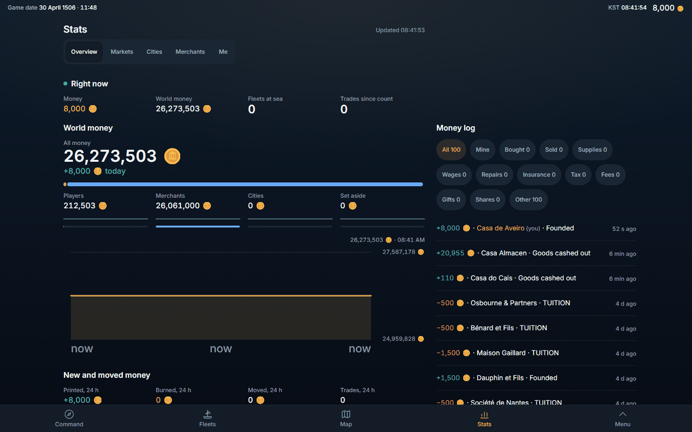
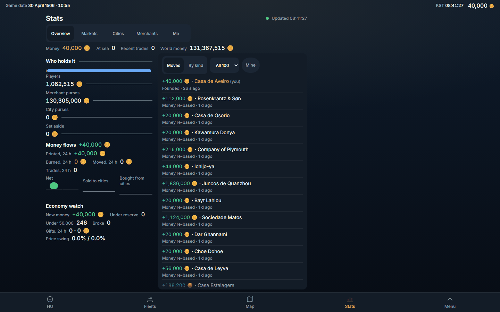
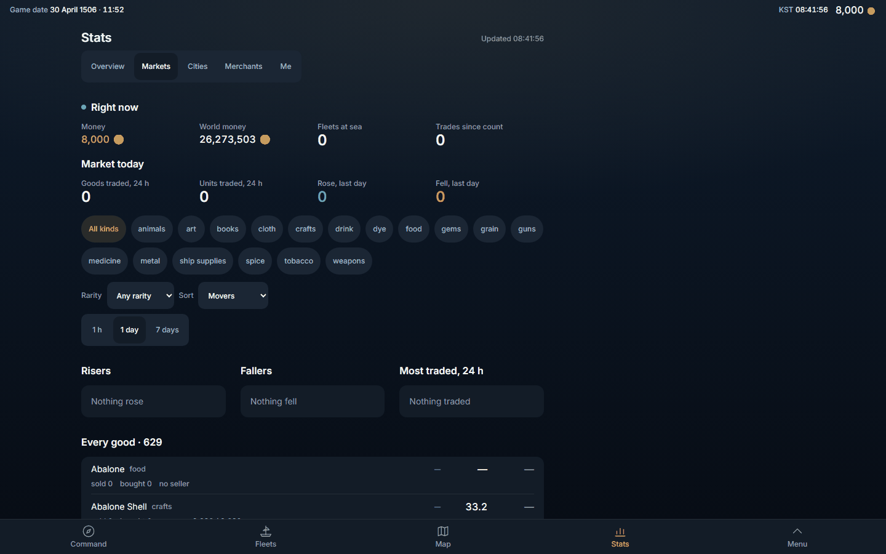
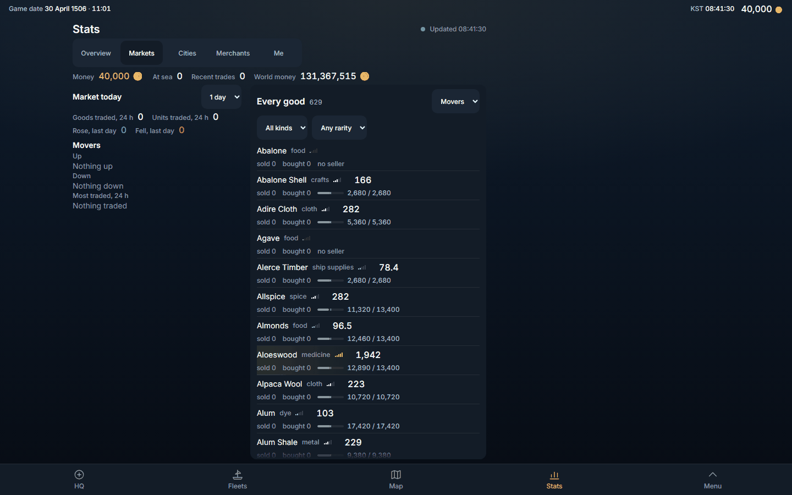
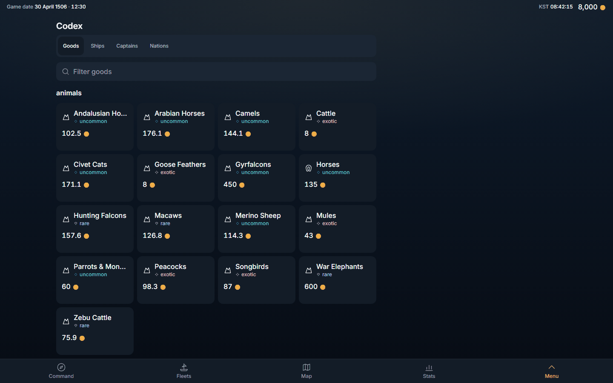
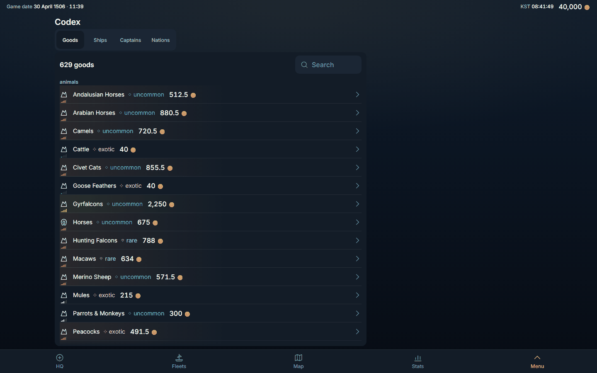
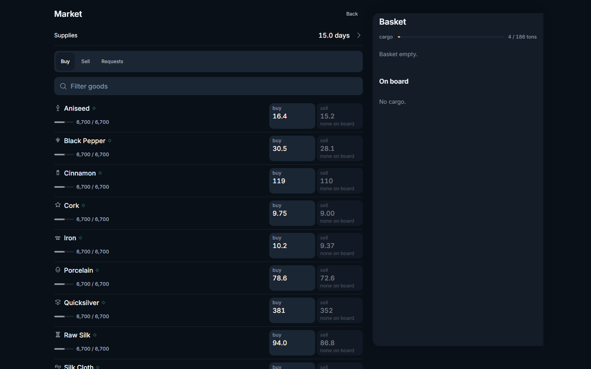
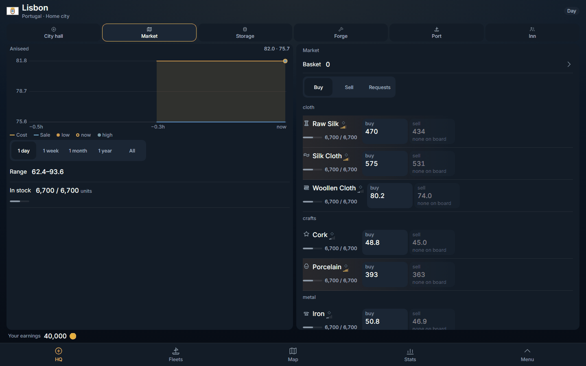
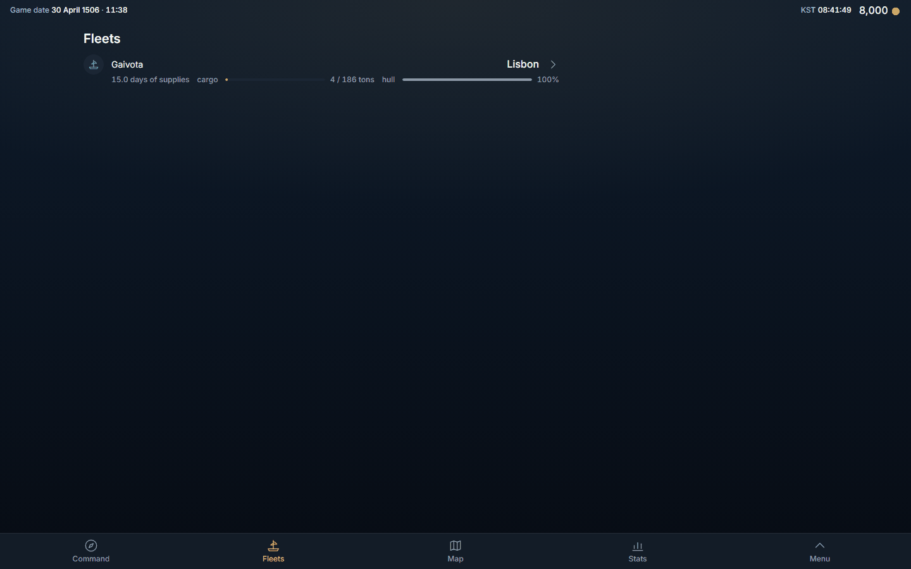
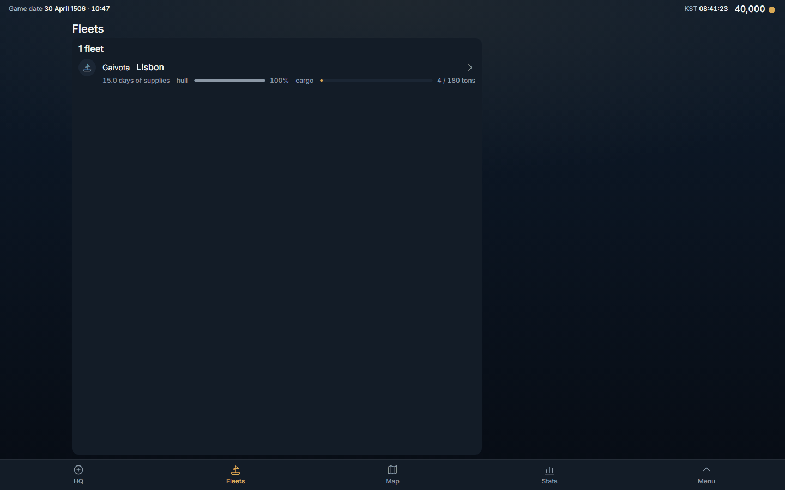

# Design: the past against now, measured (2026-11-02)

Owner, 2026-11-02, verbatim: *"i want you to redesign the looks of the game. for example stats, it looks so wrong. The past was better. right now everything is on left, too packed. this was a mistake"*.

This is a read-only comparison. Three builds of the same game were built and shot side by side, in the same browser, on the same canary world, and measured. Nothing in the game was changed.

> **Status: first version (written 2026-11-02 ~23:55 UTC), written so the next session on another PC can read it without this PC's scratch folder.** It carries the analysis, the measured tables for every screen (P1, P2, NOW at 1440x900, 1280x800, 390x844) and the five key pictures for P1 and NOW. **Not in the repo:** the other screenshots (about 200 PNGs: every screen and face at three glasses, P1/P2/NOW), `compare.html` (a one-page side-by-side) and the scripts; they stay in this PC's scratch folder `C:\Users\gkwng\AppData\Local\Temp\claude\C--Users-gkwng\053e89dc-55cd-4bfd-83d7-ad778f295a98\scratchpad\design-past\` (`compare.html`, `analysis.md`, `P1\`, `P2\`, `NOW\`, `scripts\`) and can be rebuilt from section 7.

## 0. The answer in nine lines

1. **The wide-glass column is the same width in the past and now.** `src/components/ui/screenLayout.ts` is identical at P1 and NOW: `lg:max-w-[75.5rem] lg:pr-[27.5rem]`. At 1440x900 every Sheet screen puts its text at x=132..884 (752 px, 52 % of the glass; 556 px, 39 %, empty on the right); at 1280x800 it is x=52..804 (59 %; 476 px empty). The tray reservation is **not new**.
2. **What changed is what goes into that column and into the tray column beside it.** At P1 the Stats Overview docked its Money log in the tray column (x=908..1324), so the Overview used 83 % of the glass (text x=132..1324). At NOW the log is a list panel inside the 752-px column and the Overview is 52 %. The HQ Market page at P1 did the same with its Basket (x=908..1324).
3. **NOW cuts the 752 px in two.** Stats Overview and Markets are a 308-px figure column plus a 428-px list panel; P1 used the whole 752 px as one flow (four 192-px figure cells in a row, a full-width chart, three 234-px cards).
4. **The type hierarchy is flat.** On every NOW Stats face the page title (20 px) is the largest text and the biggest figure is 16 px. At P1 the headline figure is 34 px (World money, Me) and the figure strips are 24 px, over 12-px captions.
5. **Label and figure are glued together** (the #439/#440 "hug"): the median gap between a row's label and its figure is 12 to 85 px at NOW (108 on Codex Goods) against 300 to 577 px at P1. Codex Goods text spans x=132..474 (24 % of the glass) inside a 752-px panel. Numbers no longer line up in a column that the eye can run down.
6. **Cards became hairline rows.** Thin rules in the viewport: Stats Markets 2 to 12, Merchants 1 to 11, Codex Goods 0 to 15. Outer cards: Overview 12 to 2, Markets 12 to 5, Codex Goods 18 to 1. 629 goods are one list of 44-px rows; at P1 they were 182-px tiles with a 16-px figure and a rarity mark.
7. **Choices went behind drop-downs.** P1 showed every kind and span as a chip or a segmented control (18 kind chips, 1 h / 1 day / 7 days); NOW shows "All kinds v", "Any rarity v", "1 day v", "Movers v".
8. **A law meant for long lists was applied to short ones.** Fleets (#463) draws ONE panel 752 x 765 px for a single 60-px row: 700 px of an empty card. At P1 it was one bare row on the glass.
9. **On a phone NOW is dense, not compact.** Stats Overview at 390x844 holds five blocks of 12 to 16-px text on one screen with a three-row list at the bottom; P1 is a 2 x 2 grid with a 34-px hero number, and the page scrolls (Overview 2,542 px in a 755-px glass).

Not a regression, for balance: the HQ at NOW uses the whole glass (x=16..1424) and is better than P1's HQ in width; the damage is on the Sheet screens (Stats, Codex, History, Fleets, You, Profile, Routes, Rank).

## 1. What was compared, and how

| name | commit | date | what it is |
|---|---|---|---|
| P1 | `c575fc38` | 2026-10-31 11:05 +0900 | the last commit before #413 (`6a4b192f`, "one page - every tab fits the glass"), i.e. "the past" |
| P2 | `ba8bd3c1` | 2026-10-26 23:02 +0900 | #347, Stats with filters and charts opening larger (the Stats look of a week earlier) |
| NOW | `3751cc74` | 2026-11-02 | origin/main when this run began (later commits are docs only) |

- **Builds:** `git worktree add --detach` for each, then `vite build` in LOCAL mode (no Supabase env). `tsc -b` was skipped to save time (it does not change a pixel). `package.json` and `package-lock.json` are byte-identical at P2, P1 and NOW, so one toolchain served all three: each worktree has a real `node_modules` directory whose entries are junctions to the main clone's, **except `.cache`, which is a private copy** of the needed PGlite prefix snapshots (a build of an older chain through a shared junction would PRUNE main's snapshots: `scripts/db/prefix-cache.mjs` `prune`). Builds ran with `BYEHARU_PREFIX_CACHE=required` (a cache miss fails instead of starting a from-zero replay): P1 restored 256 of 272 migrations in 3.6 s, P2 224 of 235, NOW 284 of 285; build times 110 s, 65 s, 35 s.
- **Served** with `vite preview --host localhost --port 4821 (P1) / 4822 (P2) / 4823 (NOW)`.
- **Shot** headless (Playwright 1.61 Chromium, never the owner's Chrome), English, dark scheme, DPR 1, one persistent profile per build, client-side navigation through the app's own router. Glasses: 1440x900, 1280x800, 390x844. The canary world each build boots: one fleet (Gaivota) docked in Lisbon, no trades, an empty history. **Money differs by build** (8,000 at P1 and P2, 40,000 at NOW): that is the canary of that commit.
- **Measured** by one script injected into every page (computed styles and layout boxes, nothing guessed): the span of the visible content text (leftmost to rightmost, excluding the status strip and the nav bar), the span of the surfaces (cards and panels), font sizes weighted by characters (top three; figures = numeric text), `[data-row-line]` row heights and the label-to-figure gap, thin horizontal rules (borders and 1-2 px bars), outer cards (rounded, padded, filled or bordered surfaces), and distinct text columns (left edges with at least three texts, 40 px apart or more).
- Files: the scripts are `shoot.mjs`, `aggregate.py`, `optimise.py` in the scratchpad folder named at the end; the screenshots are under `design-past\P1`, `P2`, `NOW` there; **this document carries the five key pictures at 1440x900** (P1 and NOW), the rest are in the scratchpad.

## 2. The five pictures (1440x900, DPR 1, English, dark scheme, canary world)

### Stats Overview

| P1, the past (`c575fc38`) | NOW (`3751cc74`) |
|---|---|
|  |  |

P1: the Money log stands in the tray column (x=908..1324), a 34-px "World money" hero, four 192-px figure cells in a row, the whole 752-px column as one flow. NOW: a 308-px figure column plus a 428-px "moves" panel, figures 14 to 16 px, the right 556 px empty.

### Stats Markets

| P1, the past (`c575fc38`) | NOW (`3751cc74`) |
|---|---|
|  |  |

P1: figure strips (24 px), 18 kind chips, three cards (Risers / Fallers / Most traded), then "Every good" as one flow. NOW: a 308-px info column plus a 428-px list panel, drop-downs instead of chips, twelve hairline rows.

### Codex, Goods

| P1, the past (`c575fc38`) | NOW (`3751cc74`) |
|---|---|
|  |  |

P1: 4-up tiles (name, rarity mark, a 16-px price). NOW: 44-px rows, the price hugging the name, a chevron at the far edge: all text sits in x=132..474 (24 % of the glass).

### HQ, Market

| P1, the past (`c575fc38`) | NOW (`3751cc74`) |
|---|---|
|  |  |

P1: the Market opens as a page (Back, Supplies, Buy / Sell / Requests, 79-px good rows with big buy and sell cells) and the Basket stands in the tray column. NOW: the HQ split view, price chart left, goods by kind right, the whole glass used.

### Fleets

| P1, the past (`c575fc38`) | NOW (`3751cc74`) |
|---|---|
|  |  |

P1: one bare row on the glass. NOW (#463): one panel, 752 x 765 px, around a single 60-px row.

## 2b. Measured, per screen and glass

P1 = the past, NOW = origin/main, P2 = 2026-10-26 for reference. "Text span" is the leftmost..rightmost visible content text (x, px) with its share of the glass width and the empty band to its right (px); text only, so chevrons and icons are not in it. Rows are `[data-row-line]` rows (count x median height, px); rules are thin horizontal lines; cards are outer rounded surfaces; columns are distinct text left-edges shared by three or more texts.

**1440x900** (text span = leftmost..rightmost visible content text, x in px, then share of the glass width and the empty band to the right, px)

| screen | P1 text span | NOW text span | P2 text span | P1 / NOW rows (n x median px) | P1 / NOW rules | P1 / NOW cards | P1 / NOW columns |
|---|---|---|---|---|---|---|---|
| hq-hall | 32..1408 (96%, 32) | 20..895 (61%, 545) | 16..1400 (96%, 40) | 0 / 0 | 3 / 2 | 1 / 0 | 4 / 1 |
| hq-market | 32..1408 (96%, 32) | 20..1109 (76%, 331) | - | 11x79 / 10x79 | 12 / 10 | 17 / 16 | 7 / 5 |
| command | 16..1400 (96%, 40) | 16..1404 (96%, 36) | 16..1400 (96%, 40) | 7x52 / 1x52 | 6 / 2 | 21 / 21 | 9 / 6 |
| fleets | 132..884 (52%, 556) | 132..872 (51%, 568) | 132..884 (52%, 556) | 1x60 / 1x60 | 0 / 0 | 0 / 0 | 0 / 0 |
| map | 52..1416 (95%, 24) | 52..1416 (95%, 24) | 52..1416 (95%, 24) | 0 / 0 | 0 / 0 | 1 / 1 | 0 / 0 |
| stats-overview | 132..1324 (83%, 116) | 132..884 (52%, 556) | 132..1440 (92%, 0) | 8x52 / 13x49 | 8 / 13 | 12 / 2 | 8 / 3 |
| stats-markets | 132..884 (52%, 556) | 132..884 (52%, 556) | 132..1352 (85%, 88) | 5x52 / 12x53 | 2 / 12 | 12 / 5 | 4 / 6 |
| stats-cities | 132..884 (52%, 556) | 132..884 (52%, 556) | 132..884 (52%, 556) | 8x61 / 10x61 | 8 / 10 | 9 / 5 | 5 / 3 |
| stats-merchants | 132..884 (52%, 556) | 132..884 (52%, 556) | 132..884 (52%, 556) | 3x52 / 11x53 | 1 / 11 | 5 / 4 | 4 / 4 |
| stats-me | 132..884 (52%, 556) | 132..884 (52%, 556) | 132..884 (52%, 556) | 5x52 / 1x32 | 11 / 0 | 2 / 1 | 5 / 2 |
| history | 132..868 (51%, 572) | 132..493 (25%, 947) | 132..868 (51%, 572) | 1x56 / 1x48 | 0 / 0 | 1 / 0 | 0 / 0 |
| rank-captains | 132..884 (52%, 556) | 132..884 (52%, 556) | 132..884 (52%, 556) | 11x57 / 11x49 | 9 / 10 | 3 / 1 | 2 / 1 |
| rank-countries | 132..884 (52%, 556) | 132..884 (52%, 556) | 132..884 (52%, 556) | 10x60 / 10x52 | 9 / 9 | 2 / 1 | 2 / 1 |
| routes | 132..872 (51%, 568) | 132..856 (50%, 584) | 132..872 (51%, 568) | 1x52 / 1x32 | 0 / 0 | 1 / 1 | 0 / 0 |
| codex-goods | 132..853 (50%, 587) | 132..474 (24%, 966) | 132..858 (50%, 582) | 0 / 15x44 | 0 / 15 | 18 / 1 | 8 / 4 |
| codex-ships | 132..872 (51%, 568) | 132..632 (35%, 808) | 132..1440 (94%, 0) | 0 / 10x67 | 0 / 10 | 12 / 5 | 7 / 3 |
| codex-captains | 132..906 (54%, 534) | 132..409 (19%, 1031) | 132..1440 (93%, 0) | 0 / 11x61 | 0 / 11 | 13 / 4 | 5 / 2 |
| codex-nations | 132..884 (52%, 556) | 132..409 (19%, 1031) | 132..884 (52%, 556) | 11x52 / 19x33 | 10 / 18 | 1 / 1 | 3 / 4 |
| you | 132..884 (52%, 556) | 132..884 (52%, 556) | 132..884 (52%, 556) | 5x53 / 2x50 | 2 / 0 | 2 / 0 | 1 / 2 |
| profile | 132..852 (50%, 588) | 132..587 (32%, 853) | 132..852 (50%, 588) | 3x52 / 3x52 | 0 / 0 | 4 / 3 | 1 / 1 |

**1280x800** (text span = leftmost..rightmost visible content text, x in px, then share of the glass width and the empty band to the right, px)

| screen | P1 text span | NOW text span | P2 text span | P1 / NOW rows (n x median px) | P1 / NOW rules | P1 / NOW cards | P1 / NOW columns |
|---|---|---|---|---|---|---|---|
| hq-hall | 32..1248 (95%, 32) | 20..815 (62%, 465) | 16..1240 (96%, 40) | 0 / 0 | 3 / 2 | 1 / 0 | 4 / 1 |
| hq-market | 32..1248 (95%, 32) | 20..1029 (79%, 251) | - | 10x79 / 8x79 | 11 / 8 | 15 / 12 | 7 / 5 |
| command | 16..1240 (96%, 40) | 16..1244 (96%, 36) | 16..1240 (96%, 40) | 7x52 / 1x52 | 6 / 2 | 20 / 19 | 7 / 6 |
| fleets | 52..804 (59%, 476) | 52..792 (58%, 488) | 52..804 (59%, 476) | 1x60 / 1x60 | 0 / 0 | 0 / 0 | 0 / 0 |
| map | 52..1256 (94%, 24) | 52..1256 (94%, 24) | 52..1256 (94%, 24) | 0 / 0 | 0 / 0 | 1 / 1 | 0 / 0 |
| stats-overview | 52..1244 (93%, 36) | 52..804 (59%, 476) | 52..1276 (96%, 4) | 6x52 / 11x49 | 6 / 11 | 12 / 2 | 8 / 4 |
| stats-markets | 52..804 (59%, 476) | 52..804 (59%, 476) | 52..1272 (95%, 8) | 3x52 / 10x53 | 0 / 10 | 12 / 5 | 4 / 5 |
| stats-cities | 52..804 (59%, 476) | 52..804 (59%, 476) | 52..804 (59%, 476) | 6x61 / 8x61 | 6 / 8 | 9 / 5 | 5 / 3 |
| stats-merchants | 52..804 (59%, 476) | 52..804 (59%, 476) | 52..804 (59%, 476) | 2x52 / 9x53 | 0 / 9 | 3 / 4 | 4 / 4 |
| stats-me | 52..804 (59%, 476) | 52..804 (59%, 476) | 52..804 (59%, 476) | 3x52 / 1x32 | 9 / 0 | 2 / 1 | 4 / 2 |
| history | 52..788 (57%, 492) | 52..413 (28%, 867) | 52..788 (57%, 492) | 1x56 / 1x48 | 0 / 0 | 1 / 0 | 0 / 0 |
| rank-captains | 52..804 (59%, 476) | 52..804 (59%, 476) | 52..804 (59%, 476) | 10x57 / 11x49 | 9 / 10 | 3 / 1 | 2 / 1 |
| rank-countries | 52..804 (59%, 476) | 52..804 (59%, 476) | 52..804 (59%, 476) | 10x60 / 10x52 | 9 / 9 | 2 / 1 | 2 / 1 |
| routes | 52..792 (58%, 488) | 52..776 (57%, 504) | 52..792 (58%, 488) | 1x52 / 1x32 | 0 / 0 | 1 / 1 | 0 / 0 |
| codex-goods | 52..773 (56%, 507) | 52..394 (27%, 886) | 52..742 (54%, 538) | 0 / 13x44 | 0 / 13 | 18 / 1 | 8 / 2 |
| codex-ships | 52..792 (58%, 488) | 52..552 (39%, 728) | 52..1280 (97%, 0) | 0 / 8x67 | 0 / 8 | 8 / 5 | 6 / 3 |
| codex-captains | 52..826 (60%, 454) | 52..329 (22%, 951) | 52..1275 (96%, 5) | 0 / 9x61 | 0 / 9 | 9 / 4 | 7 / 3 |
| codex-nations | 52..804 (59%, 476) | 52..329 (22%, 951) | 52..804 (59%, 476) | 10x52 / 16x33 | 9 / 15 | 1 / 1 | 2 / 4 |
| you | 52..804 (59%, 476) | 52..804 (59%, 476) | 52..804 (59%, 476) | 5x53 / 2x50 | 2 / 0 | 2 / 0 | 1 / 2 |
| profile | 52..772 (56%, 508) | 52..507 (36%, 773) | 52..772 (56%, 508) | 3x52 / 3x52 | 0 / 0 | 4 / 3 | 1 / 1 |

**390x844** (text span = leftmost..rightmost visible content text, x in px, then share of the glass width and the empty band to the right, px)

| screen | P1 text span | NOW text span | P2 text span | P1 / NOW rows (n x median px) | P1 / NOW rules | P1 / NOW cards | P1 / NOW columns |
|---|---|---|---|---|---|---|---|
| hq-hall | 32..358 (84%, 32) | 20..358 (87%, 32) | 16..388 (95%, 2) | 0 / 0 | 3 / 2 | 2 / 0 | 4 / 1 |
| hq-market | 16..358 (88%, 32) | 20..353 (85%, 37) | - | 8x79 / 6x140 | 11 / 6 | 16 / 1 | 5 / 3 |
| command | 16..366 (90%, 24) | 16..366 (90%, 24) | 16..388 (95%, 2) | 0 / 1x52 | 0 / 1 | 15 / 18 | 5 / 4 |
| fleets | 16..374 (92%, 16) | 16..362 (89%, 28) | 16..374 (92%, 16) | 1x100 / 1x80 | 0 / 0 | 0 / 0 | 1 / 1 |
| map | 52..366 (81%, 24) | 52..366 (81%, 24) | 52..366 (81%, 24) | 0 / 0 | 0 / 0 | 1 / 1 | 0 / 0 |
| stats-overview | 16..374 (92%, 16) | 16..374 (92%, 16) | 16..374 (92%, 16) | 0 / 4x49 | 0 / 4 | 1 / 2 | 2 / 4 |
| stats-markets | 16..374 (92%, 16) | 16..374 (92%, 16) | 16..390 (98%, 0) | 0 / 7x53 | 0 / 7 | 9 / 5 | 3 / 4 |
| stats-cities | 16..374 (92%, 16) | 16..374 (92%, 16) | 16..390 (100%, 0) | 3x61 / 9x61 | 3 / 9 | 9 / 5 | 3 / 4 |
| stats-merchants | 16..374 (92%, 16) | 16..374 (92%, 16) | 16..374 (92%, 16) | 0 / 5x53 | 0 / 5 | 1 / 4 | 2 / 4 |
| stats-me | 16..374 (92%, 16) | 16..374 (92%, 16) | 16..374 (92%, 16) | 1x52 / 1x32 | 0 / 0 | 1 / 1 | 2 / 1 |
| history | 16..358 (88%, 32) | 16..362 (89%, 28) | 16..358 (88%, 32) | 1x80 / 1x72 | 0 / 0 | 1 / 0 | 0 / 0 |
| rank-captains | 16..374 (92%, 16) | 16..374 (92%, 16) | 16..374 (92%, 16) | 11x57 / 11x49 | 9 / 10 | 3 / 1 | 2 / 1 |
| rank-countries | 16..374 (92%, 16) | 16..374 (92%, 16) | 16..374 (92%, 16) | 10x60 / 10x52 | 9 / 9 | 2 / 1 | 2 / 1 |
| routes | 16..362 (89%, 28) | 16..346 (85%, 44) | 16..362 (89%, 28) | 1x52 / 1x32 | 0 / 0 | 1 / 1 | 0 / 0 |
| codex-goods | 16..360 (88%, 30) | 16..330 (81%, 60) | 16..358 (88%, 32) | 0 / 13x44 | 0 / 13 | 11 / 1 | 4 / 4 |
| codex-ships | 16..361 (88%, 29) | 16..361 (88%, 29) | 16..390 (100%, 0) | 0 / 7x87 | 0 / 7 | 2 / 5 | 3 / 4 |
| codex-captains | 16..316 (77%, 74) | 16..293 (71%, 97) | 16..390 (100%, 0) | 0 / 10x61 | 0 / 10 | 3 / 4 | 3 / 3 |
| codex-nations | 16..374 (92%, 16) | 16..293 (71%, 97) | 16..374 (92%, 16) | 10x52 / 17x33 | 9 / 16 | 1 / 1 | 2 / 4 |
| you | 16..374 (92%, 16) | 16..374 (92%, 16) | 16..374 (92%, 16) | 5x53 / 2x50 | 2 / 0 | 2 / 0 | 1 / 1 |
| profile | 16..342 (84%, 48) | 16..342 (84%, 48) | 16..342 (84%, 48) | 3x52 / 3x52 | 0 / 0 | 4 / 3 | 1 / 1 |


FONTS (top-3 sizes by characters; figures = numeric text; labels = other text; gap = median px between a Row label and its value)

| screen @1440x900 | P1 all / figures / labels | NOW all / figures / labels | P1 / NOW largest text | P1 / NOW label-figure gap |
|---|---|---|---|---|
| stats-overview | 12/14/16 / 12/14/16 / 12/14/16 | 12/14/16 / 14/16/12 / 12/14/16 | 34 px '26,273,503 🪙' / 20 px 'Stats' | 301 / - |
| stats-markets | 12/16/14 / 16/24 / 12/16/14 | 12/14/16 / 12/16 / 12/14/16 | 24 px '0' / 20 px 'Stats' | 504 / 85 |
| stats-cities | 12/16/14 / 16/24 / 12/16/14 | 12/16/14 / 16/12 / 12/14/16 | 24 px '0' / 20 px 'Stats' | 577 / 12 |
| stats-merchants | 12/16/14 / 16/12/24 / 12/16/14 | 12/14/16 / 16/14 / 12/14/2 | 24 px '0' / 20 px 'Stats' | 456 / 12 |
| stats-me | 12/16/14 / 16/24 / 12/16/14 | 12/16/14 / 16/12 / 12/16/14 | 34 px '0 🪙' / 20 px 'Stats' | - / - |
| codex-goods | 16/12/2 / 16 / 16/12/2 | 14/16/12 / 16 / 14/12/16 | 20 px 'Codex' / 20 px 'Codex' | - / 108 |
| fleets | 12/14/2 / 12 / 12/14/2 | 12/16/14 / 12 / 12/16/14 | 20 px 'Fleets' / 20 px 'Fleets' | - / - |
| history | 14/12/2 / 16/12 / 14/12/2 | 14/12/16 / 16/12 / 14/12/2 | 20 px 'History' / 20 px 'History' | 393 / 12 |
| hq-market | 12/16/14 / 12/16 / 12/16/14 | 12/16/14 / 12/16 / 12/16/14 | 20 px 'Basket' / 16 px '62.4–93.6' | 444 / 57 |


## 3. (a) What made the past feel better, and what makes now feel packed and left-heavy

Read with the five pictures in section 2. All numbers are at 1440x900 unless said.

**The past (P1) felt better because:**

- **One column, used whole.** The 752 px was a single flow. Stats Markets reads top to bottom: "Right now" (four figure cells of 192 px at x=132, 324, 516, 708), "Market today" (four more), the kind chips, three cards (Risers / Fallers / Most traded, 234 px each), then "Every good". The eye has one path and one left edge.
- **A real size ladder.** Page title 20, section title 16 semi-bold, **headline figure 34 px (World money) or 24 px (the strips), sub-figures 16, captions 12.** The number is the biggest thing in its block; the label is a quiet 12-px caption above it.
- **Figures sit where figures are found.** In a P1 row the figure stands at the far end (label-to-figure gap 300 to 577 px), so a column of numbers has one right edge and can be read down.
- **Grouping by cards, with air.** 12 outer cards on Overview and Markets, tiles on Codex Goods (182 px wide, about 112 px tall, on a 190 x 120 pitch, four to a row); rows 52 to 61 px; few hairlines (Markets 2, Merchants 1, Codex Goods 0). Whitespace did the grouping, not rules.
- **Choices were visible.** Kind filter = 18 chips in two rows, span = a segmented control. One look shows every option; one press selects.
- **The right side was used where it paid.** Overview put the Money log in the tray column (x=908..1324, 416 px), the HQ Market put its Basket there. The wide glass looked composed, not left-weighted.
- **Empty screens looked empty on purpose.** A fleet list with one fleet was one row on the glass; it did not draw a card the size of the screen.

**Now (NOW) feels packed and left-heavy because:**

- **The right 556 px (39 %) are empty on every Sheet screen** while the left 132 px margin is not: the content block is at x=132..884 on a 1440 glass (left margin 132, right band 556). The `lg:pr-[27.5rem]` reservation is for a tray that is closed almost always, and nothing else lives there. At 1280 the band is 476 px (37 %).
- **The 752 px are cut in two.** Overview: a 308-px figure column (x=132..440) and a 428-px "moves" list panel (x=456..884), with a three-row-high strip of 14-px pairs above them. Markets: 308 + 428 again. Each pane is half as wide as the P1 flow, so labels stack, figures hug, and nothing breathes. P1's Overview has eight distinct text columns (a 192-px pitch at x=132, 324, 516, 708, then the log at 906..1278); NOW's has three (x=132, 468, 546).
- **The hierarchy collapsed.** 20-px page title is the largest text on every Stats face; figures are 14 to 16 px (139 characters at 14 px, 87 at 16), labels are 12 px (542 characters) and 14 px (229) on the Overview. A "headline" number is the same size as the label next to it.
- **Label and figure are glued** (#439/#440 "hug"): gaps of 12 px (Cities, Merchants, History), 85 px (Markets), 108 px (Codex Goods rows). The right 60 % of every row is blank up to a chevron. Codex Goods: all text lives in x=132..474, 24 % of the glass. HQ Hall's right panel: all its text in x=744..895 of a 696-px panel.
- **Cards turned into hairline rows.** More rules (Markets 2 to 12, Merchants 1 to 11, Codex Goods 0 to 15, Ships 0 to 10, Captains 0 to 11), fewer cards (Overview 12 to 2, Markets 12 to 5, Codex Goods 18 to 1). 629 goods in one 44-px row list (28,088 px of list in a 653-px window) is a scroll bar, not a catalogue.
- **Two nested scrollers per screen** instead of one page flow: the figures block and the list panel, e.g. Overview's list panel holds 4,904 px in 617 px, Markets 3,244 in 577.
- **Selects instead of chips**: "All kinds v", "Any rarity v", "1 day v", "Movers v" hide the choice behind a press.
- **A full-glass panel for a short list** (Fleets: 752 x 765 card around one 60-px row).
- **Phone**: the same compaction at 390 makes Overview a five-block wall of 12 to 16-px text with the Money log a 159-px window (about three rows) holding 4,904 px; Markets' list is 331 px holding 3,244. P1 at 390 is a 2 x 2 grid of 24-px figures plus a 34-px hero, and the page scrolls (Overview 2,542 px in a 755-px glass), which is the cost the #413 law removed.

## 4. (b) Traits of the past that must NOT come back (they were real defects)

Evidence is from these builds and from the 2026-11-02 layout sweep (`scratchpad\sweep\sweep.md`, measured on NOW) and the 2026-10-31 consistency audit.

- **Content wider than the glass (P2).** P2's Stats Overview, Codex Ships and Codex Captains run to x=1440 and beyond at 1440x900 (surfaces to x=1576; the Money log's chip row runs off the edge): sideways overflow. P1 did not do this at 1440; P2 did, so "the Oct 26 look" is not a base to copy.
- **Overprinted labels (P1 HQ).** At the foot of the art panel "Population" and "Relationship" are printed on top of each other (P1 `hq-hall-1440x900`, x=32..120, y=750..760).
- **A rail with no way back (P1 HQ).** The P1 City page's own bar is HQ / Command / Map / Stats / Menu with **no Fleets**: the "every screen needs a way back" rule of 2026-10-31 exists because of it.
- **An empty chart that prints "now" three times at 24 px** (P1 and P2 Overview): an empty-state artifact, not a design.
- **Fixed-rem scroll windows** (sweep row 1: the desk's Trade / City / Invest / Report panes are `max-h-[9 to 14rem]` windows that hold 400 to 14,000 px; Stats' 12-rem floor in `ListPanel.tsx:184`): scroll traps. Whatever replaces the compaction must size a list to its glass (fill) or to its content, never to a magic rem.
- **One-letter wraps, overlaps, cut text without its full text, sideways scrollers, page scroll on a tab screen, controls under 44 px, empty glass on a phone**: the seven classes of the sweep (rows 1 to 18, for example HQ Market goods names in a 0-px box, the sell cell 69 px off the edge, `Button size="sm"` 36 px, place links 15 to 26 px). Not all of these exist at P1, but the redesign must hold the 2026-10-31 laws (U1-U8, the phone laws in `tests/unfold.fixture.ts` `phoneLaws`) as it widens the layout; **bigger type and card padding must not buy back a scroll on a 390x844 tab screen**, which was the point of #413.
- **Page scroll on the phone is acceptable only where the content is a flow of cards** (P1 Overview at 390 scrolls); the law of #413 was "every tab fits the glass". Decide that per screen in the redesign rather than by a global rule: fold (Detail page) the blocks that do not fit, never shrink the type below 12 px to fit.

## 5. (c) A proposed layout system (measurable)

Goal: fill the glass the way P1 did where it paid (Overview, Market), keep what #413 and the unfold laws achieved on the phone, and stop drawing a list panel around a short list.

**Grid and widths** (one set of numbers, `screenLayout.ts` is the only place):

| glass | side margin | content width | grid | gutter | main / side columns |
|---|---|---|---|---|---|
| >= 1536 | auto (centred) | 1280 | 12 | 24 | 840 / 416 (26 rem tray width) |
| 1440 | 80 | 1280 (89 % of the glass; now 752, 52 %) | 12 | 24 | 840 / 416 |
| 1280 | 40 | 1200 (94 %; now 752, 59 %) | 12 | 24 | 792 / 384 |
| 1024 | 32 | 960 | 12 | 20 | 584 / 352 |
| 768 | 24 | 720 | 8 | 16 | one column, side block stacks under main |
| 390 | 16 | 358 | 4 | 12 | one column, blocks fold into Detail pages |

- **Side column = the tray column, used.** From 1024 up a Sheet screen is `main | side`. When the tray is closed the side column carries the screen's second block (Stats Overview: Money log; Markets: movers and filters; Codex: the selected item's card; History: the open report; Fleets: the selected fleet's status; Rank: your standing). Opening a tray slides it over that same column (same x, same width: `trayDockWideClass()` already uses `right-[max(0px,calc(50%-37.75rem))]` and 26 rem; change both from the one new constant). The page never has an empty 556-px band and never shifts when a tray opens.
- **Spacing scale (4-px base):** 4, 8, 12, 16, 24, 32, 48. Page top 16, title to content 16, between sections 32, between cards 16, card padding 16 (24 for a hero card), figure cell gap 24. Row heights: 52 px for a pressed row (44 px floor), 44 px for a read-only dense list; no row under 40.
- **Type scale (existing tokens, re-assigned; nothing under 12 px):** page title `t-title` 20 to **24/30 (new `t-page`)**; section title **16/22 semi-bold**; headline figure `t-hero` 34/38 (World money, a ship's price); strip figure `t-figure` 24/28; row figure 16/22 semi-bold tabular; label `t-label` 14/20; caption `t-caption` 12/16. The rule P1 held: **the number is always bigger than its label**.
- **Cards:** radius 12 (`--radius-tile` 0.75 rem), padding 16 (24 hero), 1-px line at the existing `--color-line`, `--color-surface` fill, one level of nesting at most. A card groups a block; rows inside a card are separated by hairlines **only between rows of one list**, never between figures.
- **Rows:** label left, figure **right-aligned** with tabular numerals (default for lists); the "hug" (figure right after the label) only for an inline pair inside a sentence strip. Codex goods go back to a 4-up tile grid at >= 768 (tile 182 x 112 at 752 main, 200 x 112 at 840) and a 44-px row list below 768.
- **Choices:** a chip row or segmented control when there are <= 6 options or the labels fit one row; a select only above that. Span pickers are always segmented.
- **Lists:** `ListPanel` sizes to its content for short lists (Fleets with 1 to 3 hulls is three rows, not a 765-px card) and fills the glass only when the list is longer than the glass; no 12-rem floor.

**Stats Overview at 1440x900 (box diagram, px):**

```
x=80 .............................................................. x=1360
Stats (24)                                          * live  updated 08:41      y 40
[ Overview | Markets | Cities | Merchants | Me ]  (44 px)                       y 88
+------------------ MAIN 840 ----------------------+ +------ SIDE 416 -------+
| Right now (16/600)                                 | | Money log (16/600)    |
| Money   World money   At sea   Trades              | | [Moves|By kind] [All v]|
| 8,000   26,273,503    0        0      4 x 192 px   | | +8,000  Casa de Aveiro|
| (12 caption over 24 figure)                        | |  Founded - 52 s ago   |
|                                                    | | -500   Osbourne ...   |
| World money (16/600)       [card 840 x 120]        | | ...  rows 52 px; the  |
|  26,273,503 (34)  +8,000 today   ====bar====       | |  list scrolls inside  |
|  Players | Merchants | Cities | Set aside  (4x24)  | |  the card only        |
|                                                    | |                       |
| [card] chart 840 x 200, span chips                 | |                       |
| [card] Money flows | [card] Economy watch  (2x)    | |                       |
+----------------------------------------------------+ +-----------------------+
```
Height estimate (not measured): title block 88 + figures 120 + hero card 120 + chart 200 + flows 140 + nav 56 + gaps ~160 = ~884 of 900 px, so the page does not scroll and only the Money log scrolls inside its card.

**Stats Overview at 390x844 (box diagram):**

```
Stats (24)                    * Updated 08:43      y 16..46
[ Overview | Markets | Cities | Merchants | Me ]   44 px (scrolls sideways inside the control only if needed)
+ Right now ------------------------------+
| Money 8,000        World money 26,273,503|  2 x 2, 12 caption / 24 figure
| At sea 0           Trades 0              |
+ World money ------------------------------+
| 26,273,503 (34)  +8,000 today  ====bar==== |
| Players | Merchants   (2 x 2 of 20)        |
+ chart 358 x 150 ---------------------------+
| Money flows                          >     |  52-px fold rows -> Detail page
| Economy watch                        >     |
| Money log (100)                      >     |
```
The phone keeps the #413 law (nothing scrolls inside a card; blocks that do not fit become 52-px fold rows that open their own page) but the blocks that are shown are shown at 24/34-px figures, not 14.

**Which shared files carry the change, and who holds them right now** (as of this run, from `git diff origin/main...HEAD` of every open worktree, plus the coordinator's note that `city-phone` holds Row, Detail, Tray, TradeRow, StockGauge and TileGrid):

| file | the change | held by |
|---|---|---|
| `src/components/ui/screenLayout.ts` | replace `sheetColumnClass()` (`max-w-[75.5rem] pr-[27.5rem]`) by `sheetGridClass()` (main + side, the table above) and one `SIDE_REM` constant shared with `trayDockWideClass()`; keep the phone branch | **free** (last changed by #447; no open branch touches it) |
| `src/components/ui/Sheet.tsx` | an `aside` slot and `SheetSection span="main/side/full"`; `fill` only when one list is the whole page | **free** (last change: `42da9245` profile; no open branch touches it) |
| `src/components/ui/ListPanel.tsx` | drop the 12-rem floor, size to content for short lists | **free** (the unfold slice #447-#452 built it; nobody open) |
| `src/components/ui/Row.tsx` | `figure="end"` default and `"hug"` for inline pairs | **`city-phone`** (also `city-repoint` and `stats-unfold` carry edits to it: three writers) |
| `src/components/ui/Detail.tsx` | folds only below 768 px | **`city-phone`** (also `city-repoint`, `stats-unfold`) |
| `src/components/ui/Tray.tsx`, `TileGrid.tsx` | tray slides over the side column; tile grid back for Codex at >= 768 | **`city-phone`** |
| `src/index.css` | tokens `--content-max`, `--side-col`, `--spacing-section`, `t-page` | **`city-phone`** (it carries the container-query variants) |
| `src/features/stats/*` (`Overview`, `Markets`, `Cities`, `Merchants`, `Me`, `LiveNow`, `StatsBlock`, `StatsChart`, `Watch`) | rebuild each face as main + side | **`stats-unfold`** (WIP: LiveNow, Overview, StatsChart, Watch + Detail, Row), **`osn-news`** (CityDetail, Merchants, Overview, statsFaces), **`osn-report`** (Me) |
| `src/features/fleets/FleetsScreen.tsx`, `you/YouScreen.tsx` | content-sized list, side column | **free** (#463 just merged) |
| `src/features/compendium/*`, `ledger`, `rank`, `routes`, `profile` | tile grid, side column | **free** |

Order that avoids collisions: land the three free primitives first (`screenLayout.ts`, `Sheet.tsx`, `ListPanel.tsx`) behind the existing call sites (no visual change until a face opts in), then let `stats-unfold` / `osn-*` rebuild their faces on them, and hand Row / Detail / Tray / TileGrid / `index.css` to `city-phone` as small requests (`figure="end"`, the tokens, the tile grid).

## 6. UNVERIFIED (what this run could not show)

- **Canary only.** One fleet (Gaivota), no trades, an empty money history (the charts print "now" three times), History with one entry, Routes with no lanes, no captains, no investors. The played-world fixture (50 ledger entries, 40 lanes) was **not** used, so History and Routes lists look emptier here than they are for a player; full lists would favour NOW's dense rows. Fleets with 8 hulls fills NOW's panel (that is its design intent; the empty-card case is the 1 to 3 hull case, which is every new player).
- **Money differs by build** (8,000 at P1/P2, 40,000 at NOW): that is the canary of each commit, not a layout effect.
- **Dark scheme and English only**; no light mode, no Korean (Korean text is wider and will push every number here), no 320-px glass, no landscape phone. **DPR 2** (the owner's laptop class) was re-shot for Stats Overview, Stats Markets, Codex Goods and Fleets, P1 and NOW, at 1440x900 and 1280x800: every layout number is identical to DPR 1 (the layout is in CSS px), so DPR 2 adds crispness, not a different layout; those 2x PNGs are in the scratchpad (`P1\*@2x.png`, `NOW\*@2x.png`), not in the repo.
- **`tsc -b` was skipped** and the build is local mode: the cloud sign-in screens, real data volume, real merchants and real prices are not shown.
- **The measurement is heuristic**: "text span" counts text only (chevrons and icons are not text), so a list panel's visual footprint (surfaces 132..884) is larger than its text span; "columns" counts left edges shared by three or more texts; "rules" counts borders and 1 to 2-px bars of 80 px or more; "cards" counts rounded, padded, filled or bordered surfaces of at least 60 x 28. Compare the pictures, not only the numbers.
- **P2** (Oct 26) is in the scratchpad table only; its Stats look is closer to P1's Overview (a 34-px hero and a 4-up strip) but overflows sideways at 1440.
- **Live data** (the real world's 200+ ports, hundreds of ledger rows, real player names) is the owner's world; the canary cannot show how long names and large numbers will fit the proposed 4 x 192 strips (at 24 px an 11-character figure such as 131,367,515 is about 150 px and fits a 192-px cell; the 34-px hero with its coin is 243 px wide (P1: 26,273,503) and needs its own full-width block, not a strip cell).

## 7. How to reproduce

```
git worktree add --detach ~/dev/wt-past-p1 c575fc38     # also -p2 ba8bd3c1, -now 3751cc74
# node_modules: a real dir of junctions to the main clone's entries, EXCEPT .cache (private; seeded with COPIES of
#   node_modules/.cache/byeharu-world-image/prefix/browser/browser-p0256-* (P1), -p0224-* (P2), -p0284-* (NOW))
BYEHARU_PREFIX_CACHE=required node ./node_modules/vite/bin/vite.js build      # in each worktree
node ./node_modules/vite/bin/vite.js preview --host localhost --port 4821     # 4822 P2, 4823 NOW
node shoot.mjs <p1|p2|now> <port> 1440x900,1280x800,390x844 1                # screenshots + measures
```
Never build an older chain through a node_modules junction that is shared with the main clone: `prefix-cache.mjs` `prune` deletes the newer snapshots (`voyage-shared-prefix-cache-gotcha`).
