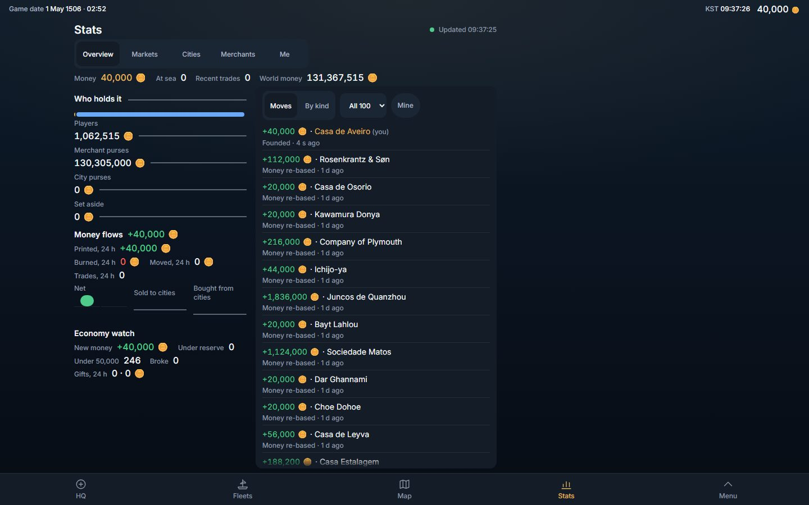
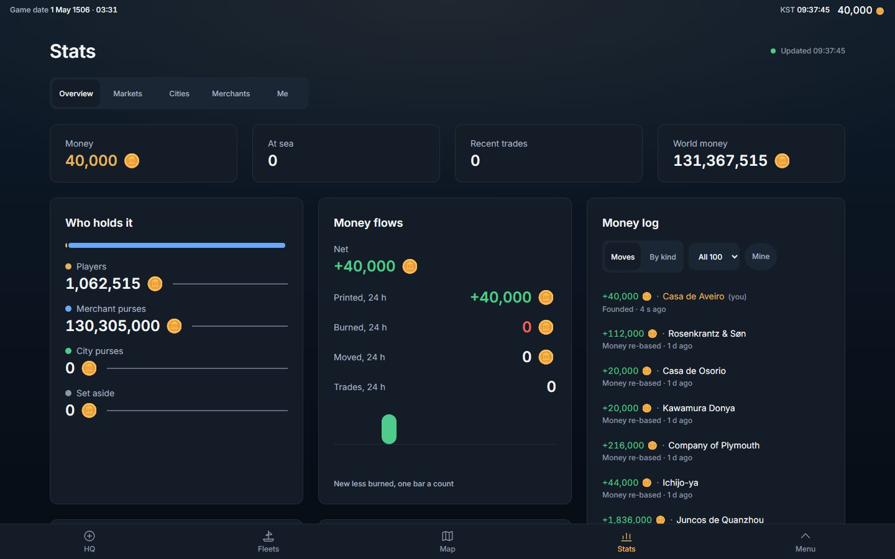
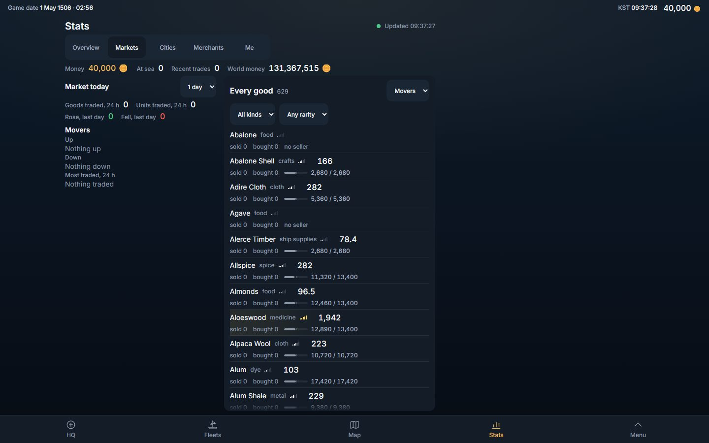
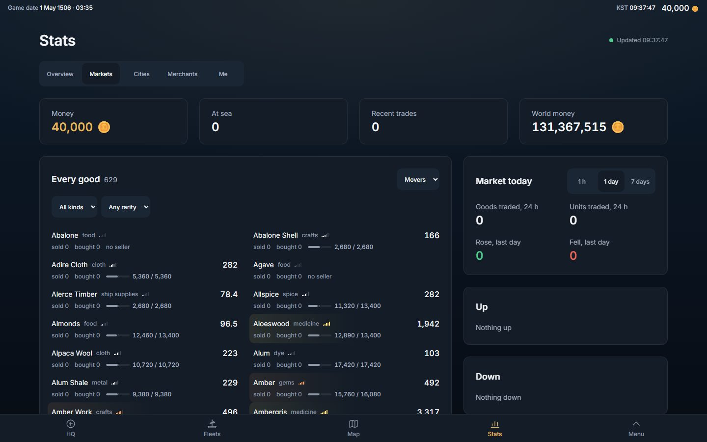
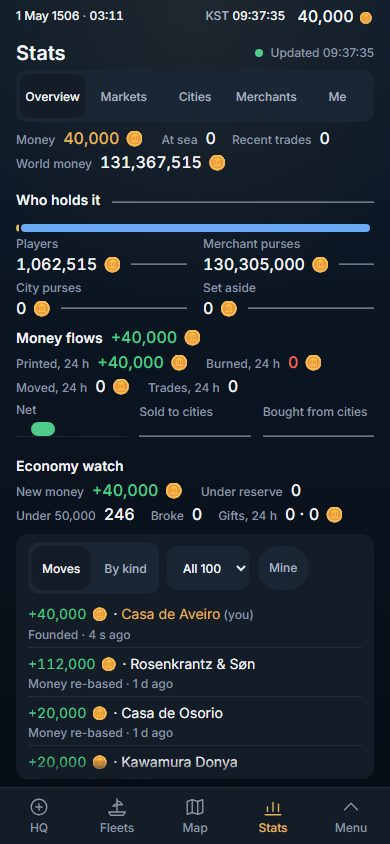
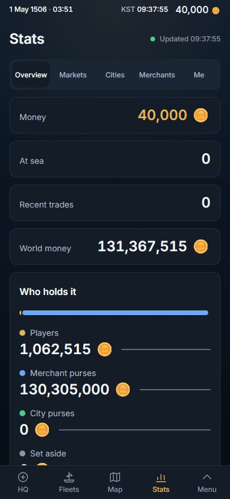
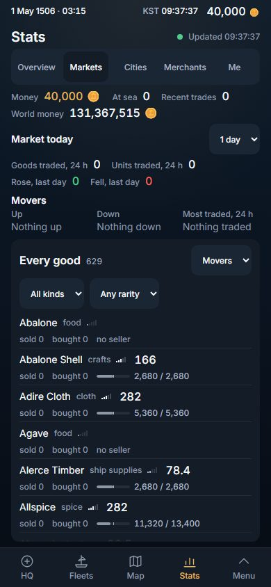
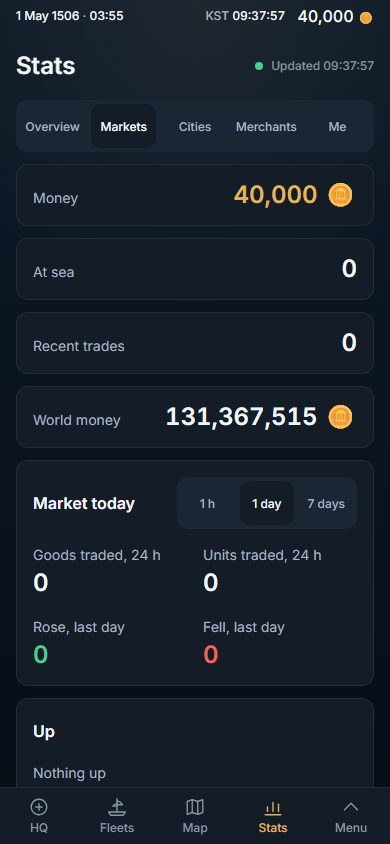

# Stats, redesigned: the page pattern (2026-11-02)

Owner, 2026-11-02, verbatim (row 267): *"i want you to redesign the looks of the game. for example stats, it looks so wrong. The past was better. right now everything is on left, too packed. this was a mistake"*.

Stats is the first screen of a game-wide redesign. What was built here is the PATTERN — a page layout, a card, a stat card, a card list, a tray that slides over the page's side column — so that Codex, History, Rank, Routes, HQ, Fleets and the Map copy it one at a time. It is client-only (no migration, no server change, no read changed) and opt-in: `Sheet layout="page"` and `ListPanel look="card"` default to what every other screen already is, so no other screen moved by a pixel.

## 0. The answer in six lines

1. **The width is used.** Stats is a centred container (content at most 1,280 px; side margins 16 · 24 · 32 · 40 px, 80 px each side at 1,440) and, from 1,024 px, **MAIN | SIDE** — the side column is the tray's column and is always used (Overview: the Money log; Markets: the day's figures and the movers; Merchants: the companies' day and the fleets; Me: your week). At 1,440 the content spans 89 % of the glass, at 1,280 94 % (it was 52 % and 59 %), and the band empty at the right is 80 px, equal to the margin at the left (it was 556 px against 132).
2. **Cards with room.** One surface, one hairline, 12-px corners, 16 px of padding on a phone, 20 from 768, 24 from 1,280; 12 · 16 · 20 · 24 px between cards; no rule between rows (13 thin rules on the Overview became 0).
3. **A real hierarchy.** Page title 30 px (24 on a phone); card title 18 (16); the figures **24 px** (they were 16) with their labels at 14 px *above* them or at the far end of a line, never glued at 8-12 px; captions 12.
4. **Lists breathe.** Rows are 52 px on a phone and 60 from 1,024 (49-53 before), the figure stands on the row's right edge, rows lay out in as many columns of at least 20 rem as the card holds (1 · 2 · 2 · 3), and the page scrolls — no list scrolls inside itself any more (there were 2 inner scrollers per face).
5. **Charts get room.** 176 px tall (they were a 24-px sparkline), drawn 1 : 1, each a press to the large view.
6. **A tray opened from a chart slides over the side column** — the same x and the same width, from one constant (`--page-side`) shared by the grid and the tray — and nothing behind it moves.

Pictures (1,440 × 900 and 390 × 844, English, canary world, DPR 1; the full set of BEFORE / AFTER shots at five glasses, two languages and two pixel ratios is kept on the PC that made them):

| | BEFORE (origin/main 3e05ab32) | AFTER |
|---|---|---|
| Overview, 1,440 |  |  |
| Markets, 1,440 |  |  |
| Overview, 390 |  |  |
| Markets, 390 |  |  |

## 1. What the past-vs-now analysis said, and what was taken from it

`docs/dev-log/2026-11-02-design-past-vs-now.md` measured P1 (before #413) against now. Its findings that decided this build: the 752-px column and the 440-px tray reservation are **identical in the past and now**, so "everything on the left" is partly old; what made the past better is that it **docked real content in the tray column** (the Overview's Money log at x=908..1324) and **set its figures at 24 and 34 px**; what got worse is the flat hierarchy (figures 14-16 px, no bigger than their labels), cards turned into hairline rows, labels glued to figures (12-85 px where the past had 300-577), choices hidden behind drop-downs, and a list panel drawn around a short list.

Adopted as proposed: content max 1,280; margins 16 · 24 · 32 · 40 (80 at 1,440); **MAIN | SIDE from 1,024, the side being the tray's column**, 352 · 384 · 416 px from ONE constant shared by the grid and the tray's dock; the closed tray's column carries the screen's second block and an open tray slides over it with no shift; spacing 4 · 8 · 12 · 16 · 24 · 32 · 48; radius 12; rows 52 (44 floor); figures right-aligned in lists; a segmented control for choices of three (the Markets window), not a drop-down; no 12-rem floor and no inner scroll.

Deliberate differences, each for a reason:

- **Card padding 16 · 20 · 24, not 16.** The owner's word is *too packed*, and the brief for this slice said 20-24; 16 is the density the order reverses. A phone keeps 16.
- **Gutters 12 · 16 · 20 · 24** (phone · 768 · 1,024 · 1,280+) — the analysis' table lists a 20-px gutter at 1,024 but a main of 584; with a 20-px gutter main is **588** (960 − 20 − 352), which is what is built and what `tests/primitives.geometry.spec.ts` asserts.
- **The page title is 30 px from 768 (24 on a phone).** The analysis' "24/30" reads as size/line-height in this repo's notation (12/16, 14/20 …); the brief asked 28-32.
- **No 12-column grid.** The brief asked for one; the analysis' own system is a split, and a split is what the screens needed (a card list lays its rows out in columns by itself). The cards sit on the two columns of `PageSplit` and in a two-across `CardRow`; nothing needed 12.
- **A list row may be 562 px wide at 1,024** (the law is 36 rem, not 35): main is 588 px there and a one-column card list is 562 px. It is one column wide, not a page wide — the 2026-09-13 complaint was 1,000 px between a name and its price.

## 2. The pattern — what the next screen copies

Files: `src/components/ui/screenLayout.ts` ("THE PAGE"), `Sheet.tsx` (`layout="page"`), `Card.tsx` (new), `pageContext.ts` (new), `ListPanel.tsx` (`look="card"`), `StatCell.tsx` (`look="stacked" | "line"`), `SeriesChart.tsx` (`height`), `Tray.tsx` (reads the page), `index.css` (two tokens). The gallery draws it all at **/ui/page**.

### Container, split, gutter (screenLayout.ts)

| glass | margin | content | gutter | main | side | the page is |
|---|---|---|---|---|---|---|
| 1,440 | 80 | 1,280 | 24 | 840 | 416 (26 rem = the tray's width) | main \| side |
| 1,280 | 40 | 1,200 | 24 | 792 | 384 | main \| side |
| 1,024 | 32 | 960 | 20 | 588 | 352 | main \| side |
| 768 | 24 | 720 | 16 | one column | — | the side stacks (first or last: the screen says) |
| 390 / 320 | 16 | 358 / 288 | 12 | one column | — | one column |

`PAGE_REM = 80`, `SIDE_REM = { lg: 22, xl: 24, wide: 26 }`, `PAGE_GAP`. The Sheet sets `--page-pad` and `--page-side` once (`pageVarsClass()`); `pageSplitClass()` and `trayDockPageClass()` both read them, and `tests/wide.layout.spec.ts` parses the literal class strings against the constants (a Tailwind class cannot be built from a number, so each is typed out beside its number).

### The tray (pageContext.ts, Tray.tsx)

`Sheet layout="page"` provides `InPage`; a docked `Tray` reads `useInPage()` and docks with `trayDockPageClass()` instead of `trayDockWideClass()` — right edge `max(--page-pad, 50% − 40 rem)`, width `--page-side`, rounded on every side. Every other screen reads `false` and docks exactly as before. Opened from a chart in the Overview it stands over the Money log; nothing under it moves (measured on the boxes of five cards before, during and after).

### Card anatomy (Card.tsx)

`Card` = `rounded-tile border border-edge bg-surface`, padding `p-4 md:p-5 xl:p-6`, a header (title 16 px, 18 from 768, `font-semibold`; ONE optional `aside` control on the title's line), then its content. `StatStrip` = a row of `StatCard`s across the page (1 column on a phone — each a 56-px line, label left and figure right — 2 from 640, 4 from 1,280). `PageSplit main side sideFirst stickySide`. `CardRow` = two cards across (768-1,023 and from 1,280; one at 1,024-1,279 where main is 588). A card is `surface` on the world with the `edge` hairline and is never inside another card.

### Figures (StatCell.tsx)

`look="stacked"` — label 14 px `ink-muted` over the figure 24 px, 4 px between, the trend beside the figure. `look="line"` — a 52-px statement line: label (and a `mark` swatch) at the left, figure at the right, for lists of money whose widths differ. `look="cell"` (default) is the old cell, unchanged (the City's info and the You screen still use it). Both card looks carry `data-stat-label` and `data-stat-figure="<size>"`, which the laws read. Key figures are `size="figure"` (24); `hero` (34) is for a face's one headline.

### Lists (ListPanel.tsx)

`look="card"` (default `panel` is every other list screen): the same header (title, count, sort, filters) on a card; rows 52 px (60 from 1,024) with **no rule between them** (whitespace), a rounded hover on a desktop, the figure on the row's right edge (the `Row`'s tracks re-cut by the list, `Row.tsx` untouched); `columns="fit"` = as many columns of at least 20 rem as the card holds, each row its own query container; no inner scroll; `footer` is where "Show all" stands (Markets, Cities and Merchants show their first 60, the money log its first 15 — the rest one press away). `above`, `face` and `DenseRows` (the packed two-pane) were used only by Stats and are deleted.

### Type (index.css)

Two tokens, used by the page layout only: `t-card` 18/24/600 and `t-page` 30/36/600. The six of §4.1 stay the vocabulary of everything else.

### Charts (SeriesChart.tsx, StatsChart.tsx)

`SeriesChart height={176}` measures its own width and draws on a sheet of that width, so a pixel of the model is a pixel of the glass (captions stay 12 px, the plot is never squeezed); `StatsChart look="chart"` is that chart as a press target that opens the same large view. The 24-px sparkline stays beside a figure where a trend is a trend.

### Phones

One column; cards stack; the stat strip is four 56-px lines; padding 16; figures stay 24 px (the world's money, nine digits and a coin, is 188 px and drops under its label at 320 rather than overflowing); the side comes first where it holds what the list is read with (Markets, Merchants, Me); the page scrolls (a face is 1,064-5,692 px tall at 390). Controls are 44 px; nothing scrolls sideways.

### Two bugs the page found, fixed at the root

- **A screen-reader label stretched the DOCUMENT.** A `FilterBar`'s `sr-only` label is `position: absolute`; with no positioned ancestor it escaped the Sheet's scroller and made the document 2,620 px tall under an 844-px glass. The old list panels were `relative` themselves; a page's lists are not, so the page Sheet is `relative`.
- **Two inline spans that wrap have boxes that cross.** The money log's amount and name were inline runs; at 320 a company's name wrapped under its amount and the overlap law read their boxes as crossing. They are flex items now (same words).

## 3. The five faces

- **Overview** — strip (money · at sea · recent trades · world money); MAIN: *Who holds it* (bar, four holders with trends), *Money flows* (net, printed / burned / moved / trades, a bar a count), *Economy watch* (seven lines), the world's money, *Sold to cities* and *Bought from cities* (176-px charts); SIDE: the *Money log* (15 moves, Show all) or the day's money by kind.
- **Markets** — MAIN: *Every good* in two columns (the filters and the sort in its header); SIDE (first on a phone, sticky from 1,024): *Market today* with its window as a segmented control and four figures, then *Up*, *Down* and *Most traded*.
- **Cities** — one list card across the page (a face with one block has no second block to put in a side): 246 cities in 1 · 2 · 3 columns, the filters in its header; a row opens the city's page, Back returns.
- **Merchants** — MAIN: *Their money* and *At sea* (a figure and a chart each), then the companies (three views: every company, best day, worst day); SIDE (first on a phone): the companies' day with its earnings chart, and *Fleets now*.
- **Me** — MAIN: *Best sales*; SIDE (first on a phone): *My week*.

Every figure and every test id of the old faces is still there (`tests/stats.design.spec.ts` asserts the list, U3); new ids were added (`stats-chart-world`, `stats-chart-sold`, `stats-chart-bought`, `stats-chart-purses`, `stats-chart-sea`, `stats-log-show-all`, `stats-cities-show-all`, `gallery-page`, …). No new word: every label is an existing dictionary key, English and Korean.

## 4. Measured, BEFORE → AFTER

Headless Chromium, English, dark scheme, DPR 1, the canary world, one persistent page per glass, both builds served by `vite preview` on `localhost` (BEFORE = origin/main 3e05ab32, AFTER = this branch). "Text span" is the leftmost..rightmost visible text of the Stats sheet (x in px, its share of the glass, and the band empty at its right). Rows are the four list rows (`money-move`, `stats-good`, `stats-city-open`, `stats-merchant`). "Cards" are outer rounded filled surfaces of at least 120 × 40 px; "rules" are thin lines under a row; "inner scrollers" are boxes other than the sheet that scroll inside themselves. Raw numbers: every face at every glass are in `scratchpad` JSON on the PC that measured them; the Overview and Markets rows are here.

### Overview

| glass | text span BEFORE | text span AFTER | title | key figure | label | row height (min) | row width (max) | thin rules | cards | inner scrollers | page height / glass |
|---|---|---|---|---|---|---|---|---|---|---|---|
| 1440 × 900 | 132..884 (52.2 %, 556 px empty) | 80..1360 (88.9 %, 80 px empty) | 20 → 30 | 16 → 24 | 12 → 14 | 48 → 60 | 405 → 382 | 99 → 0 | 1 → 11 | 1 → 0 | 811 / 811 → 1508 / 811 |
| 1280 × 800 | 52..804 (58.8 %, 476 px empty) | 40..1240 (93.8 %, 40 px empty) | 20 → 30 | 16 → 24 | 12 → 14 | 48 → 60 | 405 → 350 | 99 → 0 | 1 → 11 | 1 → 0 | 711 / 711 → 1508 / 711 |
| 1024 × 768 | 16..584 (55.5 %, 440 px empty) | 32..992 (93.8 %, 32 px empty) | 20 → 30 | 16 → 24 | 12 → 14 | 48 → 60 | 298 → 326 | 99 → 0 | 1 → 11 | 1 → 0 | 679 / 679 → 2572 / 679 |
| 390 × 844 | 16..374 (91.8 %, 16 px empty) | 16..374 (91.8 %, 16 px empty) | 20 → 24 | 16 → 24 | 12 → 14 | 48 → 56 | 334 → 340 | 99 → 0 | 1 → 11 | 1 → 0 | 755 / 755 → 3575 / 755 |
| 320 × 640 | 16..304 (90 %, 16 px empty) | 16..304 (90 %, 16 px empty) | 20 → 24 | 16 → 24 | 12 → 14 | 48 → 56 | 264 → 270 | 99 → 0 | 1 → 11 | 2 → 0 | 551 / 551 → 3675 / 551 |

### Markets

| glass | text span BEFORE | text span AFTER | title | key figure | label | row height (min) | row width (max) | thin rules | cards | inner scrollers | page height / glass |
|---|---|---|---|---|---|---|---|---|---|---|---|
| 1440 × 900 | 132..884 (52.2 %, 556 px empty) | 80..1360 (88.9 %, 80 px empty) | 20 → 30 | 16 → 24 | 12 → 14 | 53 → 60 | 405 → 395 | 60 → 0 | 1 → 9 | 1 → 0 | 811 / 811 → 2356 / 811 |
| 1280 × 800 | 52..804 (58.8 %, 476 px empty) | 40..1240 (93.8 %, 40 px empty) | 20 → 30 | 16 → 24 | 12 → 14 | 53 → 60 | 405 → 371 | 60 → 0 | 1 → 9 | 1 → 0 | 711 / 711 → 2356 / 711 |
| 1024 × 768 | 16..584 (55.5 %, 440 px empty) | 32..992 (93.8 %, 32 px empty) | 20 → 30 | 16 → 24 | 12 → 14 | 53 → 60 | 298 → 562 | 60 → 0 | 1 → 9 | 1 → 0 | 679 / 679 → 4238 / 679 |
| 390 × 844 | 16..374 (91.8 %, 16 px empty) | 16..374 (91.8 %, 16 px empty) | 20 → 24 | 16 → 24 | 12 → 14 | 53 → 60 | 334 → 340 | 60 → 0 | 1 → 9 | 1 → 0 | 755 / 755 → 4846 / 755 |
| 320 × 640 | 16..304 (90 %, 16 px empty) | 16..304 (90 %, 16 px empty) | 20 → 24 | 16 → 24 | 12 → 14 | 53 → 60 | 264 → 270 | 60 → 0 | 1 → 9 | 2 → 0 | 551 / 551 → 5520 / 551 |

### The other three faces at 1,440 and 1,280

| face · glass | text span BEFORE | text span AFTER | rows min BEFORE → AFTER | row width max BEFORE → AFTER | cards | inner scrollers |
|---|---|---|---|---|---|---|
| Cities 1440 × 900 | 132..884 (52.2 %, 556 px empty) | 80..1360 (88.9 %, 80 px empty) | 60 → 60 | 728 → 405 | 1 → 5 | 1 → 0 |
| Cities 1280 × 800 | 52..804 (58.8 %, 476 px empty) | 40..1240 (93.8 %, 40 px empty) | 60 → 60 | 728 → 378 | 1 → 5 | 1 → 0 |
| Merchants 1440 × 900 | 132..884 (52.2 %, 556 px empty) | 80..1360 (88.9 %, 80 px empty) | 53 → 60 | 405 → 395 | 1 → 9 | 1 → 0 |
| Merchants 1280 × 800 | 52..804 (58.8 %, 476 px empty) | 40..1240 (93.8 %, 40 px empty) | 53 → 60 | 405 → 371 | 1 → 9 | 1 → 0 |
| Me 1440 × 900 | 132..884 (52.2 %, 556 px empty) | 80..1360 (88.9 %, 80 px empty) | — → — | — → — | 1 → 6 | 0 → 0 |
| Me 1280 × 800 | 52..804 (58.8 %, 476 px empty) | 40..1240 (93.8 %, 40 px empty) | — → — | — → — | 1 → 6 | 0 → 0 |

What the numbers say: the content block went from 52 % / 59 % / 56 % of the glass (1,440 / 1,280 / 1,024) to 89 % / 94 % / 94 %, and the empty band at its right from 556 / 476 / 440 px to 80 / 40 / 32 — the same as the margin at its left; the key figure from 16 to 24 px and its label from 12 to 14; the page title from 20 to 30 (24 on a phone); a list row from 48-53 to 60 px (56-60 on a phone; the Cities list rows were 728 px wide at 1,440 and are 405); cards from 1 (a list panel) to 5-11; thin rules from 60-245 to 0; inner scrollers from 1-2 per face to 0. The cost is length: the sheet that was exactly the glass is now 1,508 px (Overview) to 5,692 px (Merchants, 390) tall — the owner's *"vertical page scroll is fine again"*.

## 5. The laws, and which were red before

`tests/stats.design.spec.ts` replaces `tests/stats.unfold.spec.ts` (which held U1 "N whole rows on the glass", U2 "the page never scrolls" and the 12-rem floor — the packed design). Its laws, at 1,440 × 900, 1,280 × 800, 1,024 × 768, 390 × 844 and 320 × 640, in English and Korean:

| law | what it reads | BEFORE (3e05ab32) | AFTER |
|---|---|---|---|
| (a) use the width | the visible text of the sheet is centred (the band empty at its right is no wider than the margin at its left + 2 px) from 1,024, and spans ≥ 80 % of the glass from 1,280 | **red** at every glass of 1,024 and up, both languages | green |
| (b) the defect rules | no sideways scroll, no overlap, no one-letter wrap, no cut text without its full text, every control ≥ 44 px, the document flat (`readGlass` + `phoneLaws`) | green (a guard; the sweep's rules stand) | green |
| (c) the hierarchy | key figure ≥ 24 px, its label ≥ 13 px, list row ≥ 52 px and ≤ 36 rem wide | **red** (figures 16, labels 12, money-log rows 48) | green |
| (d) a tray moves nothing, and stands over the side | the boxes of six cards before / during / after; the tray's x and width equal the side column's | the no-move half is a **guard (green)**; the side half **red** (no side column) | green |
| (f) no scroll trap | no box but the sheet scrolls inside itself | **red** (the lists scroll inside themselves: 4,904 px in 617 …) | green |
| U3 / U8 | no figure or test id removed; a city row opens its page and Back returns; the Merchants views are views; the large chart answers a press at 320 | green (kept) | green |

Specs that held the packed design, rewritten with the reason in the commit: `consistency.spec.ts` law 4 ("no scroll") and `onepage.spec.ts` ("every tab fits the glass", #413) now exempt a Sheet that declares `layout="page"` (the document must still be flat, the Sheet must arrive at the top, nothing scrolls sideways); `align.spec.ts` retires the HUG law (a figure within 16 px of its label) for card lists — their figures end on one edge, compared by the right edge — and groups a multi-column list's rows by column; `unfold.fixture.ts` skips `sr-only` text in the text-on-control law; `wide.layout.spec.ts` and `primitives.geometry.spec.ts` gain the page arithmetic and the page geometry at `/ui/page` (no 78-s boot).

## 6. What was not verified

- **Canary world only.** One fleet, no trades, charts of one or two points (a flat line; the "now" axis ×3), no sales on Me. A played world with real money moves, ten-digit purses and moving charts will lengthen the Overview's log and put real lines in the 176-px charts; the 24-px figures were checked against the longest figure this world has (131,367,515 and a coin, 188 px), not against ten digits (about 205 px: a stat card at 1,280 is 278 px with 24 px of padding, so it fits; a `stacked` holder cell in a 384-px card fits to about 15 digits).
- **Light scheme not shot**; the laws ran in the dark scheme (the suite's default).
- **DPR 2** was shot for the pictures, not re-measured (layout is in CSS px).
- The city's own page (`CityDetail`, inside `DetailPage`) keeps its old look: it is a full-screen page of the shared `Detail` primitive, and belongs to the HQ/Detail slice.
- Real Chrome on the owner's laptop was not driven (headless only).

## 7. The screens that still need the pattern, in the order proposed

Each takes `Sheet layout="page"`, a side column that is its second block, `Card` / `StatCell` / `ListPanel look="card"`, and then retires the old law it leaned on (the exemption in `consistency` / `onepage` for its tab):

1. **Codex** (Goods, Ships, Captains, Nations — `CompendiumScreen`): side = the selected item's card; goods as a tile grid again from 768 (the analysis' 4-up).
2. **History** (`LedgerScreen`): side = the open report.
3. **Rank** (Captains, Countries): side = your standing.
4. **Routes**: side = the open lane.
5. **Fleets** and **You**: side = the selected fleet's status; a list sized to its content (a card around one row is the defect the analysis found).
6. **HQ** (the city page, `CityScreen` and its faces) and the **Command desk**: HQ already uses the whole glass; they take the card and the type scale, not the split.
7. **Map trays** (the side tray, `Tray` side modes): they keep their own geometry; the page's tray rule is for docked trays.
8. **Profile** and the sign-in page.
9. Last: delete `sheetColumnClass`, `trayDockWideClass` and the pair arithmetic once nothing reads them (one authority again), and the `fill` mode of `Sheet`.

Also left for those slices: the filters that are drop-downs but have five choices (rarity, the Merchants sort) become segmented choices where their test ids allow (`filter-pick-*` are asserted by `stats.filters`, `good.class`, `captains.codex`); the Row's own HUG layout (`Row.tsx`) can then be re-cut at the source instead of by the list.
