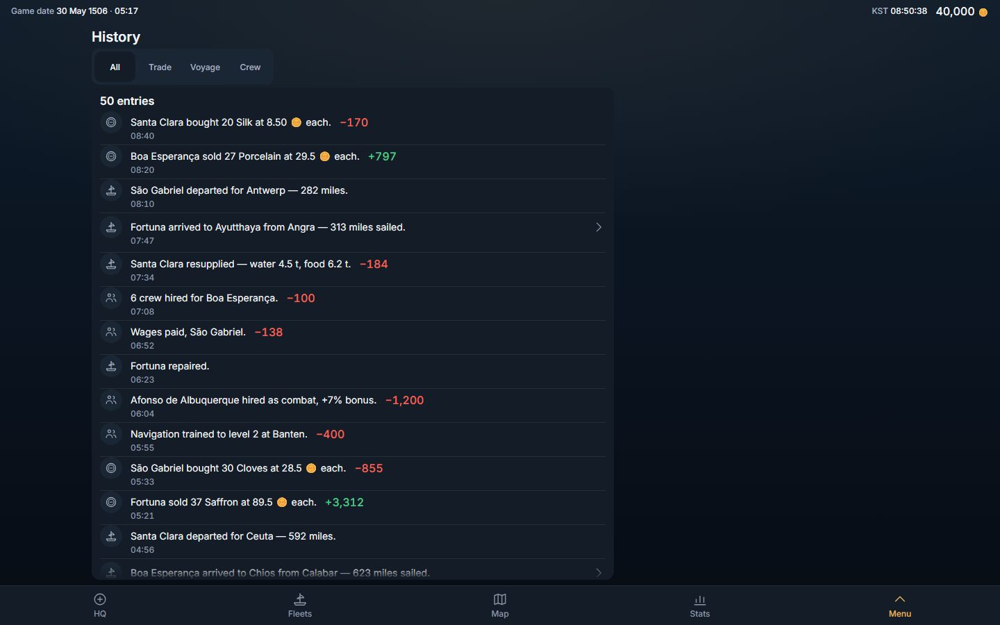
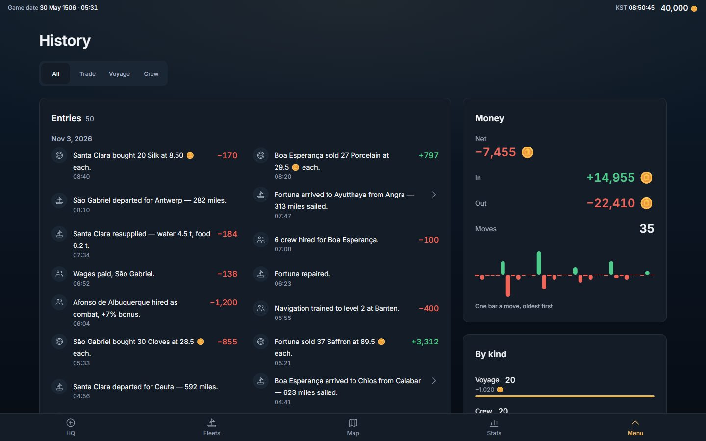
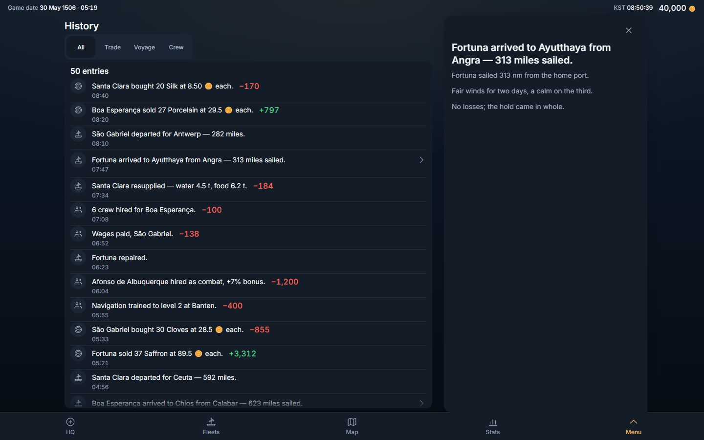
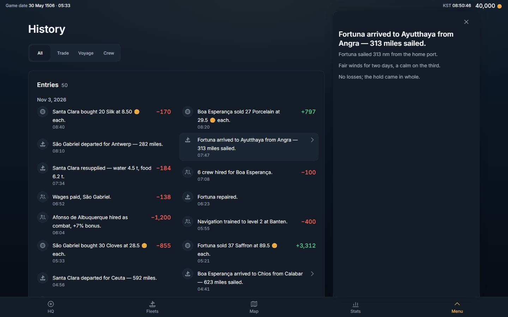
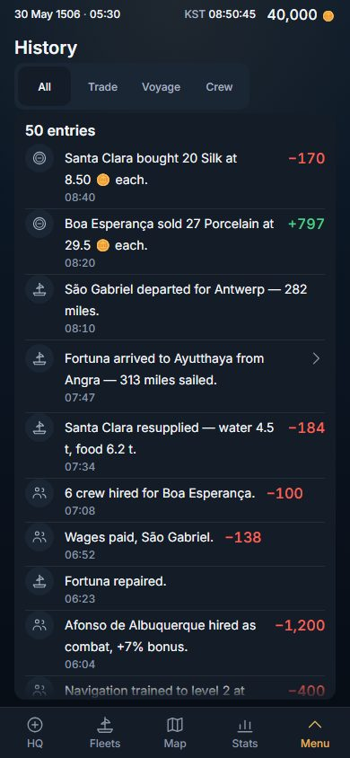
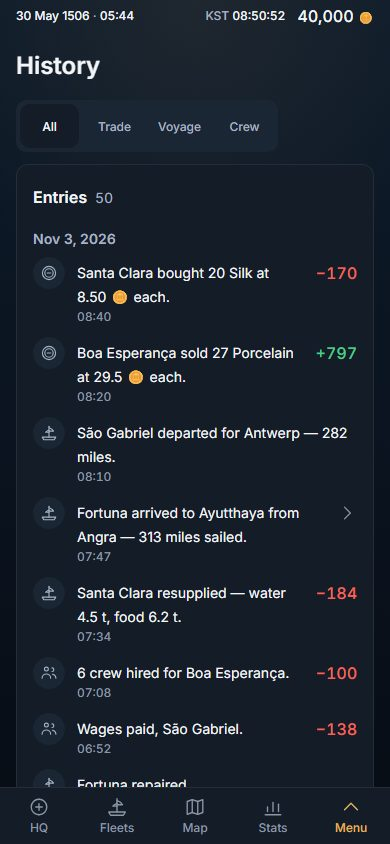

# History, redesigned: the page pattern, third screen (2026-11-03)

Owner, 2026-11-02, verbatim (row 267): *"i want you to redesign the looks of the game. for example stats, it looks so wrong. The past was better. right now everything is on left, too packed. this was a mistake"*.

Stats took the page first (PR #466, `docs/dev-log/2026-11-02-stats-design.md`) and is THE PATTERN; the Codex was second (PR #473, `docs/dev-log/2026-11-02-codex-design.md`); History is the third screen on it, in the order the Stats log proposes (Codex, History, Rank, Routes, HQ, Fleets, Map). This slice is client-only (no migration, no server change, no read changed) and composes what Stats built — `Sheet layout="page"`, `PageSplit`, `Card`, `StatCell look="stacked|line"`, `ListPanel look="card" columns="fit"`, `RankBars`, `SignedBars`, the page-context `Tray` — and adds no primitive of its own. One shared edit, and it is a fold, not a feature (§2). No other screen moved by a pixel.

## 0. The answer in six lines

1. **The width is used.** History is the centred page container (content at most 1,280 px; margins 16 · 24 · 32 · 40, 80 each side at 1,440) and, from 1,024, **MAIN | SIDE** — the side column is the tray's column and is always used.
2. **The entries are ONE card with room.** *Entries · 50* as its title and count, the rows 52 px on a phone and 60 from 1,024 with whitespace and no rule between them, the movement (`+4,500` / `−1,200`) on the row's right edge, the clock under the line, the rows in as many columns of at least 20 rem as the card holds (1 on a phone and at 1,024, 2 in the 840-px main at 1,440) — and **under the DAY they happened on**, one date once per group, spanning the columns (the record never said what day a `14:32` was). The page scrolls — **no list scrolls inside itself**.
3. **The record's figures stand in the side, as graphics** — never a paragraph where a figure would do. *Money*: the face's net at 24 px over its label, then *In*, *Out* and *Moves* as statement lines, then every move as one signed bar, oldest first. *By kind*: the record's shape — Trade, Voyage, Crew (and Other) as ranked bars of how many entries each holds, their money as the note, the face on the glass lit. *Biggest moves*: the five largest movements on the face, each by its own line, ranked. Every figure is a sum or a count over the served entries' own `ducats_delta` — never the purse (the You screen's) and never a total the game keeps elsewhere (`src/features/ledger/ledgerFigures.ts`, pure).
4. **A real hierarchy.** Page title 30 px (24 on a phone); card titles 18 (16); the key figure 24 over a 14-px label; row labels 14 with the movement in 16 at the row's edge; rows 60, not 44.
5. **A press SELECTS.** A face pressed narrows the entries and moves nothing else (measured: the strip, the list card and the side's cards hold their place and width to the pixel; the By kind board keeps every kind and lights the one on the glass); a row with a report opens its tray, which **slides over the side column** — the same x and width, from the one `--page-side` the grid and the tray share — and nothing behind it moves.
6. **Nothing removed.** The four faces, every row and its movement, the chevron and the report tray with its battle rounds, the count, the empty states — all there; `tests/history.design.spec.ts` asserts the list (U3), and `tests/ledger.fights.spec.ts` is untouched.

Pictures (1,440 × 900 and 390 × 844, English, the played world of fifty entries the specs build, DPR 1; the BEFORE shots are the build of origin/main `567b2d29`):

| | BEFORE (origin/main 567b2d29) | AFTER |
|---|---|---|
| All, 1,440 |  |  |
| A report open, 1,440 |  |  |
| All, 390 |  |  |

## 1. The page

- **The faces** — All · Trade · Voyage · Crew — are the one `Segmented` under the title, as Stats and the Codex have it. A choice of four is a segmented control, never a drop-down; its cells name themselves, so the Codex's "a picker reads its name" lesson has nothing to read here (History has no picker).
- **MAIN** — *Entries · N*, one `ListPanel look="card" columns="fit"`. A row is the entry's headline (the one composer, `headline.ts`, untouched), its mark (a coin, a ship, the crew, the ledger), its movement as a signed figure at the row's edge and its clock under the line; a row with a report is a button with a chevron and opens the report tray. The rows stand under their day (`ListHeading`, the primitive §2 names), newest first as served.
- **SIDE** (from 1,024, sticky; after the list on a phone) — three `Card`s: *Money* (`ledger-money`: *Net* as a `StatCell look="stacked"` at 24 px, *In* / *Out* / *Moves* as `look="line"`, the moves as `SignedBars`, forty at most, oldest first), *By kind* (`ledger-kinds`: `RankBars` of entry counts, the money as the note, the face on the glass `accent` and the others `neutral`), *Biggest moves* (`ledger-biggest`: `RankBars` of the five largest movements on the face, green up and red down). The Money card and the Biggest board follow the face, as the Codex's boards follow its filters; By kind is the record's own shape, so a face pressed lights its row instead of leaving the board one bar.
- **The tray** — the report, its lines and its battle rounds, exactly as before — docks over the side column (`useInPage()` in `Tray.tsx`, the Stats mechanism; nothing here chose it).

## 2. What was folded, and the two shared edits

- **`ListHeading` — the heading of a group of rows in a card list** (`src/components/ui/ListPanel.tsx`, exported through `index.ts`). The Codex's Goods face wrote the kind heading as a class string (`col-span-full block px-2 pb-1 pt-3 …`) and History's day heading was about to be its second copy; `tests/duplication.spec.ts` ("no class recipe is hand-written twice") refused it at the first run, which is the guard working. **§7B for it:** the concept is "the heading of a group of rows in a card list, spanning its columns"; it lives in `ListPanel.tsx` because it is the card list's own recipe (its 8 px of side padding are the rows' own); the second caller is this screen (the Codex was the first; Rank's and Routes' lists are the next, the day their rows are grouped); the wrong shape is a per-screen span — which is what the guard caught, so the guard is the answer to "how would anyone find out". The Goods face composes it now; its class string is byte-identical to what it was, so no pixel moved on the Codex (`tests/codex.design.spec.ts` green on this build, §5).
- **The Sheet's title stopped fluttering** (`src/components/ui/Sheet.tsx` — the one scroll handler every Sheet has). Found by this slice's tray law at 320 × 640: its settle guard read the History sheet at scrollTop `38 / unpinned → 16 / pinned → 38 / unpinned …` four times a second with nothing touching it. The cause is the pin rule, not History: the title pinned past 26 px both ways, a pinned header is SHORTER than a large one (6 px on a column sheet, 22-44 px on a page), and the browser's scroll anchoring pulls the scroll back by the shrink to hold the content still — so a stop anywhere inside (26, 26 + shrink] pinned, was pulled under 26, unpinned, grew, was pushed past 26, and pinned again, for ever. A player who stops a drag there on Stats, the Codex or any sheet sees the title flutter. The rule is now: **pin once the sheet has scrolled past the large header's own height, let go only at the top** — anchoring's pull-back (the shrink, less than that height) can never reach 0, so nothing in between can loop. **§7B for it:** the concept is "when the title pins"; it lives in `Sheet.tsx` because that is the one scroll handler; every Sheet is its caller (the page sheets pin later than before — past 62 px on a phone, 84 at `lg`, instead of 26 — and the column sheets past 46; no box moves at rest); the wrong shape is any threshold inside the shrink, and `tests/primitives.geometry.spec.ts`'s sheet law now holds it — a stop at 30 px, a stop just past the large header and a return to the top must each hold still across two readings, and it was watched go red on origin/main's Sheet (`a stop at 30 px, under the large title, pinned it`) before it was trusted. The History spec's own `settled()` guard, which found it, stays.
- **`ledgerFigures.ts`** — the screen's readings of its served page (which face a kind belongs to, the entries by day, the money of a set of entries, the record by kind, the biggest moves), pure and in their own file so the screen file holds one component and the arithmetic can be read without a browser. Its header says why it is the screen's and not a domain section: no second screen may print the ledger's money (`consistency.spec`'s "one fact, one home"), so a second caller is implausible by construction; the day one appears it moves to `src/domain` whole.
- **Deleted:** the `history.countEntries` key (English and Korean) — the card's title is the word *Entries* and its count a figure, as every card list; `tests/ledger.unfold.spec.ts` (replaced, §5).
- **New words** (English · Korean), every one a name, never a sentence: *Entries* · 기록, *Money* · 돈, *In* · 수입, *Out* · 지출, *Moves* · 변동, *By kind* · 종류별, *Biggest moves* · 큰 변동, *Other* · 기타, *No money moved.* · 돈의 변동 없음., and the bars' one assistive sentence *One bar a move, oldest first* · 막대 하나가 변동 하나, 오래된 순. *Net* is `stats.netShort`, the faces' words are the Codex's — existing keys.

## 3. Phones

One column, and **the list comes first** (the Codex's lesson): no `sideFirst`, so the three figure cards stand after the entries, and the first row of every face is on the first glass at 390 × 844 and 320 × 640 (law (g), measured in §4). Cards stack with 16 px of padding; rows 52-60 px; the page scrolls; controls are 44 px; nothing scrolls sideways; the document is flat (the Sheet is the scroller).

<!-- measured:start -->
## 4. Measured, BEFORE → AFTER

Headless Chromium, dark scheme, DPR 1, the played world of fifty entries (`tests/unfold.fixture.ts`), one persistent page per build, both builds served by `vite preview` on `localhost` (BEFORE = origin/main `567b2d29` on port 4174, AFTER = this branch on 4173), the four faces at the five glasses, in English and Korean (the Korean numbers are the English ones to the pixel, except two row heights noted). "Text span" is the leftmost..rightmost visible text of the History sheet (x in px); "block" is the text widened to the cards' edges (`tests/design.fixture.ts` `block`, what law (a) reads — a card at the margin is content at the margin, though its rightmost words end at the card's padding). "Figure" is the font size of the face's net and of its label; rows are the `ledger-row`s (the shortest, and the widest); "cards" are `[data-card]` / `[data-list-panel]` surfaces; "inner scrollers" are boxes other than the sheet that scroll inside themselves. The raw lines of both runs are in this PC's scratchpad.

### 1,440 × 900

| face | text span BEFORE | block BEFORE | text span AFTER | block AFTER | figure | row height (min) | row width (max) | cards | inner scrollers | side | sheet height / glass |
|---|---|---|---|---|---|---|---|---|---|---|---|
| All | 132..629 (35 %, 811 px empty) | 132..884 (52 %, 556 px empty) | 80..1335 | 80..1360 (89 %, 80 px empty) | — → 24 / 14 | 48 → 60 | 728 → 395 | 1 → 4 | 1 → 0 | — → 416 | 811 / 811 → 2,334 / 811 |
| Trade | 132..605 | 132..884 | 80..1335 | 80..1360 | — → 24 / 14 | 48 → 80 | 728 → 395 | 1 → 4 | 0 → 0 | — → 416 | 811 / 811 → 1,450 / 811 |
| Voyage | 132..629 | 132..884 | 80..1335 | 80..1360 | — → 24 / 14 | 48 → 80 | 728 → 395 | 1 → 4 | 1 → 0 | — → 416 | 811 / 811 → 1,470 / 811 |
| Crew | 132..610 | 132..884 | 80..1335 | 80..1360 | — → 24 / 14 | 48 → 60 | 728 → 395 | 1 → 4 | 1 → 0 | — → 416 | 811 / 811 → 1,470 / 811 |

### 1,280 × 800

| face | text span BEFORE | block BEFORE | text span AFTER | block AFTER | figure | row height (min) | row width (max) | cards | inner scrollers | side | sheet height / glass |
|---|---|---|---|---|---|---|---|---|---|---|---|
| All | 52..549 (39 %, 731 px empty) | 52..804 (59 %, 476 px empty) | 40..1215 | 40..1240 (94 %, 40 px empty) | — → 24 / 14 | 48 → 60 | 728 → 371 | 1 → 4 | 1 → 0 | — → 384 | 711 / 711 → 2,334 / 711 |
| Trade | 52..525 | 52..804 | 40..1215 | 40..1240 | — → 24 / 14 | 48 → 80 | 728 → 371 | 1 → 4 | 0 → 0 | — → 384 | 711 / 711 → 1,470 / 711 |
| Voyage | 52..549 | 52..804 | 40..1215 | 40..1240 | — → 24 / 14 | 48 → 80 | 728 → 371 | 1 → 4 | 1 → 0 | — → 384 | 711 / 711 → 1,470 / 711 |
| Crew | 52..530 | 52..804 | 40..1215 | 40..1240 | — → 24 / 14 | 48 → 60 | 728 → 371 | 1 → 4 | 1 → 0 | — → 384 | 711 / 711 → 1,470 / 711 |

### 1,024 × 768

| face | text span BEFORE | block BEFORE | text span AFTER | block AFTER | figure | row height (min) | row width (max) | cards | inner scrollers | side | sheet height / glass |
|---|---|---|---|---|---|---|---|---|---|---|---|
| All | 16..513 (49 %, 511 px empty) | 16..584 (55 %, 440 px empty) | 32..971 | 32..992 (94 %, 32 px empty) | — → 24 / 14 | 48 → 60 | 544 → 562 | 1 → 4 | 1 → 0 | — → 352 | 679 / 679 → 3,362 / 679 |
| Trade | 16..489 | 16..584 | 32..971 | 32..992 | — → 24 / 14 | 48 → 60 | 544 → 562 | 1 → 4 | 0 → 0 | — → 352 | 679 / 679 → 1,434 / 679 |
| Voyage | 16..513 | 16..584 | 32..971 | 32..992 | — → 24 / 14 | 48 → 60 | 544 → 562 | 1 → 4 | 1 → 0 | — → 352 | 679 / 679 → 1,562 / 679 |
| Crew | 16..494 | 16..584 | 32..971 | 32..992 | — → 24 / 14 | 48 → 60 | 544 → 562 | 1 → 4 | 1 → 0 | — → 352 | 679 / 679 → 1,562 / 679 |

### Phones (390 × 844 · 320 × 640)

| face · glass | text span BEFORE | text span AFTER | block AFTER | figure | row height (min) | row width (max) | cards | inner scrollers | sheet height / glass |
|---|---|---|---|---|---|---|---|---|---|
| All 390 | 16..362 | 16..357 | 16..374 (92 %) | — → 24 / 14 | 49 → 56 | 334 → 340 | 1 → 4 | 1 → 0 | 755 / 755 → 5,140 / 755 |
| Trade 390 | 16..362 | 16..357 | 16..374 | — → 24 / 14 | 72 → 80 | 334 → 340 | 1 → 4 | 1 → 0 | 755 / 755 → 2,300 / 755 |
| Voyage 390 | 16..362 | 16..357 | 16..374 | — → 24 / 14 | 48 → 56 | 334 → 340 | 1 → 4 | 1 → 0 | 755 / 755 → 2,980 / 755 |
| Crew 390 | 16..362 | 16..357 | 16..374 | — → 24 / 14 | 49 → 56 | 334 → 340 | 1 → 4 | 1 → 0 | 755 / 755 → 2,860 / 755 |
| All 320 | 16..292 | 16..287 | 16..304 (90 %) | — → 24 / 14 | 49 → 56 | 264 → 270 | 1 → 4 | 1 → 0 | 551 / 551 → 6,052 / 551 |
| Trade 320 | 16..292 | 16..287 | 16..304 | — → 24 / 14 | 73 → 80 (104 in Korean) | 264 → 270 | 1 → 4 | 1 → 0 | 551 / 551 → 2,564 / 551 |
| Voyage 320 | 16..292 | 16..287 | 16..304 | — → 24 / 14 | 48 → 56 | 264 → 270 | 1 → 4 | 1 → 0 | 551 / 551 → 3,220 / 551 |
| Crew 320 | 16..292 | 16..287 | 16..304 | — → 24 / 14 | 49 → 80 | 264 → 270 | 1 → 4 | 1 → 0 | 551 / 551 → 3,388 / 551 |

What the numbers say: the content went from one list panel at the left (its block 52 % / 59 % / 55 % of the glass at 1,440 / 1,280 / 1,024, its text 35-49 %, 440-811 px empty at its right) to the page's block at 89 % / 94 % / 94 %, the empty band at its right equal to the margin at its left (80 / 40 / 32 px); the record gained a key figure at 24 px over a 14-px label where it had none; a row from 48 px (a pressable row at the 44-px reach floor plus its clock) to 60 (56 on a phone; 80 where a headline takes two lines in a 371-395-px column — the Trade and Voyage faces' sale and arrival lines); a row from 728 px wide at 1,440 (a sentence with its figure hugging it and 400 px of nothing to the chevron) to 395 in two columns; cards from 1 to 4; inner scrollers from 1 to 0. The cost is length: the sheet that was exactly the glass is 1,434 (Trade, 1,024) to 6,052 px (All, 320) tall — fifty entries on one page under their day.

<!-- measured:end -->

## 5. The laws, and which were red before

`tests/history.design.spec.ts` replaces `tests/ledger.unfold.spec.ts` (which held U2 "the page and the Sheet never scroll; the feed scrolls inside its panel" and U1 "N whole rows in the panel inside the glass before a press" — the packed design). Its laws, at 1,440 × 900, 1,280 × 800, 1,024 × 768, 390 × 844 and 320 × 640, in English and Korean, read by the same `tests/design.fixture.ts` Stats and the Codex use, on the same played world of fifty entries the unfold spec built (`tests/unfold.fixture.ts`), plus the young canary world.

The same file was run against both builds (served side by side: origin/main `567b2d29` on port 4174, this branch on 4173), 16 tests each — the four faces at five glasses in two languages, the tray-and-face-press law at five glasses, the young world.

| law | what it reads | BEFORE (567b2d29): **16 of 16 failed** | AFTER: **16 of 16 passed** |
|---|---|---|---|
| (a) use the width | the content block (text widened to the cards' edges) is centred from 1,024 and spans ≥ 80 % of the glass from 1,280 | **red** — 40 lines, every face at every glass of 1,024 and up, both languages (block 132..884 at 1,440: 556 px empty against a 132-px margin; 52 % of the glass at 1,440, 59 % at 1,280) | green |
| (b) the defect rules | no sideways scroll, no overlap, no one-letter wrap, no cut text without its full text, every control ≥ 44 px, the document flat | green (0 lines — a guard, kept) | green |
| (c) the hierarchy | the face's net ≥ 24 px over a ≥ 13-px label; a list row ≥ 52 px and ≤ 36 rem wide | **red** — 92 lines: no key figure on any face (40), every face's pressable rows 48 px (36), rows 728 px wide at 1,440 and 1,280 (16) | green |
| (d) a tray moves nothing, and stands over the side | the boxes of the list card and the three side cards before / during / after; the tray's x and width equal the side column's; a face pressed moves neither the strip, the list card nor the side's cards, and the By kind board keeps every kind | the no-move half **green** (a guard); the side half **red** ("the page has no side column for the tray to stand over") at 1,440 · 1,280 · 1,024; on the phones the By kind board has no rows to keep (2) | green |
| (e) the side is used | the Money card, the By kind board and the Biggest board exist, and from 1,024 stand in `[data-page-side]` | **red** — 144 lines (no side column: 24; no Money card, no By kind board, no Biggest board: 120) | green |
| (f) no scroll trap | no box but the sheet scrolls inside itself | **red** — 34 lines (the list panel scrolls inside itself on every face that fills it: 983 px of rows in 575-675) | green |
| (g) the list comes first on a phone | at 390 × 844 and 320 × 640 the first row stands on the first glass | green on the packed column (its list was the only block; 0 lines) — a guard against a side card standing above the list, as the Codex's first cut had | green |
| U3 / U5 / U8 / the young world | nothing removed (the list, its rows, the four tabs, the count); the day heading; no overlap, no cut text; a report's row opens its tray with the report's lines and closing it leaves the list; a face narrows to its share; the one entry whole in its card and an empty face says so | U3 red only for the day heading (`ledger-day`, 40 lines — it is new: the packed column never said what day a `14:32` was); the young world red for the side cards it does not have; the rest green (kept) | green |

Specs that held the packed design, retargeted with the reason: `ledger.unfold.spec.ts` deleted (U1 / U2 were the packing; U3 / U5 / U8 and the young-world test are restated above). `consistency.spec` law 4 and `onepage.spec` already exempt any `Sheet layout="page"` (Stats' slice did that generically) and `layout.spec`'s History entry measures tables, of which History has none — neither needed a line. The red build's walks fail at the non-vacuity gate ("the walk measured no key figure"), which is why the spec prints its law lines (`LAWS …`) before any gate: a red on a build with no key figure still says which laws it broke.

## 6. What was not verified

- **The played world the specs build** (fifty entries of nine kinds, four fleets, no battle) is what the laws and the pictures measured; the canary (one entry, the founding) has its own test. A real world with hundreds of entries lengthens the card (the page scrolls); a headline longer than the fixture's (a route lap with every part printed) wraps to more lines in a 372-px column at 1,280.
- **Light scheme not shot**; the laws ran in the dark scheme (the suite's default). **DPR 2** not re-measured (layout is in CSS px). Real Chrome on the owner's laptop was not driven (headless only).
- **Korean** was measured by the laws (both locales at five glasses) but not shot.

## 7. Next

Rank is the next screen on the pattern (side = your standing), then Routes, HQ, Fleets, the Map — `docs/dev-log/2026-11-02-stats-design.md` §7. The kinds no face claims (the founding, a gift, a change of country or flag, insurance) stand on the All face only, as before this slice; a *Company* face for them is a word the owner has not asked for.
