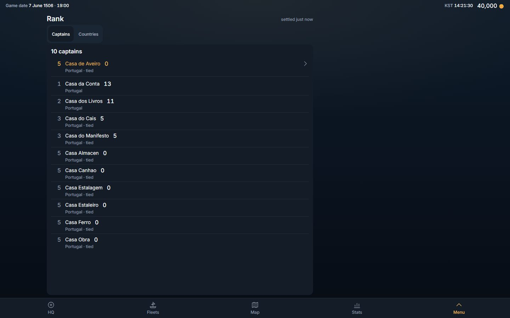
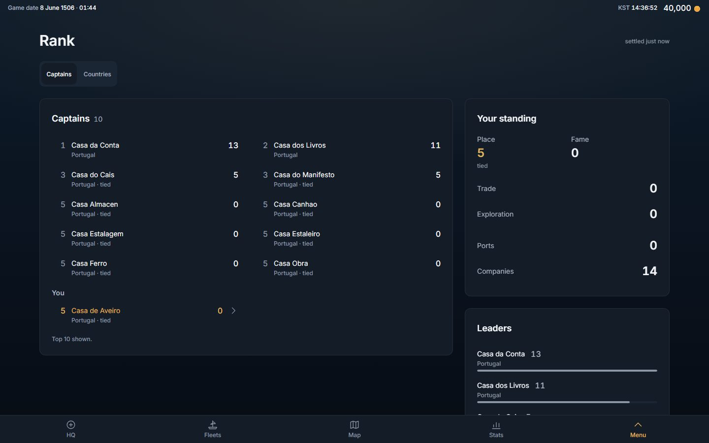
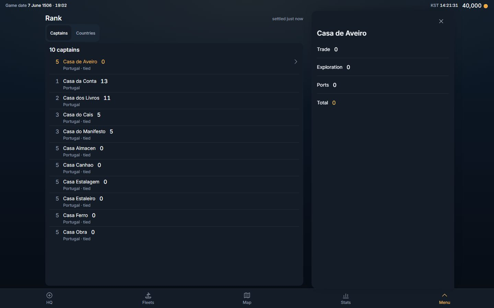
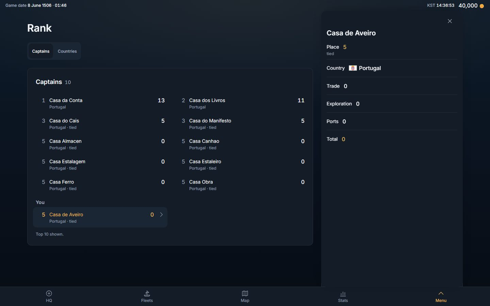
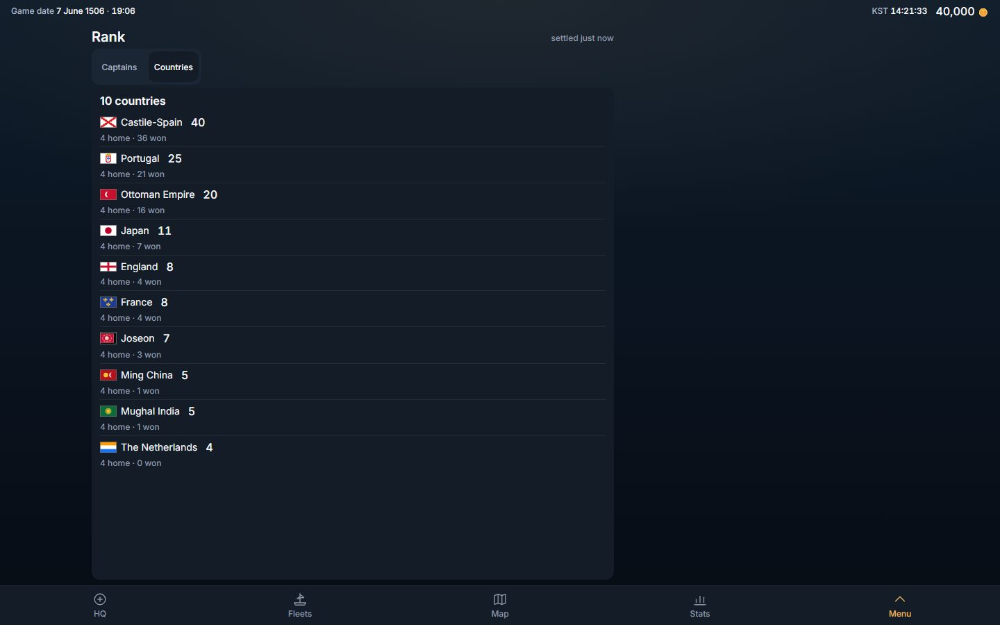
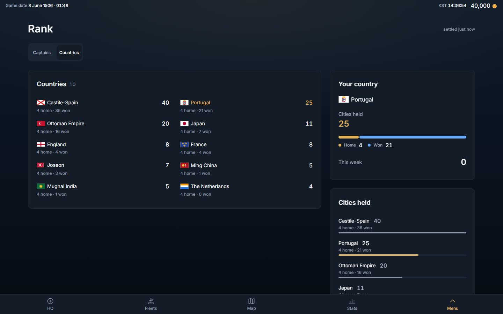
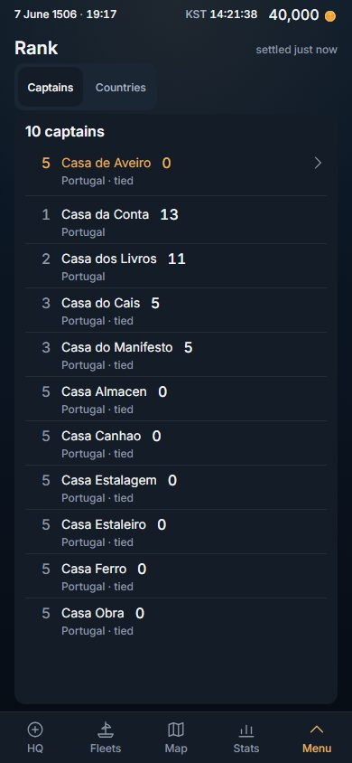
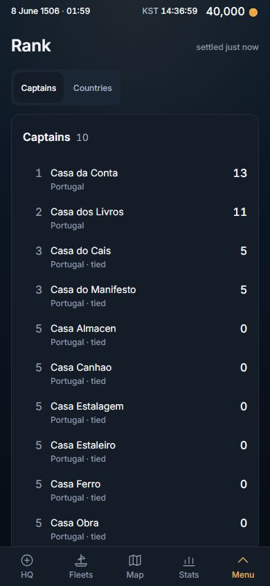

# Rank, redesigned: the page pattern, fourth screen (2026-11-03)

Owner, 2026-11-02, verbatim (row 267): *"i want you to redesign the looks of the game. for example stats, it looks so wrong. The past was better. right now everything is on left, too packed. this was a mistake"*.

Stats took the page first (PR #466, `docs/dev-log/2026-11-02-stats-design.md`) and is THE PATTERN; the Codex was second (PR #473, `docs/dev-log/2026-11-02-codex-design.md`), History third (PR #474, `docs/dev-log/2026-11-03-history-design.md`); Rank is the fourth screen on it, in the order the Stats log proposes (Codex, History, Rank, Routes, HQ, Fleets, Map). This slice is client-only (no migration, no server change, no read changed) and composes what Stats built — `Sheet layout="page"`, `PageSplit`, `Card`, `StatCell look="stacked|line"`, `StackedBar`, `ListPanel look="card" columns="fit"`, `ListHeading`, `RankBars`, the page-context `Tray` — and adds no primitive. No shared source primitive was edited; no other screen moved by a pixel. The one shared edit is in the test apparatus (§2).

## 0. The answer in six lines

1. **The width is used.** Rank is the centred page container (content at most 1,280 px; margins 16 · 24 · 32 · 40, 80 each side at 1,440) and, from 1,024, **MAIN | SIDE** on both faces — the side column is the tray's column and is always used.
2. **The board is ONE card with room.** *Captains · 10* as its title and count, the rows 52 px on a phone and 60 from 1,024 with whitespace and no rule between them, the place as each row's mark, the fame on the row's right edge, the flag and *tied* under the line, the rows in as many columns of at least 20 rem as the card holds (1 on a phone and at 1,024, 2 in the 840-px main at 1,440 — the place number keeps two columns reading as one ladder). The page scrolls — **no list scrolls inside itself**, and **nothing is pinned**: your line stands IN the list, in its place when you are on the board, else under its own *You* heading after the board's rows (0025 serves `you` off the board's end for exactly this; the *Top 10 shown.* caption is the card's footer).
3. **Your standing stands in the side, as graphics** — never a paragraph where a figure would do. *Your standing*: the place at 24 px over its label beside the fame at 24 px, the two fames the total is made of as one stacked bar (trade · exploration, with their figures; before there is any fame the two stand as lines reading 0), then *Ports* and *Companies* as statement lines. *Leaders*: the first five rows of the board as ranked bars, yours lit. On the Countries face: *Your country* (its flag and name, the cities it holds at 24 px, home and won as one stacked bar, *This week* as a line) and *Cities held* (every country's figure as ranked bars, yours lit). Every figure is a served field or a slice of served rows — never a place computed here, never a fame summed here (`src/features/rank/rankFigures.ts`, pure).
4. **A real hierarchy.** Page title 30 px (24 on a phone); card titles 18 (16); the key figures 24 over a 14-px label; row labels 14 with the figure in 16 at the row's edge; rows 60, not 44.
5. **A press SELECTS.** A face pressed swaps the board for the countries and moves the strip by nothing; **your line opens the fame tray** — the place, the country, the two fames the total is made of, the ports, the cities you are mayor of, the total — which **slides over the side column** (the same x and width, from the one `--page-side` the grid and the tray share) and nothing behind it moves. The other rows are read-only, as they were (§5 says why the first cut's "every row opens its line" was taken back).
6. **Nothing removed.** Both faces, your line and its press (`rank-you` → `fame-tray`), every board row and its *Mayor of* caption, the ten countries with home · won · this week · their givers, the count, the settled caption on the title line, the skeleton / refused / empty states — all there; `tests/rank.design.spec.ts` asserts the list (U3), and `tests/rank.countries.spec.ts` is untouched.

Pictures (1,440 × 900 and 390 × 844, English, canary world, DPR 1; the BEFORE shots are the build of origin/main `4078b90f`):

| | BEFORE (origin/main 4078b90f) | AFTER |
|---|---|---|
| Captains, 1,440 |  |  |
| Your line open, 1,440 |  |  |
| Countries, 1,440 |  |  |
| Captains, 390 |  |  |

## 1. The two faces

- **Captains** — MAIN: *Captains · 10*, one `ListPanel look="card" columns="fit"` (`rank-list`); a row (`rank-row`; yours `rank-you`, in the accent tone) is the place as its mark, the company's name, the total fame at the row's edge, the flag and *tied* under the line, and the *Mayor of* caption where the server says so; your line is a button with a chevron and opens the fame tray (`fame-tray`: place, country, trade, exploration, ports, mayor of, total), the others are read-only. SIDE (from 1,024, sticky; after the list on a phone): *Your standing* (`rank-standing`: `rank-place` and `rank-fame` as `StatCell look="stacked"`, the split as `StackedBar` `rank-fame-split`, *Ports* and *Companies* as `look="line"`; with no company, the one *Not ranked yet.* row) and *Leaders* (`rank-leaders`: `RankBars` of the board's first five, the nation and *tied* as the note, yours `accent` and the others `neutral`).
- **Countries** — MAIN: *Countries · 10* (`rank-countries`), a row a country (`rank-country`: the flag and name, the cities held at the edge, home · won · this week · its givers under the line — the sentence the row had), yours in the accent tone. SIDE: *Your country* (`rank-my-country`: the flag and name at the title size, `rank-held` as the key figure, home and won as `StackedBar` `rank-held-split` with their figures, *This week* as a line) and *Cities held* (`rank-held-bars`: `RankBars` of every country in the served order, yours lit).
- **The faces** are the one `Segmented` under the title, as every page has it. The title line keeps the settled caption (the photograph's age, measured by the server).

## 2. What was folded, and the one shared edit

- **`rankFigures.ts`** — the screen's readings of its served boards (one house's line in one shape whether it is a row or the `you` off the board's end; the leaders as a slice of the served order; your country's line), pure and in their own file so the screen file holds components and the readings can be read without a browser. Its header says why it is the screen's and not a domain section: no second screen may print a house's place (`consistency.spec`'s "one fact, one home"), so a second caller is implausible by construction.
- **`settled()` moved to `tests/design.fixture.ts`** — the "the sheet has settled" guard History wrote (the one that found the Sheet's flutter) was about to be copied into this spec; it is the page laws' apparatus, so it lives with them, and `history.design.spec.ts` reads it from there (the same lines, one home). No source primitive was edited.
- **Deleted:** the `rank.countCaptains` and `rank.countCountries` keys (English and Korean) — the card's title is the face's word and its count a figure, as every card list; `tests/rank.unfold.spec.ts` (replaced, §5).
- **New words** (English · Korean), every one a name, never a sentence: *Your standing* · 내 순위, *Place* · 등수, *Fame* · 명성, *Fame by kind* · 종류별 명성 (the bar's one assistive name), *Companies* · 회사, *Leaders* · 선두, *Your country* · 내 나라, *Cities held* · 보유 도시, *Home* · 본거지, *Won* · 획득, *This week* · 이번 주. *Country* on the tray is `codex.country`; everything else is an existing key.

## 3. Phones

One column, and **the list comes first** (the Codex's lesson): no `sideFirst`, so the side's cards stand after the board, and the first row of both faces is on the first glass at 390 × 844 and 320 × 640 (law (g), measured in §4). Cards stack with 16 px of padding; rows 52-60 px; the page scrolls; controls are 44 px; nothing scrolls sideways; the document is flat (the Sheet is the scroller). Rank has no picker, so the Codex's "a picker reads its name" law has nothing to read here.

<!-- measured:start -->
## 4. Measured, BEFORE → AFTER

Headless Chromium, dark scheme, DPR 1, the canary world (ten companies on the board of fourteen, you off its end; ten great powers), one persistent page per build, both builds served by `vite preview` on `localhost` (BEFORE = origin/main `4078b90f` on port 4174, AFTER = this branch on 4173), both faces at the five glasses, in English and Korean — the Korean numbers are the English ones to the pixel. "Block" is the visible text widened to the cards' edges (`tests/design.fixture.ts` `block`, what law (a) reads); "figure" is the font size of the face's key figure and of its label; rows are the `rank-row` / `rank-you` / `rank-country` rows (the shortest, and the widest) — on the packed column the board's rows carried no id, so only the pinned `rank-you` line was measured there; "cards" are `[data-card]` / `[data-list-panel]` surfaces; "inner scrollers" are boxes other than the sheet that scroll inside themselves. The raw lines of both runs are in this PC's scratchpad.

### Captains

| glass | block BEFORE | block AFTER | figure | row height (min) | row width (max) | cards | inner scrollers | side | sheet height / glass |
|---|---|---|---|---|---|---|---|---|---|
| 1440 × 900 | 132..884 (52 %, 556 px empty) | 80..1360 (89 %, 80 px empty) | — → 24 / 14 | 57 → 60 | 728 → 395 | 1 → 3 | 0 → 0 | — → 416 | 811 / 811 → 1,060 / 811 |
| 1280 × 800 | 52..804 (59 %, 476 px empty) | 40..1240 (94 %, 40 px empty) | — → 24 / 14 | 57 → 60 | 728 → 371 | 1 → 3 | 0 → 0 | — → 384 | 711 / 711 → 1,060 / 711 |
| 1024 × 768 | 16..584 (55 %, 440 px empty) | 32..992 (94 %, 32 px empty) | — → 24 / 14 | 57 → 60 | 544 → 562 | 1 → 3 | 1 (493 px in 482) → 0 | — → 352 | 679 / 679 → 1,036 / 679 |
| 390 × 844 | 16..374 | 16..374 (92 %) | — → 24 / 14 | 57 → 56 | 334 → 340 | 1 → 3 | 0 → 0 | — | 755 / 755 → 1,738 / 755 |
| 320 × 640 | 16..304 | 16..304 (90 %) | — → 24 / 14 | 57 → 56 | 264 → 270 | 1 → 3 | 1 (493 px in 354) → 0 | — | 551 / 551 → 1,738 / 551 |

### Countries

| glass | block BEFORE | block AFTER | figure | row height (min) | row width (max) | cards | inner scrollers | side | sheet height / glass |
|---|---|---|---|---|---|---|---|---|---|
| 1440 × 900 | 132..884 (52 %, 556 px empty) | 80..1360 (89 %, 80 px empty) | — → 24 / 14 | 51 → 60 | 728 → 395 | 1 → 3 | 0 → 0 | — → 416 | 811 / 811 → 1,294 / 811 |
| 1280 × 800 | 52..804 (59 %, 476 px empty) | 40..1240 (94 %, 40 px empty) | — → 24 / 14 | 51 → 60 | 728 → 371 | 1 → 3 | 0 → 0 | — → 384 | 711 / 711 → 1,294 / 711 |
| 1024 × 768 | 16..584 (55 %, 440 px empty) | 32..992 (94 %, 32 px empty) | — → 24 / 14 | 51 → 60 | 544 → 562 | 1 → 3 | 0 → 0 | — → 352 | 679 / 679 → 1,270 / 679 |
| 390 × 844 | 16..374 | 16..374 (92 %) | — → 24 / 14 | 51 → 58 | 334 → 340 | 1 → 3 | 0 → 0 | — | 755 / 755 → 1,882 / 755 |
| 320 × 640 | 16..304 | 16..304 (90 %) | — → 24 / 14 | 51 → 58 | 264 → 270 | 1 → 3 | 1 (523 px in 415) → 0 | — | 551 / 551 → 1,882 / 551 |

What the numbers say: the content went from one list panel at the left (its block 52 % / 59 % / 55 % of the glass at 1,440 / 1,280 / 1,024, 556 / 476 / 440 px empty at its right) to the page's block at 89 % / 94 % / 94 %, the empty band at its right equal to the margin at its left (80 / 40 / 32 px); each face gained a key figure at 24 px over a 14-px label where it had none; a country's row from 51 px (a read-only row packed to its text line) to 60 (58 on a phone), your line from 57 to 60; a row from 728 px wide at 1,440 (a name and its figure hugging at the left, 500 px of nothing) to 395 in two columns; cards from 1 to 3; the inner scroller the board had where it did not fit (1,024 and 320) gone. The cost is length: the sheet that was exactly the glass is 1,036 (Captains, 1,024) to 1,882 px (Countries, 320) tall.
<!-- measured:end -->

## 5. The laws, and which were red before

`tests/rank.design.spec.ts` replaces `tests/rank.unfold.spec.ts` (which held U2 "the page and the Sheet never scroll; the board scrolls inside its panel", U1 "N whole rows in the panel inside the glass before a press", and "your line stays on the glass while the board scrolls" — the pinned line, which docks and follows the scroll). Its laws, at 1,440 × 900, 1,280 × 800, 1,024 × 768, 390 × 844 and 320 × 640, in English and Korean, read by the same `tests/design.fixture.ts` Stats, the Codex and History use.

The same file was run against both builds (served side by side: origin/main `4078b90f` on port 4174, this branch on 4173), 15 tests each — the two faces at five glasses in two languages, the tray-and-face-press law at five glasses.

| law | what it reads | BEFORE (4078b90f): **15 of 15 failed** | AFTER: **15 of 15 passed** |
|---|---|---|---|
| (a) use the width | the content block (text widened to the cards' edges) is centred from 1,024 and spans ≥ 80 % of the glass from 1,280 | **red** — 20 lines, both faces at every glass of 1,024 and up, both languages (block 132..884 at 1,440: 556 px empty against a 132-px margin; 52 % of the glass at 1,440, 59 % at 1,280) | green |
| (b) the defect rules | no sideways scroll, no overlap, no one-letter wrap, no cut text without its full text, every control ≥ 44 px, the document flat | green (0 lines — a guard, kept) | green |
| (c) the hierarchy | the face's key figure ≥ 24 px over a ≥ 13-px label; a list row ≥ 52 px and ≤ 36 rem wide | **red** — 38 lines: no key figure on either face (20), a country's row 51 px (10), rows 728 px wide at 1,440 and 1,280 (8) | green |
| (d) a tray moves nothing, and stands over the side | the boxes of the list card and the two side cards before / during / after your line's press; the tray's x and width equal the side column's; a face pressed moves the strip by nothing | **red** at every glass — the five tray tests stop at their first gate: the board's rows carry no id on the packed column (the no-move half held there by construction, a `fixed` tray — it is a guard) | green |
| (e) the side is used | Your standing and Leaders, Your country and Cities held exist, and from 1,024 stand in `[data-page-side]` | **red** — 52 lines (no side column: 12; no Your standing, Leaders, Your country or Cities held: 40) | green |
| (f) no scroll trap | no box but the sheet scrolls inside itself | **red** — 6 lines (the board's panel scrolls inside itself where it does not fit: 493 px in 482 at 1,024, 493 in 354 and 523 in 415 at 320) | green |
| (g) the list comes first on a phone | at 390 × 844 and 320 × 640 the first row stands on the first glass | **red** — 4 lines (the packed column's rows carry no id, so the law finds no first row); on the page a guard against a side card standing above the list | green |
| U3 / U5 / U8 | nothing removed (the list, its rows, your line, the two face tabs, the count on the card, the settled caption); no overlap, no cut text; your line opens the fame tray and closing it leaves the board | U3 red only for the count (20 lines — the packed title was "10 captains", a sentence, not a count beside a word); U5 green (kept); U8 inside the tray test above | green |

Specs that held the packed design, retargeted with the reason: `rank.unfold.spec.ts` deleted (U1 / U2 and the pinned line were the packing; U3 / U5 / U8 are restated above). `consistency.spec` law 4 and `onepage.spec` already exempt any `Sheet layout="page"` (Stats' slice did that generically); `layout.spec`'s Rank entry measures tables, of which Rank has none; `align.spec` already exempts a card list from its HUG law — none needed a line. The red build's walks fail at the non-vacuity gate ("the walk measured no key figure"), which is why the spec prints its law lines (`LAWS …`) before any gate.

**The first cut, and what the guards said.** The first cut of this slice made EVERY row a button that opened the house's line (0025 serves the two fames and the ports on every row); `tests/i18n.ko.spec.ts` refused it — 21 leaks on `rank`, every one a word of the ten probe companies' names (*Casa da Conta*, *Casa dos Livros*, …) read off a button, names no data file lists. A button is the client's own element and the sweep reads it whole; on origin/main only your line was a button (and *Casa de Aveiro* is allow-listed by hand). The rows are read-only again, as they were, and the tray opens from your line — the one press the board had. The spec's tray law was written for that press from then on; the red run above is of that file. On the first cut's own build the fifteen page laws were already green (15 of 15), so the rows' pressability was the only thing the second build changed.

## 6. What was not verified

- **Canary world only** (fourteen companies, ten on the board at the fame the sim gave them; you off the board's end at the founding's zero, so the *You* heading and the *Top 10 shown.* footer are what the pictures show; Portugal holds 25 cities, 4 home and 21 won). A played world puts you on the board (your line in its place, no heading) and gives the stacked bar fame to split; a board of a hundred companies lengthens the card (the page scrolls).
- **Light scheme not shot**; the laws ran in the dark scheme (the suite's default). **DPR 2** not re-measured (layout is in CSS px). Real Chrome on the owner's laptop was not driven (headless only).
- **Korean** was measured by the laws (both locales at five glasses) but not shot.

## 7. Next

Routes is the next screen on the pattern (side = the open lane), then HQ, Fleets, the Map — `docs/dev-log/2026-11-02-stats-design.md` §7.
