# Routes, redesigned: the page pattern, fifth screen (2026-11-03)

Owner, 2026-11-02, verbatim (row 267): *"i want you to redesign the looks of the game. for example stats, it looks so wrong. The past was better. right now everything is on left, too packed. this was a mistake"*.

Stats took the page first (PR #466, `docs/dev-log/2026-11-02-stats-design.md`) and is THE PATTERN; the Codex was second (PR #473), History third (PR #474), Rank fourth (PR #476, `docs/dev-log/2026-11-03-rank-design.md`); Routes is the fifth screen on it, in the order the Stats log proposes (Codex, History, Rank, Routes, HQ, Fleets, Map). This slice is client-only (no migration, no server change, no read changed) and composes what Stats built — `Sheet layout="page"`, `PageSplit`, `Card`, `StatCell look="stacked|line"`, `StackedBar`, `ListPanel look="card" columns="fit"`, `ListHeading`, `RankBars`, the page-context `Tray` — and adds no primitive. No shared source primitive was edited; no test apparatus was edited; no other screen moved by a pixel. It is stacked on the Rank branch only because its spec reads the `settled()` guard Rank moved into `tests/design.fixture.ts`.

## 0. The answer in six lines

1. **The width is used.** Routes is the centred page container (content at most 1,280 px; margins 16 · 24 · 32 · 40, 80 each side at 1,440) and, from 1,024, **MAIN | SIDE** — the side column is the tray's column and is always used.
2. **The board is ONE card with room.** *Lanes · 40* as its title and count, the board's one button (*Read again*) on the title's line and the three orders (Distance · Earnings · Calls) under it, as they were; the rows 52 px on a phone and 60 from 1,024 with whitespace and no rule between them, the ranked figure on the row's right edge, whose lane and its shape under the line, the rows in as many columns of at least 20 rem as the card holds (1 on a phone and at 1,024, 2 in the 840-px main at 1,440) — **hers under a *Yours* heading, the merchants' under a *Merchants* heading**, each heading spanning the columns. The page scrolls — **no list scrolls inside itself**, and **nothing is pinned, nothing follows the scroll** (the side is three cards tall, taller than a 768 glass, so it stands where it is rather than sticking).
3. **The board's shape stands in the side, as graphics** — never a paragraph where a figure would do. *Overview*: the lanes on the board at 24 px beside yours at 24 px, within reach and out of reach (the gate read forward against your own levels, 0108) as one stacked bar, then *Merchants* and *No fleet* as statement lines. *Top lanes*: the first five lanes of the order on the glass as ranked bars, yours lit, the order's word on the card's title line — the board follows the sort, as the Codex's boards follow its filters. *By company*: the five companies with the most lanes as ranked bars, their flag as the note, yours lit. Every figure is a served field, a count over the served rows or a slice of the ordered rows — never a distance measured here, never earnings summed here (`src/features/routes/routesFigures.ts`, pure).
4. **A real hierarchy.** Page title 30 px (24 on a phone); card titles 18 (16); the key figures 24 over a 14-px label; row labels 14 with the figure in 16 at the row's edge; rows 60, not 44.
5. **A press SELECTS.** An order pressed re-ranks the lanes and moves neither the strip, the list card nor the side's cards (measured to the pixel); a lane pressed opens its tray — the calls in loop order, the lap, the regions, what it asks, its state, what a lap earns, the laps closed — which **slides over the side column** (the same x and width, from the one `--page-side` the grid and the tray share) and nothing behind it moves.
6. **Nothing removed.** The three orders, the refresh button on the 44-px floor, every lane with its chevron and its line, the lane tray and all its rows, the count, the *shorter lanes hidden* caption (the card's footer), the read-age (now on the title line: *read just now*), the stale note, the skeleton / refused / empty states — all there; `tests/routes.design.spec.ts` asserts the list (U3). The one line that changed on a row: the figure the row is ranked by is no longer repeated in its caption (under Distance the miles stood twice on one row: at the edge and in the line).

Pictures (1,440 × 900 and 390 × 844, English, the played world of forty lanes the specs build, DPR 1; the BEFORE shots are the build of `origin/rank-design` a84db57b — the Routes screen there is origin/main's, untouched by the four earlier slices):

| | BEFORE (a84db57b) | AFTER |
|---|---|---|
| Distance, 1,440 | 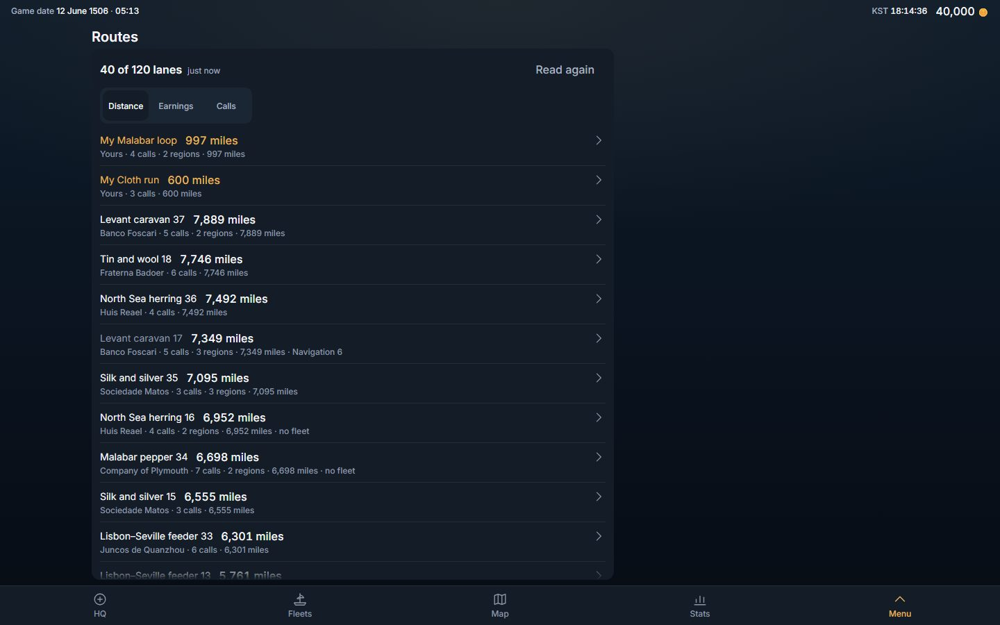 | 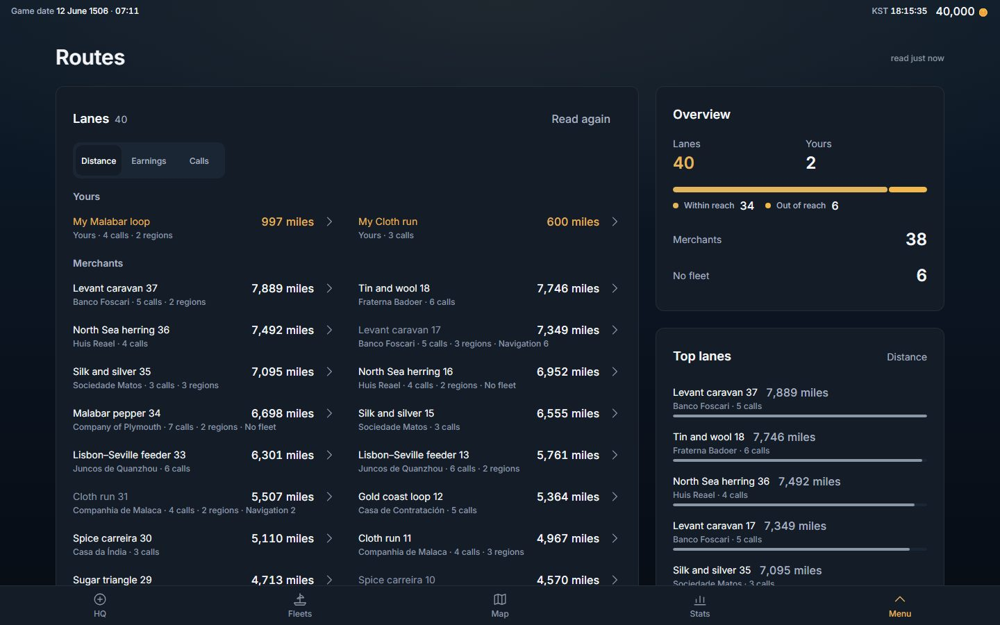 |
| A lane open, 1,440 | 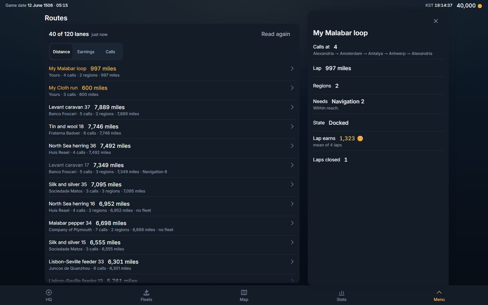 | 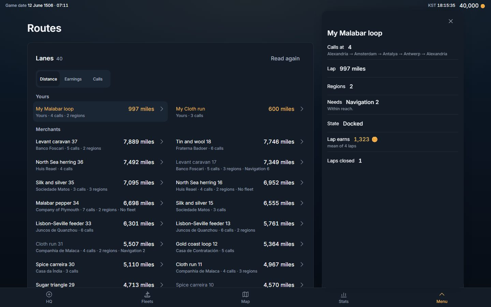 |
| Earnings, 1,440 | 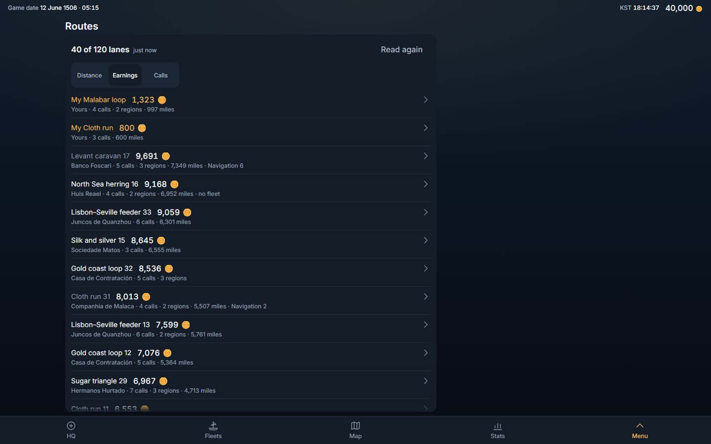 | 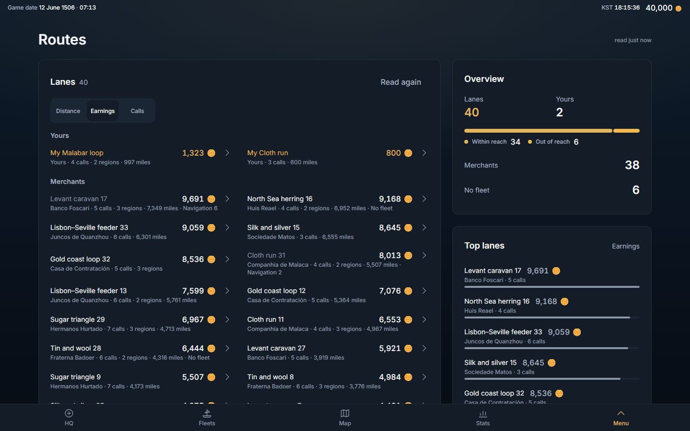 |
| Distance, 390 | 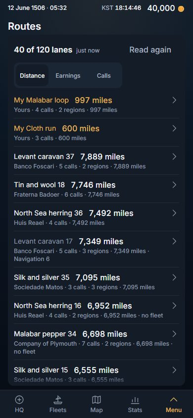 | 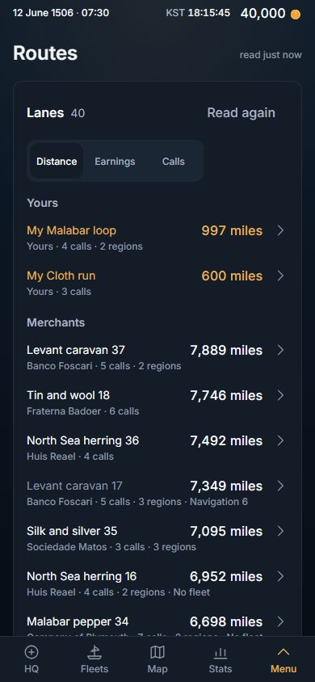 |
| A lane open, 390 | 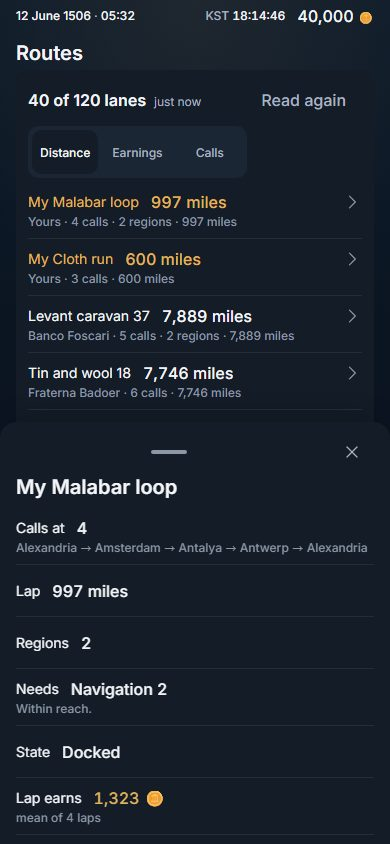 | 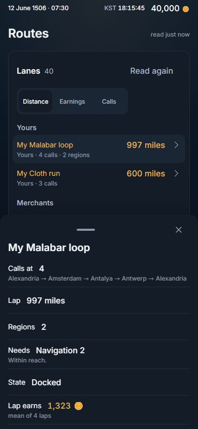 |
| The foot of the page, 390 | 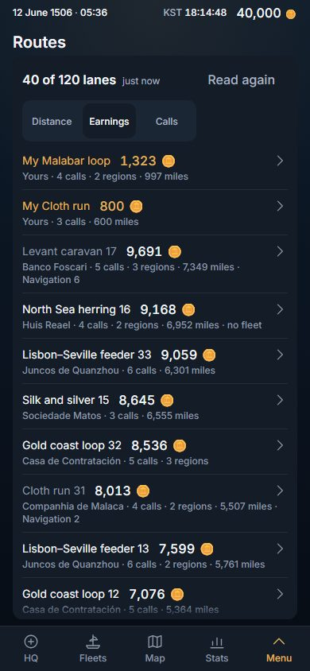 | 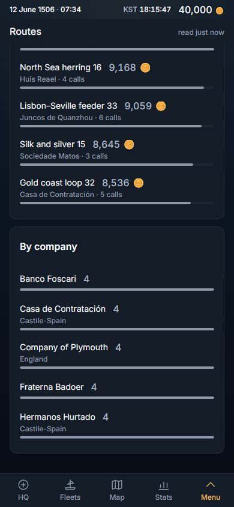 |

## 1. The page

- **MAIN** — *Lanes · 40*, one `ListPanel look="card" columns="fit"` (`routes-list`); its title line carries the one button (`routes-refresh`, md, 44 px) and its controls line the one `Segmented` of three orders (the sort the list already had — it stays in the card's header, where the strip was; it is a sort, not a face). A row (`route-lane`) is the lane's name, the ranked figure at the row's edge (a word — *unmeasured*, *not yet* — where the server has none, never a dash), and under the line whose lane it is, its calls, its regions, its miles, *No fleet*, and the navigation it asks when it is shut to you; hers in the accent tone, a shut lane muted. Hers stand first under *Yours* (`routes-yours`, a `ListHeading`), the merchants' under *Merchants* (`routes-merchants`); with no lane of hers there is no heading. The footer is the *N shorter lanes hidden.* caption when the world holds more than the board serves.
- **SIDE** (from 1,024, not sticky; after the list on a phone) — three `Card`s: *Overview* (`routes-overview`: `routes-lanes` and `routes-mine` as `StatCell look="stacked"`, the reach split as `StackedBar` `routes-reach` — two lines reading 0 before there is a lane to split — *Merchants* and *No fleet* as `look="line"`), *Top lanes* (`routes-top`: `RankBars` of `topOf(rows, order, 5)`, the order's word as the card's `aside`, the company and calls as the note, yours `accent` and the others `neutral`), *By company* (`routes-companies`: `RankBars` of `companiesOf(rows, 5)`, the flag as the note). On an empty board the two boards print the board's own empty word (*No routes yet.* / *No routes of yours.*).
- **The title line** carries the read-age (*read just now*, `routes.read`), as Rank's carries *settled 3 min ago* — it was the list's count slot, where the count now is.
- **The tray** — the lane, exactly as before (`route-tray`) — docks over the side column (`useInPage()` in `Tray.tsx`, the Stats mechanism; nothing here chose it).

## 2. What was folded, and what was not touched

- **`routesFigures.ts`** — the screen's readings of its served board: the ranked figure under an order (`rankedOf`), the order (`sortRoutes`, moved out of the screen file unchanged: name tie-break, an absent figure last), hers apart from the merchants' (`groupsOf`), the board's shape as counts (`figuresOf`), the first lanes of the order as a slice (`topOf`), the lanes by company as a count (`companiesOf`) — pure and in their own file so the screen file holds components and the readings can be read without a browser. Its header says why it is the screen's and not a domain section: no second screen reads the board (`useRouteBoard.ts`), so a second caller is implausible by construction.
- **No shared source edit.** `ListHeading`, `Card`'s `aside`, `RankBars rules={false}`, `StatCell`'s two card looks and `StackedBar` are composed as the four earlier slices left them. The test apparatus (`tests/design.fixture.ts`, `tests/unfold.fixture.ts`) is read, not edited.
- **Deleted:** the `routes.someLanes` key (English and Korean) — the card's title is the word *Lanes* and its count a figure, as every card list; the lanes the world holds beyond the board are the footer's; `tests/routes.unfold.spec.ts` (replaced, §5).
- **Changed words:** `routes.lanes` from the plural sentence *{n} lanes* to the word *Lanes* · 항로; `routes.noFleet` from *no fleet* to *No fleet* (it is a statement line's label now as well as a caption fragment; the Korean 선단 없음 is unchanged).
- **New words** (English · Korean), every one a name, never a sentence: *Top lanes* · 상위 항로, *By company* · 회사별, *Within reach* · 항해 가능, *Out of reach* · 항해 불가, *Lanes by reach* · 항해 가능 여부 (the bar's one assistive name), *read {when}* · {when} 읽음. *Overview* and *Merchants* are `stats.overview` and `stats.merchants` — existing keys, one word for one idea.

## 3. Phones

One column, and **the list comes first** (the Codex's lesson): no `sideFirst`, so the side's cards stand after the forty lanes, and the first lane is on the first glass at 390 × 844 and 320 × 640 (law (g), measured in §4: the card's title line, the three-cell strip and the *Yours* heading stand above it and still leave the first row at about 270 px). Cards stack with 16 px of padding; rows 56 px; the page scrolls (3,710–4,252 px of sheet on a 755 / 551 glass — the cost of forty lanes with room); controls are 44 px; nothing scrolls sideways; the document is flat (the Sheet is the scroller). Routes has no picker (its orders are a segmented control), so the Codex's "a picker reads its name" law has nothing to read here.

<!-- measured:start -->
## 4. Measured, BEFORE → AFTER

Headless Chromium, dark scheme, DPR 1, the played world (`tests/unfold.fixture.ts`: forty lanes served of a hundred and twenty, two of them hers, some unmeasured, some shut, some with no closed lap), one page per test, both builds served by `vite preview` on `localhost` (BEFORE = `origin/rank-design` a84db57b, whose Routes is origin/main's, on port 4174; AFTER = this branch on 4173), the three orders at the five glasses, in English and Korean — the Korean numbers are the English ones to the pixel. "Block" is the visible text widened to the cards' edges (`tests/design.fixture.ts` `block`, what law (a) reads); "figure" is the font size of the board's key figure (`routes-lanes`) and of its label; rows are the `route-lane` rows (the shortest, and the widest); "cards" are `[data-card]` / `[data-list-panel]` surfaces; "inner scrollers" are boxes other than the sheet that scroll inside themselves. The three orders measure alike; one line a glass.

| glass | block BEFORE | block AFTER | figure | row height (min) | row width (max) | cards | inner scrollers | side | sheet height / glass |
|---|---|---|---|---|---|---|---|---|---|
| 1440 × 900 | 132..884 (52 %, 556 px empty) | 80..1360 (89 %, 80 px empty) | — → 24 / 14 | 56 → 60 | 728 → 395 | 1 → 4 | 1 (2,307 px in 653) → 0 | — → 416 | 811 / 811 → 1,602 / 811 |
| 1280 × 800 | 52..804 (59 %, 476 px empty) | 40..1240 (94 %, 40 px empty) | — → 24 / 14 | 56 → 60 | 728 → 371 | 1 → 4 | 1 (2,307 px in 553) → 0 | — → 384 | 711 / 711 → 1,602 / 711 |
| 1024 × 768 | 16..584 (55 %, 440 px empty) | 32..992 (94 %, 32 px empty) | — → 24 / 14 | 56 → 60 | 544 → 562 | 1 → 4 | 1 (2,307 px in 521) → 0 | — → 352 | 679 / 679 → 2,794 / 679 |
| 390 × 844 | 16..374 | 16..374 (92 %) | — → 24 / 14 | 56 → 56 | 334 → 340 | 1 → 4 | 1 (2,419 px in 597) → 0 | — | 755 / 755 → 3,726 / 755 |
| 320 × 640 | 16..304 | 16..304 (90 %) | — → 24 / 14 | 56 → 56 | 264 → 270 | 1 → 4 | 1 (2,707 px in 393) → 0 | — | 551 / 551 → 4,252 / 551 |

What the numbers say: the content went from one list panel at the left (its block 52 % / 59 % / 55 % of the glass at 1,440 / 1,280 / 1,024, 556 / 476 / 440 px empty at its right) to the page's block at 89 % / 94 % / 94 %, the empty band at its right equal to the margin at its left (80 / 40 / 32 px); the board gained a key figure at 24 px over a 14-px label where it had none; a lane from 56 px (a two-line row packed to its reach floor) to 60 from 1,024; a row from 728 px wide at 1,440 (a name and its figure hugging at the left, 500 px of nothing) to 395 in two columns; cards from 1 to 4; the inner scroller the board had at every glass (forty lanes in a 393–653-px panel) gone. The cost is length: the sheet that was exactly the glass is 1,602 (1,440) to 4,252 px (320) tall.
<!-- measured:end -->

## 5. The laws, and which were red before

`tests/routes.design.spec.ts` replaces `tests/routes.unfold.spec.ts` (which held U2 "the page and the Sheet never scroll; the board scrolls inside its panel" and U1 "N whole lanes in the panel inside the glass before a press"). Its laws, at 1,440 × 900, 1,280 × 800, 1,024 × 768, 390 × 844 and 320 × 640, in English and Korean, read by the same `tests/design.fixture.ts` Stats, the Codex, History and Rank use. The same file was run against both builds, 16 tests each — the three orders at five glasses in two languages, the tray-and-order-press law at five glasses, the young world.

| law | what it reads | BEFORE (a84db57b): **16 of 16 failed** | AFTER: **16 of 16 passed** |
|---|---|---|---|
| (a) use the width | the content block (text widened to the cards' edges) is centred from 1,024 and spans ≥ 80 % of the glass from 1,280 | **red** — 18 lines, every order at every glass of 1,024 and up, both languages (block 132..884 at 1,440: 556 px empty against a 132-px margin; 52 % of the glass at 1,440, 59 % at 1,280) | green |
| (b) the defect rules | no sideways scroll, no overlap, no one-letter wrap, no cut text without its full text, every control ≥ 44 px, the document flat | green (0 lines — a guard, kept) | green |
| (c) the hierarchy | the board's key figure ≥ 24 px over a ≥ 13-px label; a lane ≥ 52 px and ≤ 36 rem wide | **red** — 36 lines: no key figure (30), rows 728 px wide at 1,440 and 1,280 (6); the packed lane was 56 px (two lines on a 44-px floor), so the 52-px half held | green |
| (d) a tray moves nothing, and stands over the side | the boxes of the list card and the three side cards before / during / after a lane's press; the tray's x and width equal the side column's; an order pressed moves the strip, the list card and the side by nothing; the Top lanes board leads with the order's largest figure | **red** at every glass (the side column and the board do not exist; the no-move half held there by construction, a `fixed` tray — it is a guard) | green |
| (e) the side is used | Overview, Top lanes and By company exist, and from 1,024 stand in `[data-page-side]` | **red** — 108 lines (no side column: 18; no Overview, Top lanes or By company: 90) | green |
| (f) no scroll trap | no box but the sheet scrolls inside itself | **red** — 30 lines (the board's panel scrolls inside itself at every glass: 2,307 px in 653 at 1,440 … 2,707 in 393 at 320) | green |
| (g) the list comes first on a phone | at 390 × 844 and 320 × 640 the first lane stands on the first glass | green (the packed panel's first lane was on the glass too — a guard against a side card standing above the list) | green |
| U3 / U5 / U8 | nothing removed (the list, its lanes, the button on the 44-px floor, the three orders, the count on the card, the read caption on the title line); no dash; a lane opens its tray and closing it leaves the board; an order re-ranks the lanes and moves neither title nor strip; *not yet* under Earnings | U3 red for the count and the caption (60 lines — the packed title was *40 of 120 lanes*, a sentence, and *just now* stood in the count slot); U5 / U8 green (kept) | green |

Specs that held the packed design, retargeted with the reason: `routes.unfold.spec.ts` deleted (U1 / U2 were the packing; U3 / U5 / U8 and the young world are restated above). `consistency.spec` law 4 and `onepage.spec` already exempt any `Sheet layout="page"`; `align.spec` already exempts a card list from its HUG law and finds the order strip as the sheet's first tablist, where it still is; `layout.spec` has no Routes entry — none needed a line. The red build's walks fail at the non-vacuity gate ("the walk measured no key figure"), which is why the spec prints its law lines (`LAWS …`) before any gate.

**The first cut of the spec, and what it got wrong.** Its tray law said "the Top lanes board leads with the list's first lane" — and the list leads with HER lanes, whatever their figure, while the board ranks every lane together, so on the finished page the law was false by design (the five tray tests red on the AFTER build: *My Malabar loop* on the list, *Malabar pepper 14* on the board, under Calls). The law now compares the figure, not the place: the board's first bar carries the largest figure on the list. The walks were green on the first run of the AFTER build; only that one line changed. The same line read the board's first bar with an UNBOUNDED wait (`innerText()` with no action timeout), so on the packed build — where there is no board — the two phone tray tests that reach it hung instead of failing, and the RED run's first 13 verdicts were followed by silence for half an hour; the wait is bounded at 10 s now, and the three outstanding tests (the two phone trays and the young world) were re-run alone against the packed build: all three red (*the Top lanes board does not lead with the most calls (reads "")*; *routes-overview is not on the young page*). The 16-of-16 above is those 13 and these 3; the final spec text was run once more on the AFTER build (the tray and young-world tests, 6 of 6; the walks do not read that line).

## 6. What was not verified

- **The played world only** for the pictures and the laws (forty lanes of a hundred and twenty, two hers, the shut and unmeasured and not-yet lanes the fixture seeds). The owner's world serves up to `route_board_max`; a board with no lane of hers has no headings; a board of one company fills *By company* with one bar.
- **Light scheme not shot**; the laws ran in the dark scheme (the suite's default). **DPR 2** not re-measured (layout is in CSS px). Real Chrome on the owner's laptop was not driven (headless only).
- **Korean** was measured by the laws (both locales at five glasses) but not shot.
- `tests/route.stopface.spec.ts` (the COMMAND desk's route editor — not this screen) passed its browser half on this build; its two pure word tests read this PC's Korean locale (*전부*, *가격 무관*) and fail identically on untouched main — the locale effect CLAUDE.md names, not this slice's.

## 7. Next

Fleets and You are the next screens on the pattern (side = the selected fleet's status), then HQ and the Command desk, Profile, the Map's trays — `docs/dev-log/2026-11-02-stats-design.md` §7.
