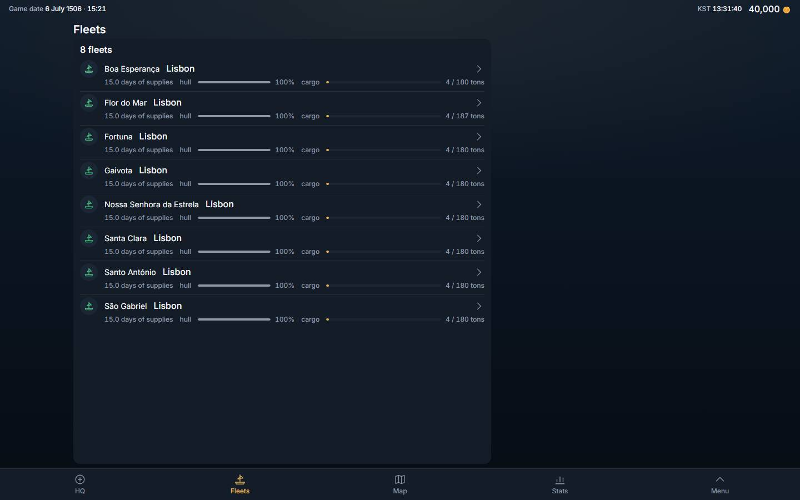
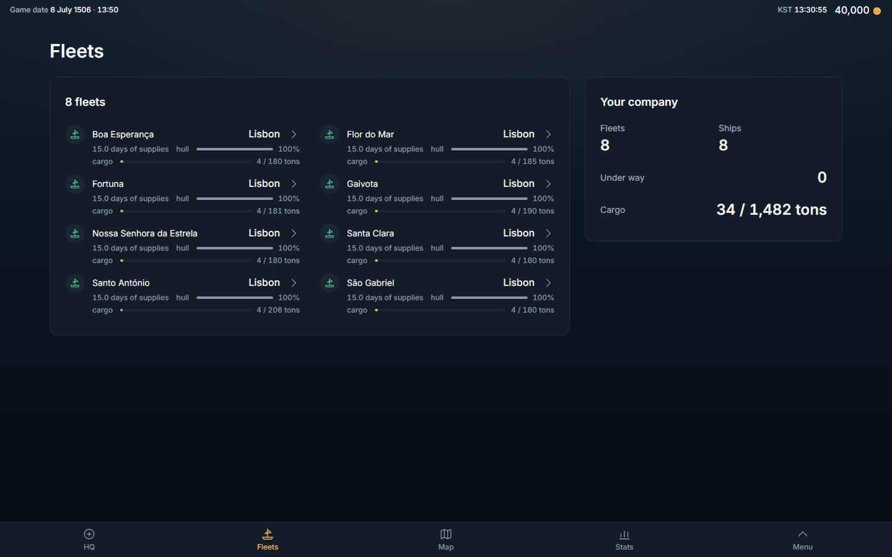
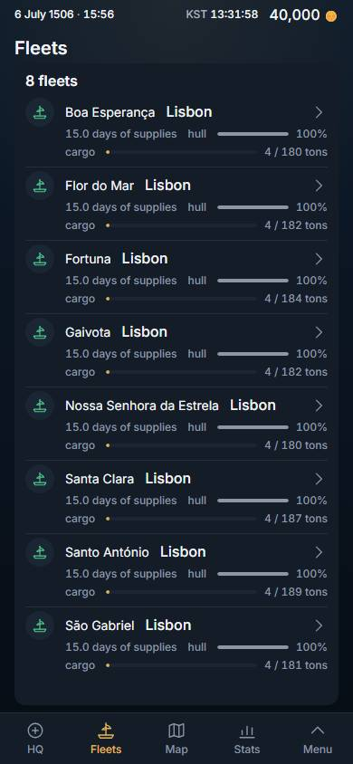
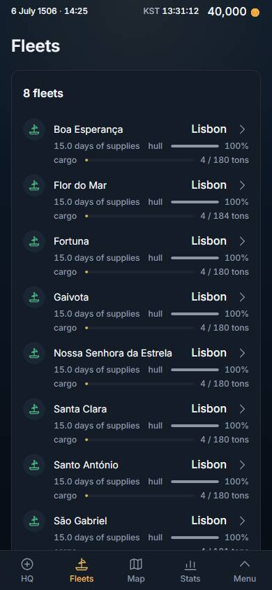

# Fleets, redesigned: the page pattern (2026-11-04)

Owner, 2026-11-02, verbatim (row 267): *"i want you to redesign the looks of the game. for example stats, it looks so wrong. The past was better. right now everything is on left, too packed. this was a mistake"*. Stats took the page first (#466, `docs/dev-log/2026-11-02-stats-design.md`), then the Codex (#473), History (#474), Rank (#476), Routes (#477) and the HQ (#478, `docs/dev-log/2026-11-04-hq-design.md`). Fleets is the next screen on the same pattern. Client-only: no migration, no served field, no read changed. No shared primitive was edited (`Sheet layout="page"`, `PageSplit`, `Card`, `StatCell`, `ListPanel look="card" columns="fit"` are used as they are); no other screen changes look.

Direction from the owner for this slice: the earlier compaction was a mistake, **use the width, do not add density**.

## 0. What it was, what it is

**Was:** one `ListPanel` (`Sheet fill`) that filled the glass and scrolled inside itself: a column of fleet rows at the left, 728 px wide at 1,440 with 556 px of nothing at the right; eight fleets at 320 x 640 scrolled inside the panel.

**Is:** a page (`Sheet layout="page"`; the document stays flat, the sheet scrolls).

1. **MAIN | SIDE** from 1,024 px, the side being the tray's column (`--page-side`).
   - MAIN: *N fleets* as one card list (`fleets-list`), the rows in as many columns of at least 20 rem as the card holds (two at 1,440: the rows are 395 px, not 728). The row is exactly the row it was (status mark, name, where she is, supplies, hull bar, cargo gauge), same test ids.
   - SIDE: *Your company* (`fleets-company`): Fleets and Ships as 24-px figures over 14-px labels, then *Under way* and *Cargo* (used / total tons across the fleets) as lines. Every figure is a count of the served list or the existing hold folds (`fleetHoldUsed`, `fleetHoldTotal`) summed; nothing new is computed by a rule the server owns.
2. **Below 1,024 px** one column, the list first (Rank's and the Codex's lesson): the first fleet is on the first glass at 390 and 320.
3. **A press on a fleet** still opens her page (`DetailPage`, `fleet-page`) and nothing behind it moves; Back leaves the screen as it was.
4. **No scroll trap:** the list does not scroll inside itself; the page scrolls.

New words (English / Korean), names not sentences: *Your company* / 내 회사, *Under way* / 항해 중 (`fleets.company`, `fleets.underway`). *Fleets* and *Ships* and *Cargo* are the tab word and existing keys.

Pictures (headless Chromium, dark, DPR 1, the veteran world of eight fleets; before = origin/main `15d86521`):

| | BEFORE | AFTER |
|---|---|---|
| 1,440 |  |  |
| 390 |  |  |

## 1. The test, red then green

`tests/fleets.design.spec.ts`, in the style of `hq.design.spec.ts`, read by the same apparatus (`design.fixture.ts`), on the veteran's eight fleets (`manyFleets.fixture.ts`): five glasses (1,440 / 1,280 / 1,024 / 390 / 320), English and Korean, plus the press test at 1,440 and 390. Laws: (a) width used, (b) defect rules, (c) hierarchy (figures 24 / labels 13, fleet rows at least 52 px and at most 36 rem), (e) the side is used, (f) no scroll trap, (g) the list first on a phone, (h) a press moves nothing; U3 nothing removed.

**Red** (English walks, build of origin/main `15d86521`, run before the change): 5 of 5 fail. 1,440: block 132..884, 556 px empty at the right and 132 at the left, the content 52 % of the glass; no company figures; rows 728 px wide; no side column. 1,280: 59 %, 476 px empty. 1,024: 440 px empty. 390 and 320: no company block; at 320 a box scrolls inside itself (833/471).

**Green** (this branch's build): the 5 English walks, the 5 Korean walks and the 2 press tests all pass (12 of 12). 1,440: block 80..1360, figures 24/24, rows 80 px at most 395 wide, 0 scrollers; 390: block 16..374; 320: 0 scrollers.

## 2. Old specs this changes, and why

Row 267 reverses the compaction order those specs held (*"make things unfolded, minimize scrolling, everything compact with full info"*, 2026-11-01): the panel fills the glass and scrolls inside itself.

- `tests/fleets.you.grow.spec.ts`: the FLEETS half is REPLACED by `fleets.design.spec.ts` (`checkFleets`, its eight-and-two-hull walks and the Korean 320 walk, `NEED_FLEETS`: they asserted "the panel fills the glass", "N rows whole in the panel", "the panel scrolls inside itself at 320"). Kept and passing: the YOU half, the press-opens-her-page test, the 24-character name whole at 320, and the fleet at sea (its page-is-flat check now reads the document and the defect rules, not the panel).
- Run on this build and passing, unchanged: `layout` and `wide.layout` fleet tests, `firstRead.empty`, `fleet.supplies` (18 with the grow spec); `consistency`, `i18n.ko`, `words`, `i18n.keys`, `duplication`, `sections` (43).

## 3. What was not verified

- Only the local (PGlite) world: the canary, and the veteran image of eight fleets all docked at Lisbon. Fleets under way (the "Under way" figure was only seen at 0; the at-sea row test passes), refused or stuck fleets, and a played world's states were not looked at.
- Korean was walked at five glasses by the new spec; the pictures are English.
- Pixel ratio 2 and light scheme were not measured.
- The fleet's own page (`DetailPage`) is unchanged: it is still the full-glass overlay, not placed in the side column.
- Run locally only one spec file group at a time with one worker; the full suite is CI's.
