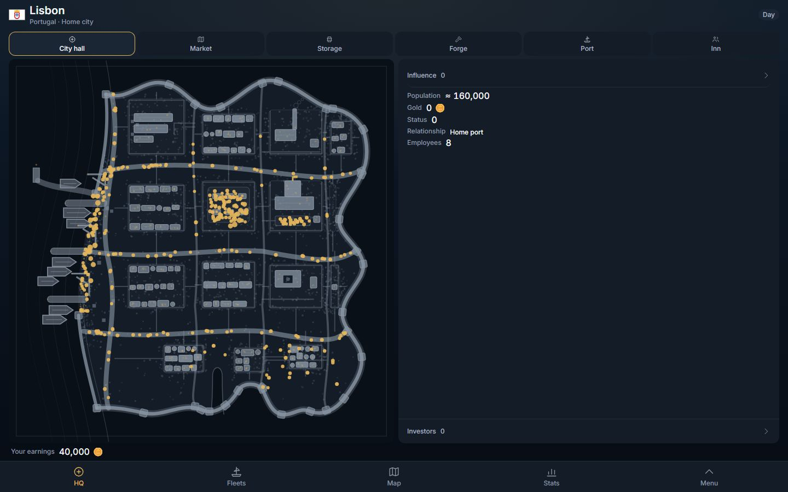
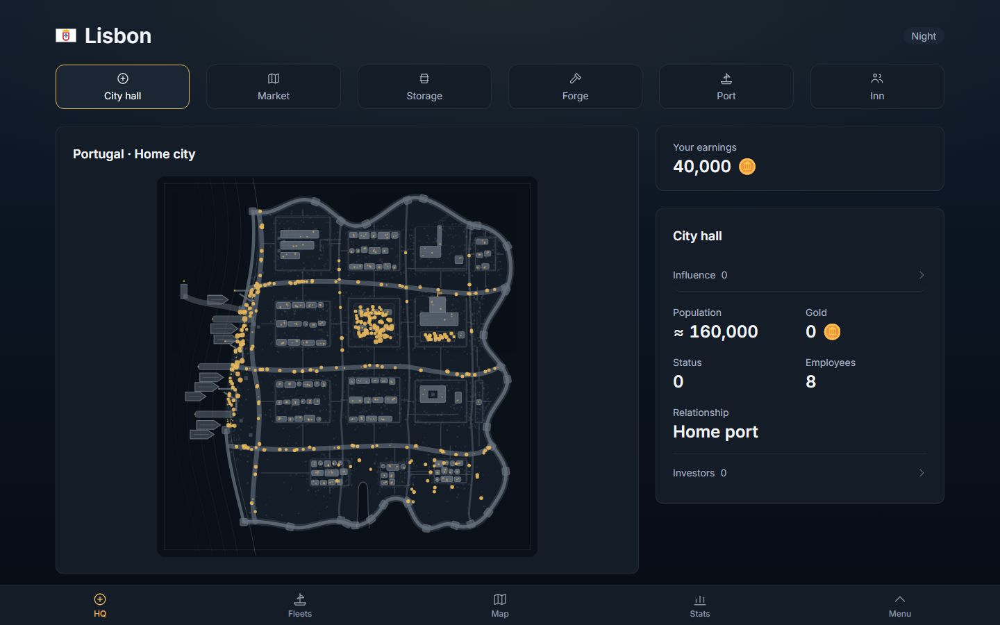
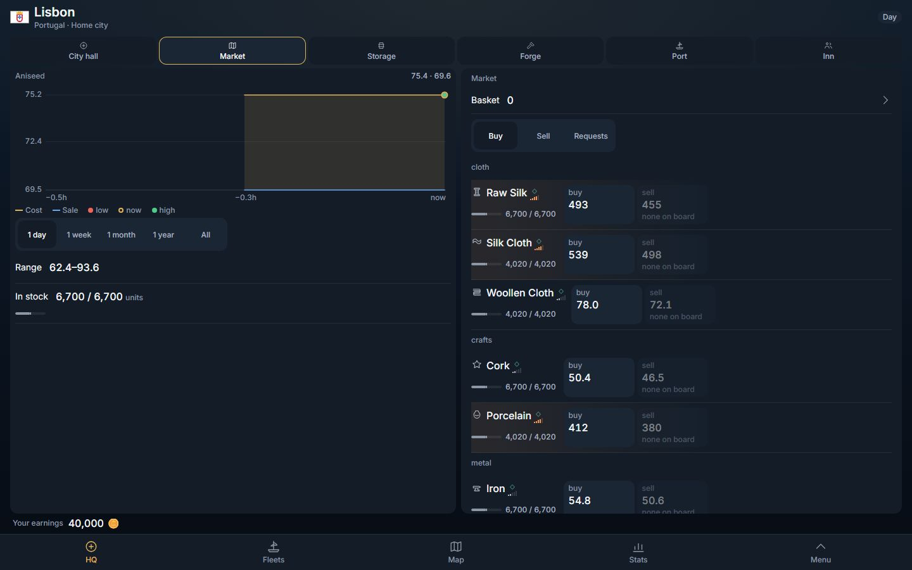
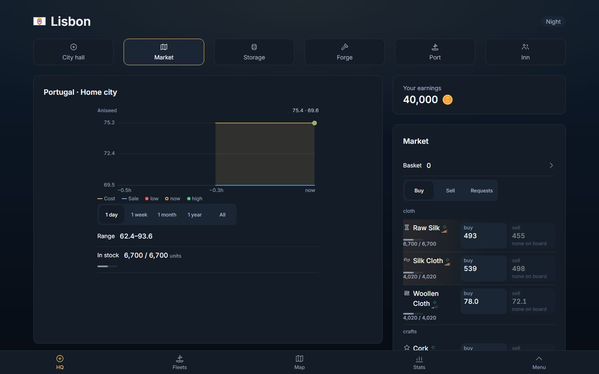
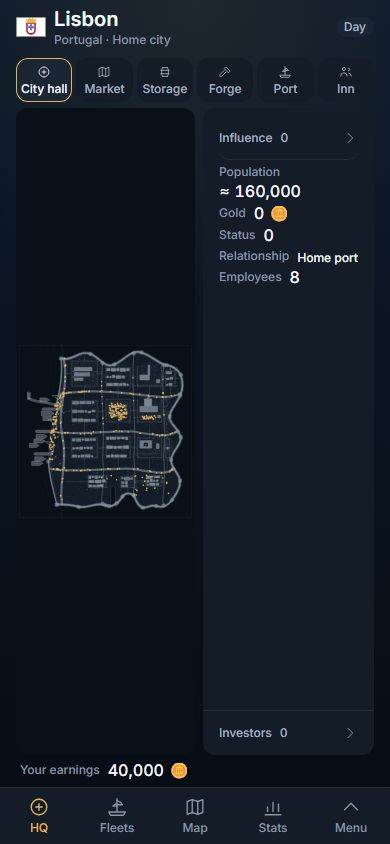
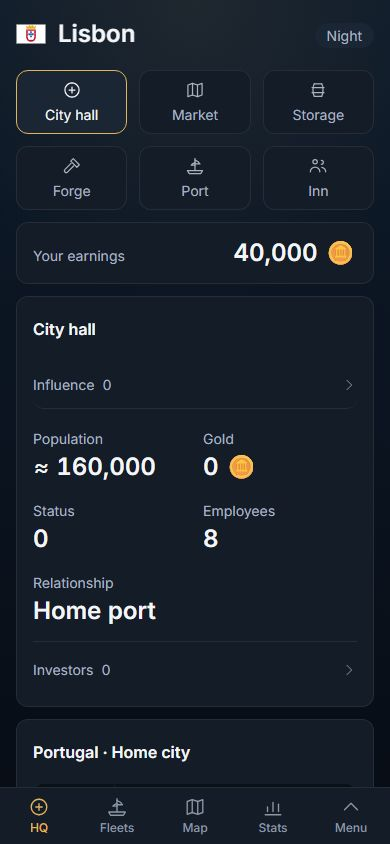
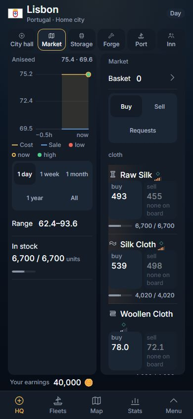
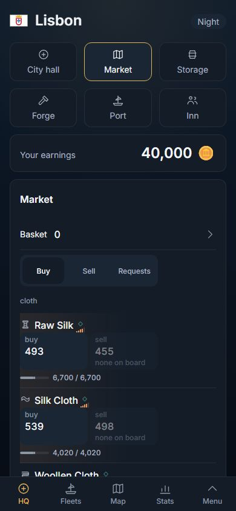

# The HQ, redesigned: the page pattern (2026-11-04)

Owner, 2026-11-02, verbatim (row 267): *"i want you to redesign the looks of the game. for example stats, it looks so wrong. The past was better. right now everything is on left, too packed. this was a mistake"*. Stats took the page first (#466, `docs/dev-log/2026-11-02-stats-design.md`), then the Codex (#473), History (#474), Rank (#476) and Routes (#477). The HQ (the City page, `/city`) is the next screen on the same pattern. Client-only: no migration, no served field, no read changed. Nothing outside the HQ changes look: the shared primitives are used as they are (`Sheet layout="page"`, `Card`, `PageSplit`, `StatCard`, `StatCell look="stacked"`, `Tray`); none was edited.

Direction from the owner for this slice: the earlier compaction was a mistake, **use the width, do not add density**.

## 0. What it was, what it is

**Was:** a `100dvh` frame outside the AppShell: a header, a row of six small tiles, then the plan (50 %) beside the open place's panel (50 %), your purse as one line under them, then the rail. Every panel scrolled inside itself, rows were pitched at the 44-px floor, the hall's five figures were 16 px hugging their words. At 1,440 the hall panel was a 700-px card with about 130 px of text in it and 600 px of nothing.

**Is:** a page (`Sheet layout="page"`; the document stays flat, the sheet scrolls).

1. **Title** is the city's flag and name at 30 px (24 on a phone), the day/night chip on its right.
2. **The six places** are a row of cards across the page (64 px tall, 20-px icons, 14-px words; three across and two rows on a phone). Always there; a press moves nothing here.
3. **MAIN | SIDE** from 1,024 px, the side being the tray's column (352 · 384 · 416 px, the shared `--page-side`).
   - MAIN: the plan, on the left as the owner ordered on 2026-10-31. It is a card under the nation line, the plan a square that never exceeds the first glass (`clamp(20rem, 100dvh − 22rem, 44rem)`), so the whole town stands above the rail at 1,024 and up. When the market is open the plan's place shows its chart.
   - SIDE: your purse as a stat card (24-px figure), then the open place's panel as a card titled with the place's word. The hall's five figures are two across at 24 px with 14-px labels over them; Influence and Investors are 48-px rows. Faces keep their own rows; the summary rows are 52 px (they were 44).
4. **Below 1,024 px** one column, the panel BEFORE the plan (the Codex's lesson: the thing you act on is on the first glass); the market's chart stands at its own height there so it does not scroll inside itself.
5. **The investors drawer** is a docked tray: from 1,024 px it slides over the side column, the same x and width, and nothing behind it moves. It was the map's full-height `side` panel (39 rem wide) standing over the plan as much as the panel. Below 1,024 it is the tray's bottom sheet.
6. **No scroll trap:** no panel, face or chart card scrolls inside itself; the page scrolls.

Nothing was removed: the same test ids (city-screen, city-name, city-phase, city-header, city-buildings, city-building-grid, the six tiles, city-info-image, city-summary, city-hall-panel and its five figures, city-face-panel, city-rail) are on the page. New: `city-page` (the sheet), `city-plan` (the plan card).

Pictures (headless Chromium, dark, DPR 1, the local world; before = origin/main `30606229`):

| | BEFORE | AFTER |
|---|---|---|
| Hall, 1,440 |  |  |
| Market, 1,440 |  |  |
| Hall, 390 |  |  |
| Market, 390 |  |  |

## 1. The test, red then green

`tests/hq.design.spec.ts`, in the style of `stats.design.spec.ts`, read by the same apparatus (`design.fixture.ts`): all six places at 1,440 · 1,280 · 1,024 · 390 · 320, in English and Korean, plus the drawer at the same five glasses. Laws: (a) width used, (b) the defect rules, (c) hierarchy (hall figures 24/13 px, summary rows 52 px and at most 36 rem), (d) the drawer moves nothing and stands over the side column, (e) the side is used (purse and panel in it, plan in main), (f) no scroll trap, (g) the panel before the plan on a phone, (h) the plan whole on the first glass from 1,024.

**Red:** run against the build of origin/main `30606229` the ten walks all fail (the run was cut short by the machine's memory guard at test 11 of 15, so the five drawer tests were not run on the old build). Typical lines, 1,440 English: the five hall figures 16 px with 12-px labels, no side column, purse and panel not in a side, the market's chart card scrolling inside itself (1082/703), the port and inn summary rows 44 px and 664 px wide. Law (a) was already (almost) green on the old frame: 24 px empty at the right against 20 at the left; it is a guard here, not part of the red.

**Green:** against this branch's build the ten walks pass and the five drawer tests pass (the final build was run as: the full file once, then the drawer tests again after the drawer's one change; the walks were not re-run after that change, which touches only the tray's mode).

## 2. Old specs this changes, and why

Row 267 reverses the compaction order those specs held (*"more compact with full detail"*, 2026-11-01): the frame never scrolls and the panel does inside itself, the plan always left of the panel, one shape of height for all six. What they were right about stands.

- `tests/city.page.spec.ts` (phone): "the plan is left of the panel" is now "from 1,024 the plan is left of the panel; below it the panel stands above the plan". Same at the pressed-face check.
- `tests/city.audit.spec.ts`: the same split law, the "panel shorter than the glass" law dropped (a card has its content's height), and "one shape for all six" compares x and width (the columns hold still), not heights.
- `tests/consistency.spec.ts` (HQ at 390 / 320): "no dead band between the figures and the rail" (the 100dvh frame) becomes "the rail stands at the glass's foot"; the doors-above-the-split law stays.
- `tests/city.density.spec.ts` is DELETED. It was written for the order *"more compact with full detail"* (2026-11-01) and held exactly what row 267 reverses: the figures hugging their words, the hall panel and faces never scrolling, a 44-px row pitch. What it was right about is held by `hq.design.spec.ts`: nothing removed (the five figures, the tiles, the purse, the panels), no overlap, 44-px controls, the frame (tiles, rail) not moving on a press.
- Run on the final build and passing, unchanged: `city.phone` (13), `city.nocity` (5), `desk.city` (4), `nav.geometry` (4). `city.page`, `city.audit` and the `consistency` HQ tests pass after the edits above.

## 3. What was not verified

- Only the local (PGlite) world, canary data: Lisbon, a home city. Cities without an inn, yard or forge, and a played world with investors, were not looked at.
- The two Korean glasses of the old specs were run only where those specs carry them.
- Pixel ratio 2 and light scheme were not measured.
- The stock gauge in the market's side card sits close to its figure at 416 px; the overlap law passed, but it is the tightest place on the page.
