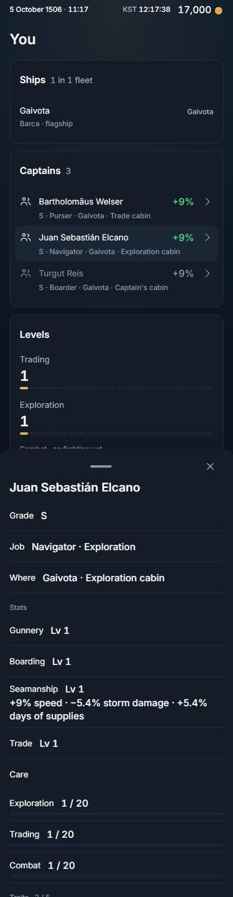
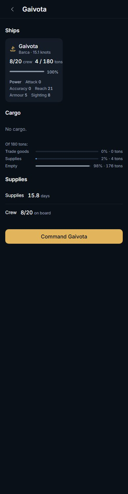

# A captain has a sheet (migration 0337, W3, owner row 288, a read)

Owner, 2026-11-05 (row 288): *"we also need levels and stats for characters as well as ships ... these factors will be the power and ability of each company / ships. captains should also have stats."* `docs/WORLD_POWERS.md` section 2.4 designed it, W3 of the build order. Levels went live on 2026-11-06 19:50 UTC (`levels_bite` true), so a captain's level now bites. This slice reads it and lights nothing.

**State: built, a read, PR open, not deployed.** No table, no knob, no switch, no row. The server read and the client lines land together in one PR: a half of it is worse than none.



## What was built

**Server: `world.captain_stats(p_code text)`.** One function, `STABLE`, `SECURITY DEFINER`, granted to `authenticated` and nobody else, exactly as `world.levels()` (0325). One hunk: the client registry (`public.client_rpc_entry_points`) gains the one row, at the head of the list as 0310 and 0331 put theirs. It answers for the caller's own signing of the officer named by the code.

```
{ code, seated, stats: [ { stat, track, level, parts: [ { effect, pct, line } ] } ] }
```

| Stat (EN / KO) | Her level | Parts it carries |
|---|---|---|
| Gunnery / 포술 | Combat | accuracy, reach |
| Boarding / 백병 | Combat | attack |
| Seamanship / 항해 | Exploration | speed, storm, supplies |
| Trade / 교역 | Trading | hold, spread |
| Care / 돌봄 | none | crew_saved, homesick_relief, hospitality |

- A **level** is `public.captain_level` (0160), never above her company's in the same track.
- A **part** is her own term: what `public.crew_terms` (0157) gives for her seat, in per cent. That is `greatest(base, the grade's floor once promoted) × the trait's mult × her level × her cabin's rate × homesickness`, the arithmetic `public.crew_pct` sums and `world.crew_bonuses` lists by source. So the sheet is the lines of `crew_bonuses` that are hers, grouped into five stats. No rule of what a captain is worth exists twice.
- A **line** is `public.trait_effect_words` over the effect's own words in `public.crew_effects`: "+9.5% speed", the server's English, as every trait line on the card is.
- **Hospitality** is `world.skill_pct(company, null, 'homesick')`, the call `crew_terms` makes. It is the company's, so every seated captain of a company reads the same number.
- The five groups are decided in **one place**, the `values` list in the function. The client regroups nothing.

**Client.** The five lines on the existing captain card (`src/live/CaptainStats.tsx`, mounted in `CaptainSheet`, under her grade, job and seat): each is a label, her level as `Lv 3` (the word `ship.level` already owns), and under it the server's lines when she adds to that stat. A stat that adds nothing shows its level alone. Care has no level, so it shows nothing beside its label. While the first read is on the wire a block the height of five rows stands in its place, so the card below does not jump. `useCaptainStats` is the one door (`useServedRead`, as `useNavyShipCard`). `worldCaptainStats` is added in `catalog.ts`, `types.ts` and `index.ts`, and pinned in `tests/rpc.surface.spec.ts`.

**The Power line** (section 2.3, client only): one caption line on `ShipTile`, "Power Attack 130 Accuracy 59 Reach 70 Armour 30 Sighting 8", the five fighting figures from the ship the server served. The callers hand over the ship itself (`power={ship}`): a fleet's page, a merchant's sheet, a cargo ship's, a navy ship's. Her hull and her crew are the tile's own bar and figure just above, so they are not said twice. No total, no new number.



Words, English and Korean, through the dictionary: `Stats / 능력치`, `Gunnery / 포술`, `Boarding / 백병`, `Seamanship / 항해`, `Trade / 교역`, `Care / 돌봄` (`books`), `Power / 전력` (`ship`). Everything else reuses a word that exists: the five figure labels are `ship.attack` and its four neighbours, the level is `ship.level`.

## Decided by default (the owner may reverse any)

1. **A stat is a level and its parts, not a blended score.** The design writes "Combat level + grade floor × seated Gunner share". Added together, a level and a per cent make a number nothing in the game reads, and a number nothing reads is the second authority the design refuses. The floor and the cabin rate are inside each part already.
2. **A part is her own term, not a slice of `crew_pct`.** I built the slice first (`crew_pct × 100 × her terms / the crew's terms`, so the captains of a crew always add up to the crew's answer). It is wrong to ship: see the cost below. **A cap is the crew's, not hers.** `crew_pct` caps the sum of a crew's terms at the effect's cap (25 %) and Command lifts it. Below the cap and with no Command, the parts of a crew add up to `crew_pct × 100` to the digit. Above it, `crew_pct × 100` is the least of their sum and the cap, and a part above the cap still reads whole. The crew's total stays `world.crew_bonuses`'s.
3. **By officer code, not a signing id.** Every captain verb names the officer (`cmd.captain_traits_set`, `cmd.promote_captain`, `cmd.seat_captain`). `world.captains` serves no signing id, and adding one would have moved a live body for nothing. A caller who keeps no such captain, a signed-out caller and a code nobody keeps read null: a blank, never an error, never another house's captain.
4. **Blank, never 0.** She sits nowhere: every part's `pct` is null (no crew to bring a term to), her levels are still served. No experience row: level null, not a made-up 1. A ship effect (accuracy, reach, attack) while `combat_bite` is off: null, because it does nothing yet. She sits and the role is not hers: a true 0, and no line.
5. **Trade counts hold and spread only.** The 17 category traders add per good (`category_spread`), and the design lists "hold and spread". A Gem trader's Trade stat is her Trading level.
6. **Nothing for an NPC captain.** She is nobody's signing; her hull fights on class, level and gear.
7. **The Power line goes on all four tiles** (own fleet, merchant, cargo, navy), because one component draws a hull and the ship is the same object in all four. That edit is in `src/components/ui`, so CI's rule A selects every browser spec on this PR (140 of them, the selector's count). That is the net doing its job, not a mistake.

## Prod, read only (2026-11-07 ~02:30 to 03:10 UTC)

Every probe was a file shaped `begin transaction read only; <one statement>; rollback;`, run from the main clone, after the volatility of each function was read in its own call: `crew_pct`, `crew_terms`, `captain_level`, `player_progress`, `world.skill_pct`, `world.crew_bonuses` are all `s`; `trait_effect_words` and `skill_scale` are `i`. EXPLAIN ANALYZE ran only on those.

**What prod holds.** 512 signings, of which 1 is a human's (GARCIAORTA, ashore, no seat); 511 are merchants' and seated. `captain_xp` has that one row, and every captain's level is 1 in all three tracks. The busiest human has 300 ledger rows. So no captain on prod can show a level above 1 yet, and the one real card would show a blank where she adds nothing.

**What it costs.**

| Call | Reads (ms) | What it tells |
|---|---|---|
| `player_progress`, busiest human | cold 688, then 22.9, 20.9, 22.4, 27.2, 22.5 | one read per track above level 1 |
| `crew_terms`, a three-captain merchant fleet | 59.1 (cold), 32.2, 40.4 | 2,440 buffers; the joins are 0.74 ms, the helpers are the cost: `wc_num` 2.7 ms each, `captain_level_mult` 3.4, `cabin_focus` 2.1, per row |
| `crew_pct`, one effect, the same fleet | 45.6, 134.1, 91.1 | one `crew_terms` inside, plus its own reads |
| `world.crew_bonuses`, the same fleet (the read the app already makes) | 163.6, 311.9, 235.9 | for scale |
| `world.skill_pct(company, null, 'homesick')` | 13.9, 8.9, 20.3 | Hospitality |
| three `captain_level` calls, the one human signing (level 1) | 14.6, 8.8, 4.4 | |
| **the sheet's body on a seated captain of that fleet (her terms and Hospitality)** | **42.6, 41.1, 48.8, 118.9, 57.2, 46.5** | **median 47; five reads of six 41 to 57** |

**So one card costs about 47 ms (her terms, Hospitality) + 4 to 15 ms (three levels at level 1) = about 55 to 65 ms**, typical. Each track above level 1 adds a warm `player_progress`, about 22 ms: **a captain levelled in all three tracks would cost about 120 ms**, over the 100 ms target. No such captain exists today. The cold first `player_progress` (688 ms) is paid by `world.player`'s poll first, so it is warm for any active player.

**The design I threw away.** Her slice of `crew_pct` calls `crew_pct` once for every part she has, and each call reads the whole fleet's terms again (45 to 134 ms): 150 to 500 ms to open a card, against `crew_bonuses` at 164 to 312 ms that the app already pays on its polls. It stood in the file for one measurement and is gone from it; the header says why.

**Local (PGlite, this PC).** a sheet takes a median of 20.7 ms (a seated captain with three active traits) and 19.8 ms (a Gunner and Boarder), and 0.8 ms for a captain the caller does not keep. One `crew_terms` of the fleet is 18.9 ms and one `crew_pct` 19.5 ms, so the sheet costs one `crew_terms`, as built. The slice-of-`crew_pct` design measured 123.3 ms and 79.4 ms on the same world. PGlite is a floor, not a forecast: prod ran the same body about 2.3 times slower (47 ms against 20.7 ms) on a real fleet.

**If it must be cheaper.** In order of size: read `player_progress` once for the three tracks instead of up to three times (a hunk in `captain_level`, a live body, not this slice); drop Hospitality from the sheet (about 10 to 20 ms, and it is the company's number anyway); cache a fleet's terms for the beat (a new thing, not this slice). None is needed at today's data.

## What is pinned, and how

- **Proof 44** (`scripts/db/proofs/44_a_captain_has_a_sheet.sql`, 11 markers, about 40 s on PGlite): a probe company of nine signings in two hulls, three company levels made different on purpose (exploration 4, trading 3, combat 2), a promoted captain, Command and Hospitality. `SHEET_DOOR`, `SHEET_SHAPE`, `SHEET_EQUALS_CREW` (12 effect-and-hull sums equal `crew_pct × 100`; six captains alone in a crew read it exactly), `SHEET_AMOUNT` (16 parts worked out here from the tables: base × level × cabin rate, a promoted C on her B floor, equal to `crew_terms` and to the sheet), `SHEET_CAP`, `SHEET_LIFT`, `SHEET_LEVELS`, `SHEET_BLANKS`, `SHEET_DARK`, `SHEET_FIGHT_BYTES` (30 seeded fights byte for byte the same after 18 reads, and the same fights differ when the Gunners are taken away, so the comparison can fail), `SHEET_READ_ONLY` (stable, and `pg_stat_xact_user_tables` counts 0 tuples written).
- **The migration's own self-assert**: the catalog (nothing else moved: functions, knobs, relations; volatility, definer and search path equal `world.levels()`'s; the grants equal its ACL; the registry row once, reversing), then a probe house of its own rolled-back rows. No money moves and no harbour's purse is touched, so it runs on prod's closed economy as on CI's open one.
- **Red first, and 30 breakages** (`scripts/ops/harness/captain-sheet/`): proof 44 on the world with no file is red (`world.captain_stats(unknown) does not exist`); with the file, green; then 30 deliberate breakages, each required to go red for its intended reason: 11 of the file's own asserts (not STABLE, not a definer, anon may read, the registry row missing, the hunk not reversing, the body not what it was cut against, another function moved, a knob moved, a table appeared, the probe not rolled back, a lone captain not reading `crew_pct`); 15 of the function (the part is the whole crew's answer; another captain's term is counted as hers; the part cut at the cap; Gunnery under the wrong track; Gunnery reading the Trading level; Seamanship reading her own level, not the company-capped one; Gunnery and Boarding swapping effects; a stat losing the storm; a signing with no xp row reading 1; a captain ashore reading numbers; a ship effect read while combat is off; Hospitality read while skills are off or for a captain ashore; a part of 0 carrying a line; **the read writing an event while still declared STABLE**); and 4 of the live rules the proof leans on, applied after the file: **the grade floor lifting someone never promoted, the floor one grade too high, a level worth one level less, a cabin off her focus worth as much as her own**. The last four are the ones where the sheet agrees with the reader it composes, so only a number worked out from the tables can see them.
- **`before.sql`, `after.sql`, `after-call.sql`**: each one read-only statement, run once each on prod before this PR (the outputs are in the PR). `after.sql` also runs clean before the deploy and shows the function absent.
- **`tests/rpc.surface.spec.ts`**: the catalogue and the registry agree in both directions with the new row (29 pass).
- **`tests/captains.sheet.spec.ts`** (7 tests, 390×844 and 1440×900, English and Korean): three real captains seated through the game's own doors by a patched world (`tests/captainSheet.fixture.ts`, nothing stubbed). Each card shows the five stats in the server's order, in the app's words, with `Lv 1` (none on Care), and the server's lines where she adds (`+9% speed · −5.4% storm damage · +5.4% days of supplies` for the Navigator), **each line also found on her trait rows, which print it by another server path**; no line where she adds nothing; the tray's width law with the five rows in it; the roster behind the card not moved by a pixel when a card opens and closes (pressing SELECTS). The Power line on a hull's tile is five words and five numbers that equal what the ship's own panel prints in its Spec, and the fleet's page keeps its Back. This slice adds no screen, so the cycle is the one it sits on: the card's ✕ and the fleet page's Back, both exercised.
- **Words and i18n**: `tests/words.spec.ts`, `tests/i18n.keys.spec.ts`, `tests/duplication.spec.ts` (migration shape, supersede rule), `tests/sections.spec.ts` pass.
- **Existing captain specs** pass with the sheet in the tray: `captains.roster` (a real Inn hire, the tray law at three glasses), `captains.codex`, `captains.catalogue`.

## What is NOT verified

- **Prod cost of a levelled captain.** None exists. The 120 ms figure is arithmetic from one `player_progress` timing (22 ms warm), not a measured card.
- **The sheet on a real seated human captain on prod.** The one human captain is ashore. The sheet was priced on a merchant's seated captain's fleet, with the same function arithmetic emulated as a statement; the function itself cannot run on prod from a read-only file (it needs a caller's identity). `after-call.sql` runs it once after the deploy, for the null answer.
- **The migration's probe on prod.** It builds a house of its own rows (`players`, a fleet, a ship, a signing) inside the deploy transaction and rolls it back. It moves no money and touches no harbour's purse, and it passed on PGlite with 0336 in the chain, but prod has not run it. If it fails there, the push fails and nothing is applied.
- **Korean wording by a reader.** `포술 백병 항해 교역 돌봄 능력치 전력` are mine. **`항해` is also the nearest word for the company skill `항해술` on the Levels page**, which prints "Seamanship" for a different measure (the company's skill, not a captain's). The design fixed both words; the owner should see them together.
- **The Power line on a merchant's, cargo ship's and navy ship's tiles in a browser.** `ShipTile` is shared and those callers pass the same served object, but `map.merchants.spec.ts` needs the merchants-on world and was not run here. CI runs it (rule A).
- **The whole suite.** Run here: the new spec, `rpc.surface`, the captain specs, `you.design`, `fleets.you.grow`, the pure structure specs. CI runs the rest on this PR.
- **That the five groups are what the owner wants.** They are the design's. "Combat level + grade floor × share" was not built as a number (decision 1).

## Deploy

Prod head is 0336. This is 0337, a read: `~/bin/bv-deploy.sh <pr>` after CI is green, then `after.sql` and `after-call.sql`. Nothing to light, nothing to watch: no job, no beat cost, no knob. Rollback is a forward migration dropping `world.captain_stats(text)` and reversing the registry hunk (the hunk reverses to its pre-image, asserted).
