# Trade flow 1 — five fixes to the Trade home screen (2026-11-11)

Slice "trade-flow-1" of `docs/SUCCESS_PLAN.md` §A (T1, T2, T3, T8, T9). Client only: no migration, no knob, no flag. Built first on #589 and #590; re-applied on main (2026-11-12, branch `trade-flow-2`) after they, #583, 0351 and 0352 landed.

A played audit of the Trade screen (a new company at Lisbon, a phone at 390×844, a laptop at 1,280×800, English and Korean) found five places where the screen was a dead end, said something false, or moved under the thumb. Each has one law in `tests/trade.flow.spec.ts`.

## T1. Your cargo was a dead end

**Before.** A city row pressed on the Your cargo page lit up and nothing else happened. The Sail & sell tray had opened, but on the Trade screen, under the full-screen page. `pressCargo` (`Trade.tsx`) never closed the page it was pressed on.

**After.** The row closes its page, so the tray shows. Closing the tray (its Back) opens the page again; the page's Back returns to Trade. A trade done from that tray does not reopen the page.

| | before | after |
|---|---|---|
| the row pressed | 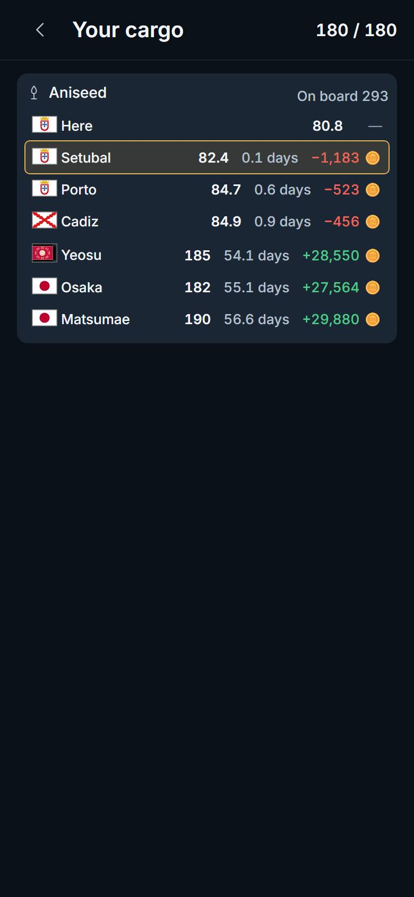 | 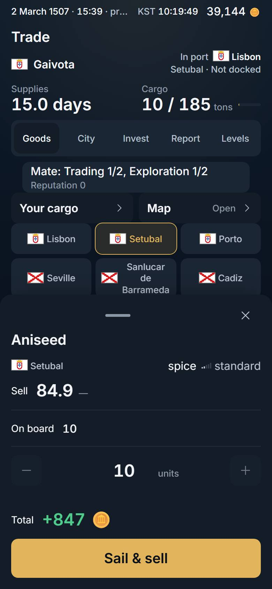 |

Measured (all four runs): after the press the cargo page count is 0, the tray's button is on the glass and nothing lies over its middle; after the tray's Back the cargo page is visible again; after the page's Back the board is visible and no tray stands.

Two older specs pressed a row and then closed the page by hand to reach the tray (`command.sellCargo.spec.ts`, `trade.map.spec.ts`). They now assert the page is already gone.

## T2. "No buyer" was false

**Before.** With none of a good aboard the card's sell cell said "No buyer". The city does buy it: `world.market` serves the bid (`sell`) for every good on the quay, and the Map's tray printed it for the same good. `TradeCard.tsx` printed "No buyer" whenever the units aboard were 0.

**What the server serves (checked first).** `tradeRows.ts` keeps `row.sell` for every good the city sells (`listedHere` is true for every available good, aboard or not). So the bid was already at the card; the card hid it. No migration needed.

**After.** The cell prints the bid, quiet (the faint ink), whenever one is served. Its title says "None on board", the card's own "On board 0" stands above it, and Sell stays dead. "No buyer" is kept for the one case it is true: no bid is served for the good at that city.

| before | after |
|---|---|
| 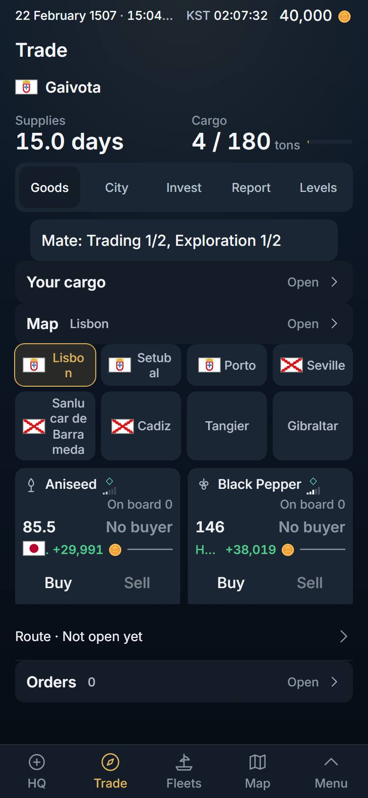 | 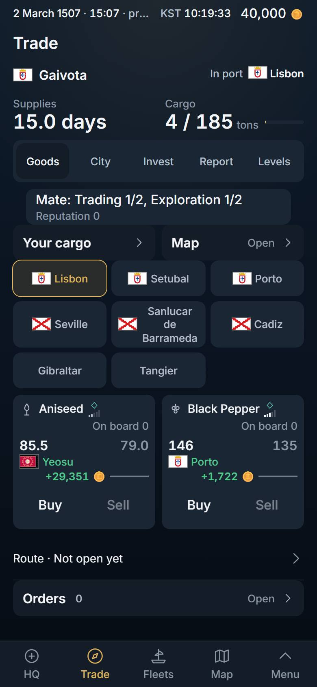 |

Measured at Lisbon, a new company: before, 10 of 10 cards said "No buyer"; after, 10 of 10 print a bid, each under its own ask, and 0 say "No buyer".

## T3. At sea, Trade did not say so, and opened a waypoint's market

**Before.** Under way, the board opened on `voyage.to`: the end of the leg she is on. On a far trip that is a harbour she only takes supplies at (Saint-Louis on the way to Japan), named "Not docked", with a stranger's chips and every card "Cargo full". Nothing on Trade said she was sailing, to where, or until when.

**After.**

1. **One line that says where she is** (`buysell/TradeStatus.tsx`). In port: "In port · Lisbon". Under way: "to Matsumae · arrives 02:41 · 8m" and a bar of the miles sailed. On a leg to a stop: "to Matsumae · next stop Saint-Louis 02:41 · 8m".
   - **Wide desk:** a strip at the head of Trade's left pane.
   - **Phone:** beside her name, in the fleet picker's own 44-px row (`FleetStrip`'s new `trailing`, `CommandScreen.tsx`). A strip of its own was built first and measured: the Trade face then scrolled its sheet by 58 px at 390×844 (775 in 717), which the owner's one-page law forbids (`tests/onepage.spec.ts`: the tab's own sheet never scrolls; #589 had left 22 px). Beside her name it costs no line: 717 in 717, in port and under way.
2. **The board stays on her destination** while she is under way, never a stop on the way. The strip, the board and the first chip are the same city.

**One authority each, none copied.** Which state she is in and the words "to X" are `domain/fleet`'s `whereabouts` and `whereLine`, the same reading the Map's fleet tray (`features/map/fleetLine.ts`) and the Fleets row use. It already lives in `src/domain`, so nothing had to move. The bar is `voyageFraction`. The destination past the stops is new: `boundFor` in `domain/order/trip.ts`, beside `orderTrips`, read from her own queue (the SAILs that follow the leg she is on, up to her next order that is not a SAIL).

| | before | after |
|---|---|---|
| a far trip, Korean | 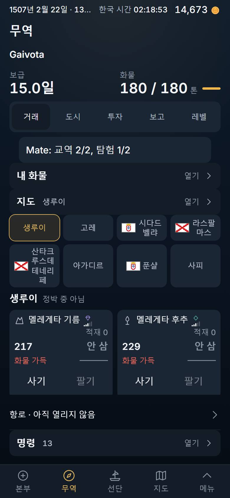 | 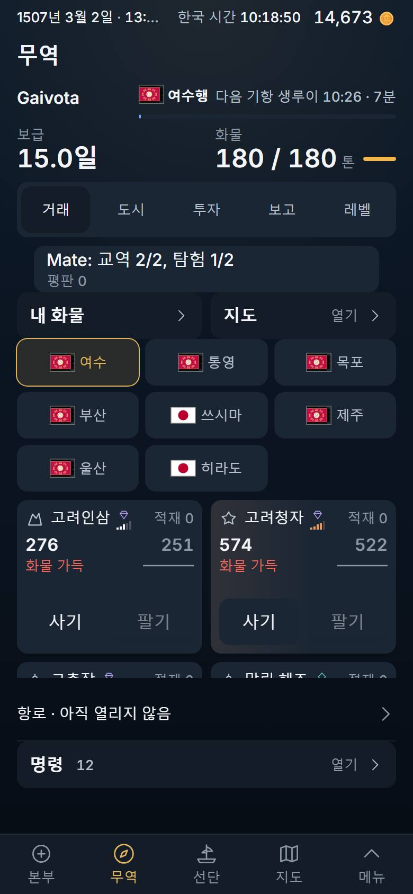 |
| a near trip | (no sailing state) | 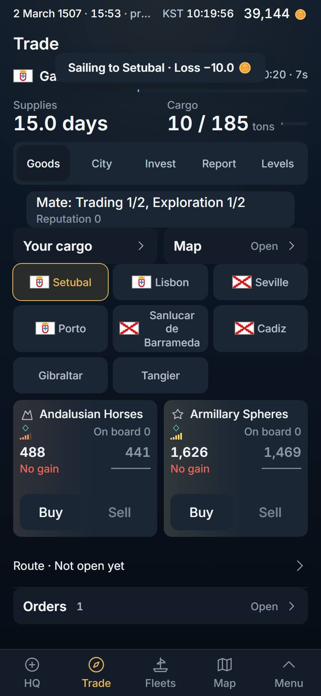 |
| the laptop | | 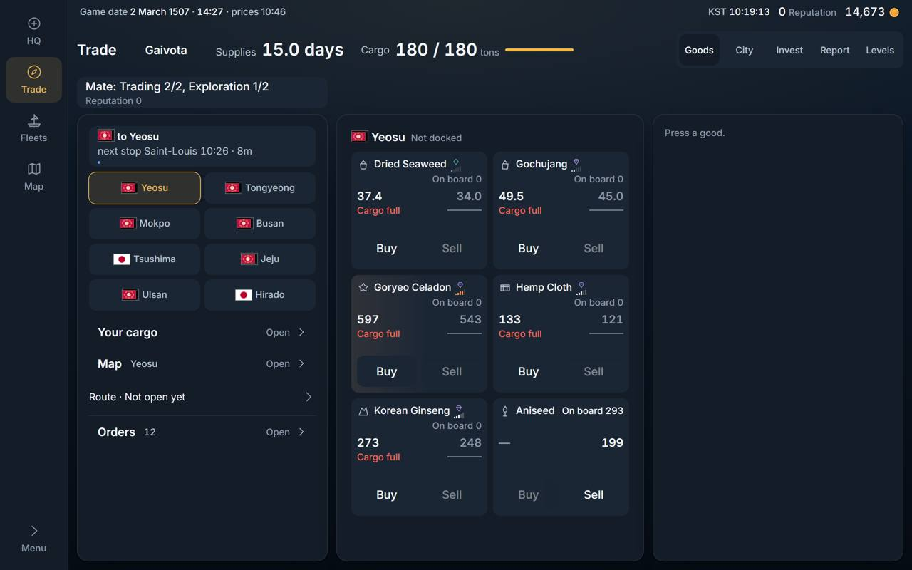 |

Measured on a far trip (a best sale at Lisbon pressed, 13 orders): before, the board was Saint-Louis (SAI) and its chips were SAI, GOR, CID, LPA…; after, the strip's destination, the board and the first chip are Matsumae (MAT), the next stop is SAI, and SAI is not among the chips.

## T8. No jumps

**Before.**

- A chip pressed was moved to the second cell (the list was "where she lies, the city in hand, then the nearest"), so the cell under the thumb changed its name as it was pressed. After a trip the list was sorted again from the new port.
- The line "Setubal · Not docked" stood only where she did not lie, so pressing another city pushed every card 30 px down and pressing her own pulled them back.
- On a phone the goods scrolled inside a pane of their own, 144 px high (`max-h-[9rem]`): 2 of Lisbon's 10 goods showed. **Not changed: see below.**

**After.**

- The chips' order is a fact of her place alone: her port, or under way her destination, then the nearest harbours. A press only marks. A city in hand that is not one of the eight (pressed on the map, or a cargo row's far city) takes the last cell, so the count and the other seven stay.
- Nothing comes or goes under the chips. On the wide desk the board's own line is always there: "Lisbon · Docked" or "Setubal · Not docked", one height. On a phone there is no such line at all: "Porto · Not docked" stands as the second line beside her name, where it pushes nothing.

| before | after |
|---|---|
| 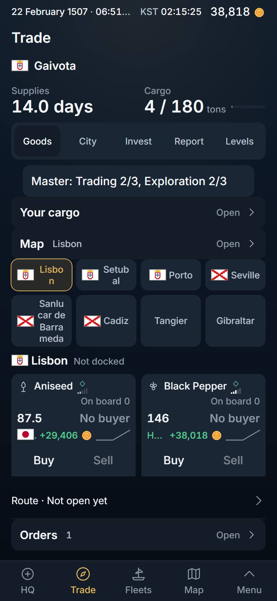 | 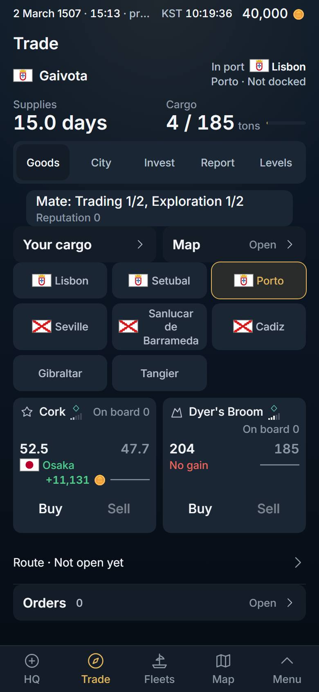 |

Measured: three chips pressed in turn, then her own. The order is the same list each time, exactly one chip is marked, and the chips' box, the board's line (wide) and the line beside her name keep the same top and height in all five states. After landing, the chips are in the order they had under way.

**Not done: "on a phone the goods scroll with the page".** The brief asked for the 144-px inner scroller to go. It was removed first (the page then scrolled, 1,512 px in 717) and then put back, because it meets an owner's law head on: `tests/onepage.spec.ts`, *"i hate to scroll down on things, make it so that all the info is packed on one page"*, law 1b, "the tab's own sheet never scrolls", measured on the Trade face at 390×844. Ten goods cannot stand whole on a 390×844 glass without one of the two scrolling. The law is kept and the goods keep their own pane, as #589 left it on main: 168 px (`max-h-[10.5rem]`, one whole row of cards), with the Your cargo and Map doors on one line. Both of #589's phone changes are still needed: without either, the face is over the glass again. Showing more than one row of goods on a phone needs the owner to choose between the two rules, or a different shape for the goods (smaller cards, or a page of their own).

**The other fold laws were read too.** `tests/layout.spec.ts` asks for two whole, priced goods above the bar on a phone; `tests/desk.inplace.spec.ts` that the desk's frame does not move; `tests/desk.layout.spec.ts` that a press opens the good in its own place and the rows above it do not move. All pass unchanged.

## T9. Figures with their units

| figure | before | after |
|---|---|---|
| a trip's days (Your cargo, the tray) | "0.1 days" | "0.1 days · 10s" |
| Your cargo's price at another city | "82.4" | "82.4 avg" |
| a buy's money on the tray | "Total −856" | "Cost 856" |
| the toast after a buy | "Bought 10 Aniseed −856" | "Bought 10 Aniseed · Cost 856" |
| the toast after a sale | "Sold 10 Aniseed +790" | "Sold 10 Aniseed · Total +790" |
| the toast after a trip queued | "Sailing to Setubal" | "Sailing to Setubal · Loss −10.0" |
| the arrival card's figure | "−1,182" | "Loss −1,182" |

- **The real time** is the existing rate (`lib/format/time.ts`: one voyage day is 90 real seconds, `voyageDaysToRealMs`) in the existing table-cell form (`formatRealShort`). `formatDaysReal` only joins the two. The brief's example read "0.1 days · 1 min"; at the served rate 0.1 days is 9 to 10 seconds, so that is what is printed.
- **"avg"**: the price on a cargo row is the served `price_each`, the average a unit of what is aboard fetches there (the bid slides as she sells). Her own quay's "Here" price is the bid now and carries no word.
- **A cost is not a loss**: one spelling for a money figure and its word (`lib/format/numbers.ts`: `moneyWord`, `moneyFigure`), used by the tray's pinned figure, the toasts and the arrival card.
- **The arrival card** prints the sale's served profit with "Profit" or "Loss" (green or red), or "Total" when the server recorded no profit.

| | before | after |
|---|---|---|
| the buy tray | 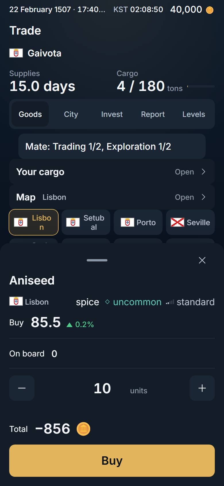 | 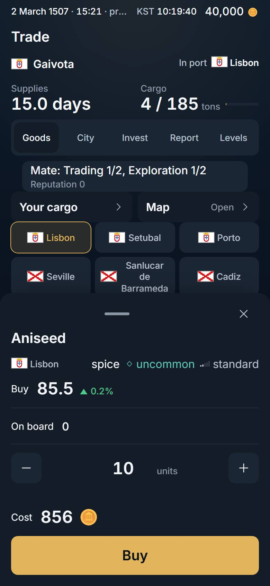 |
| Your cargo | 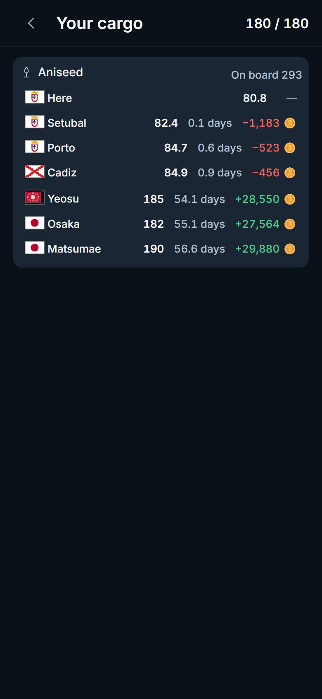 | 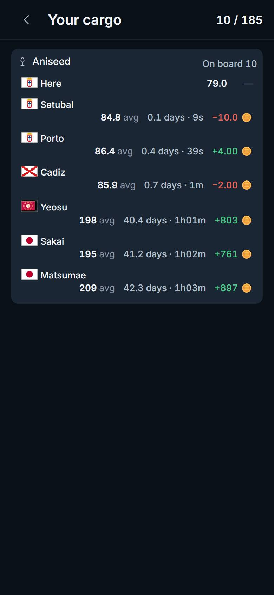 |
| the arrival card | 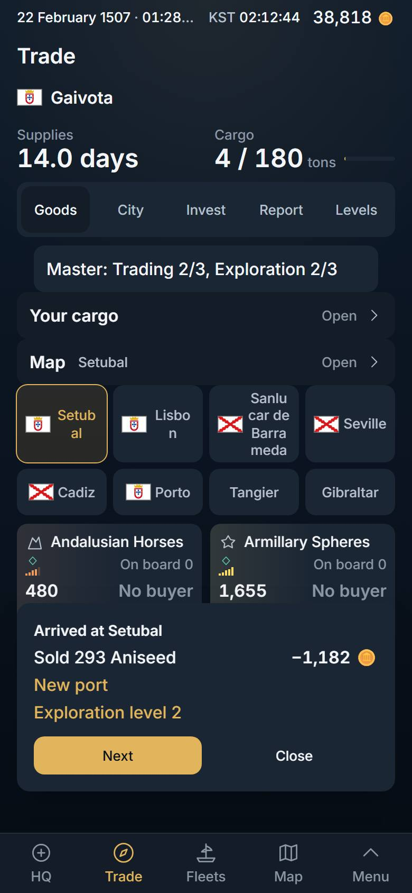 | 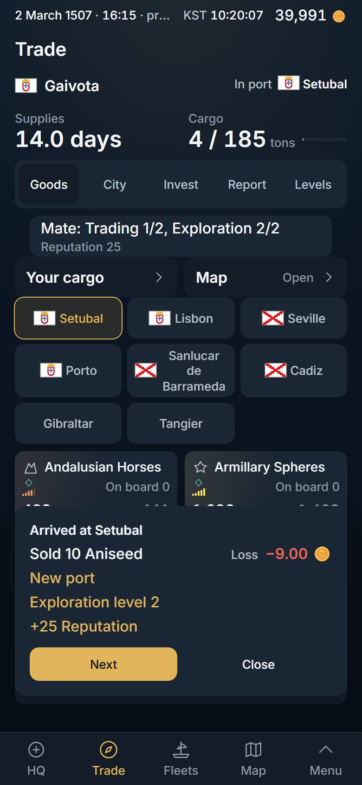 |

### Why the tray said −1,183 and the arrival card −1,182

It is not rounding. They are two different figures:

- the tray and the cargo row print the served **forecast** of `world.good_board`'s sell row: proceeds − cost − tax − **wages** − supplies (migration 0348, `world.board_sell`);
- the arrival card prints the **SOLD** event's `profit`: the sale's total − cost (0081 in `cmd.do_sell`), before tax, with no wages and no supplies.

On a 0.1-day trip the wages are 1 coin, which is the whole difference (the same 1 was measured here: forecast −10, sale −9). Both figures now go through one rounding (`formatPriceDelta`; the card used a second one, `formatDucatsDelta`), so they can no longer differ by rounding. **They still differ by the wages**, and by any move of the price between the forecast and the sale. Making them one figure needs the server to put the voyage's wages and supplies on the SOLD event (or the card to do arithmetic, which it must not): a migration, not in this slice.

## Decided by default

1. **The line does not repeat her hold.** The brief asked for "where she is and her hold" in port. The desk's own strip prints "Cargo 4 / 189 tons" right beside it, and the owner's rule on this face is one readout, one home (2026-10-31, "no info duplicate info needed"; it is why the Your cargo door carries no figure). The strip says where she is; the hold stays where it was.
2. **Under way the chips are the harbours nearest her destination.** So the list changes once, when she leaves (the board changes city at that moment too), stays through every stop on the way, and does not change when she lands. The alternative, keeping the harbours near the port she left, would show Lisbon's neighbours all the way to Japan.
3. **A far city in hand takes the last chip** rather than adding a ninth, so nothing below the chips moves.
4. **The arrival clock on a far trip is the next stop's**, printed beside the stop's name. The arrival at the far destination is not served (only the leg's is), and nothing is estimated on the client.
5. **"None on board" is the sell cell's title; the visible word is the card's own "On board 0"** directly above it. A second visible word does not fit a 123-px card's price line (the HQ Market at 320 px), and `docs/WORDS.md` bans "aboard".
6. **The tray's pinned money row changed its word and sign for a buy** (`TradePanel.tsx`, two lines inside the frame). The brief keeps the tray's frame for a later slice; this is the figure T9 names, and the frame's layout is untouched.
7. **On a phone the line stands beside her name on every desk face**, not only on Goods (it is in the fleet picker's row, which every face shares, so turning a face moves nothing). Its second line ("Porto · Not docked") shows on Goods only.
9. **On a phone a cargo row is two lines: the city, then its figures at the right.** The figures grew ("84.8 avg", "0.1 days · 10s") and beside them a name was squeezed to one word with its flag alone above it (`tests/names.whole.spec.ts` caught it). The name now asks for 9 rem first; the figures take the next line where they do not fit beside it. On the laptop they stay on one line.
8. **The clock is the device's own** (`formatClock`, the Ledger's), with the countdown beside it. The shell's top bar shows Korea's time; for the owner they are the same.

## Left, and why

- **Fleets' row still names the leg's end** ("to Saint-Louis · 8m"). Its figure is the leg's countdown; printing the far destination beside the leg's clock would be a new falsehood, and changing the row's shape is not cheap. Left as it was.
- **The best-sale line of the goods card** and `lib/rpc/types.ts` are another builder's (branch near-sale): not touched. That line still prints its profit without days.
- **`TradeToast.tsx` is not touched** (the amount is in the words it is handed, `tradeDone.ts`), so there is nothing to conflict with #583.

## Checks (the tree re-applied on main, local build, `vite preview` on port 47533, headless Chromium)

- `tsc -b`, `eslint .`, `vite build`: clean.
- One Playwright run, 190 of 190: `trade.flow` (new: 2 pure laws; the played flow and the far trip at 390×844 and 1,280×800, English and Korean), `trade.layout`, `trade.map`, `trade.home`, `trade.ceiling`, `command.sellCargo`, `command.buySell`, `command.bestSale`, `arrival.card`, `reputation`, `desk.layout`, `desk.terminal`, `desk.inplace`, `desk.sweep`, `onepage`, `layout`, `wide.layout`, `names.whole`, `shell.polish`, `city.phone`, `hq.design`, `market.shortTray`, `good.class`, `consistency`, `sections`, `duplication`, `words`, `i18n.keys`.
- Updated for the new state (a cargo row pressed closes its page): `command.sellCargo.spec.ts`, `trade.map.spec.ts`.

## A CI red on the new spec, and its cause (2026-11-12)

Run 43137152187, `trade.flow` at ko-KR 390×844: no arrival card after 300 s. The run's video shows the line reading "세투바우행 02:28 · 5분 도착" seventeen seconds after she sailed, and still "31초" when the wait ran out: the sea had delayed a ten-second passage by about three voyage-days (a calm adds 1 to 4 voyage-days, a storm 1.5: `voyage.day_delay_hours`). She had not landed, so there was no card to show; nothing was wrong in the app, in Korean, or in the card. The spec's wait was a guess at the usual passage. It is now the worst served delay and a margin (480 s), and its message prints what the line read.

The same run showed the far-trip law had gone quiet: since 0351 a card's own sale is the near one (one leg), so the "far trip" was a ten-second hop with no stop. The law now sends the card's FAR sale (the tray's "Far" row), so it is a far trip again (Matsumae by Saint-Louis, 13 orders; in Korean the first such good goes to Salvador by Cidade Velha, 3 orders).

Known, not fixed here: the arrival card stands 20 s. A player who looks away for longer never sees that sale's profit on a card (the Report and the ledger keep it).

## Not proven

- The line's fit with long names. On a phone it has the picker row's 40 px (two small lines) and what her name leaves of the row's width: "to Yeosu · next stop Saint-Louis 10:26 · 7m" fits (the sheet 717 in 717). A long fleet name with a long destination and a long stop would need a third line; that case is not measured.
- The far trip is proven for the trip a best sale at Lisbon makes in the local world. The rule itself (`boundFor`) is proven as a pure function for the shapes of queue it reads.
- The arrival figure and the tray's forecast still differ by the wages (above).
- Only the two glasses named (390×844, 1,280×800). 320 px and 1,920 px are covered for the cards' boxes by `tests/trade.layout.spec.ts`, not for this flow.
