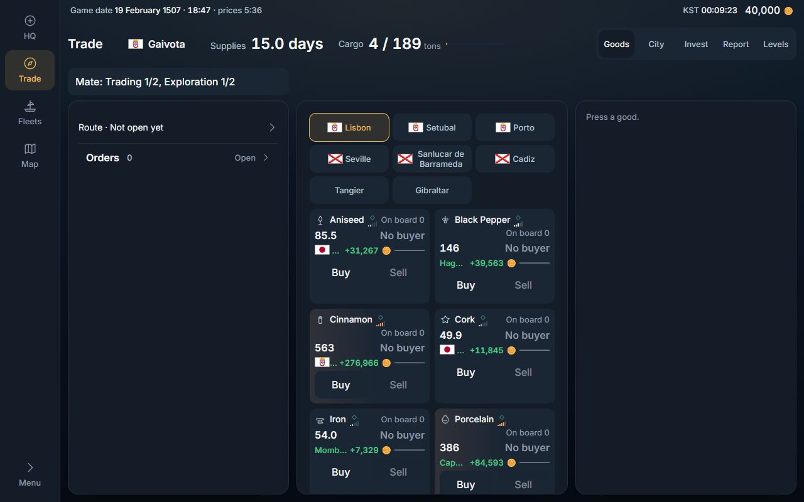
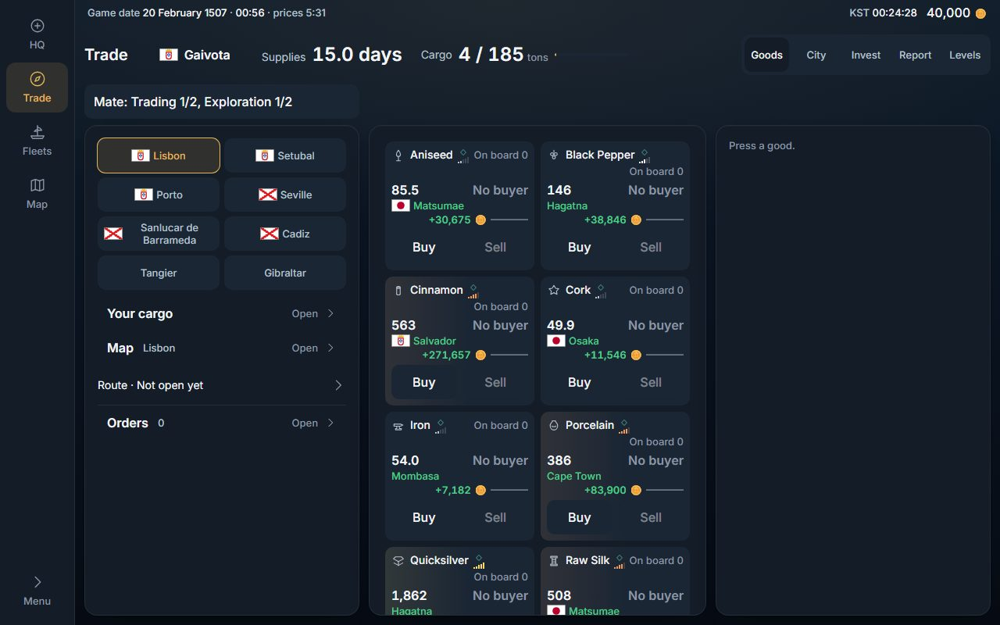
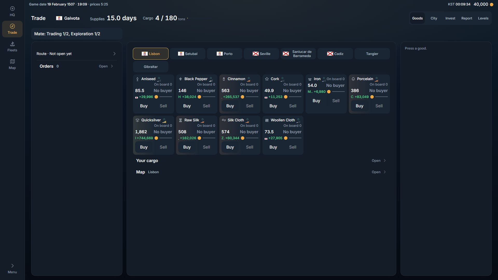
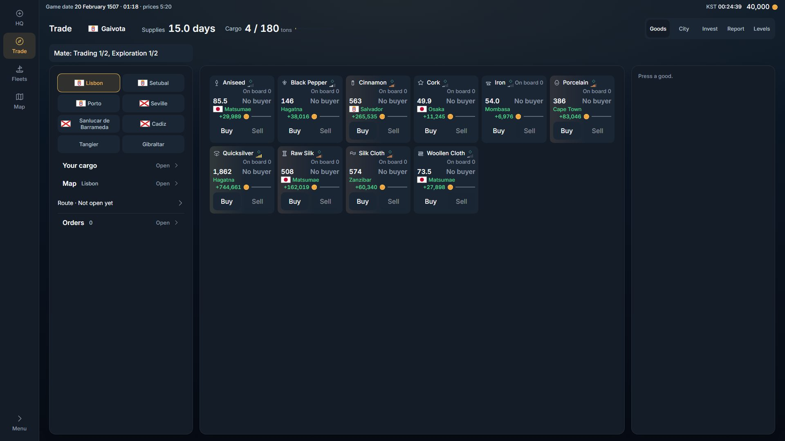
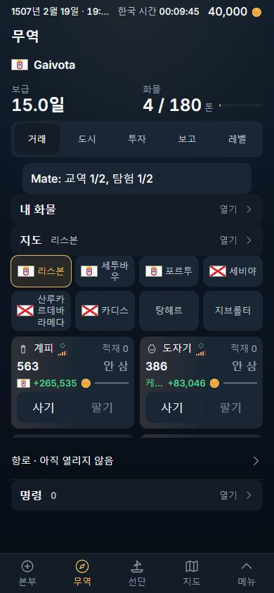
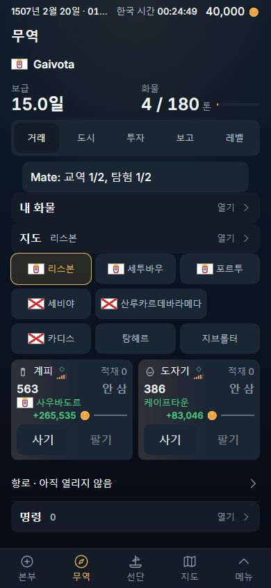
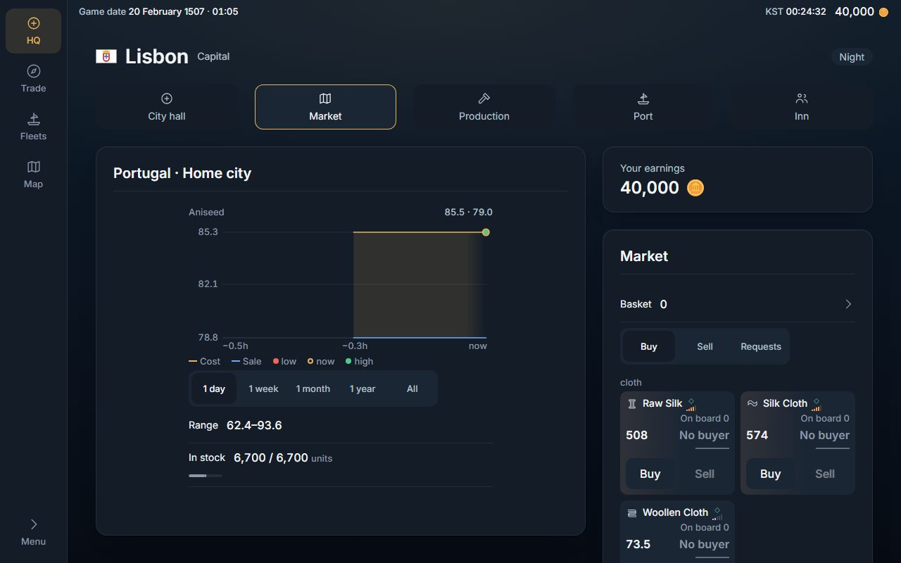
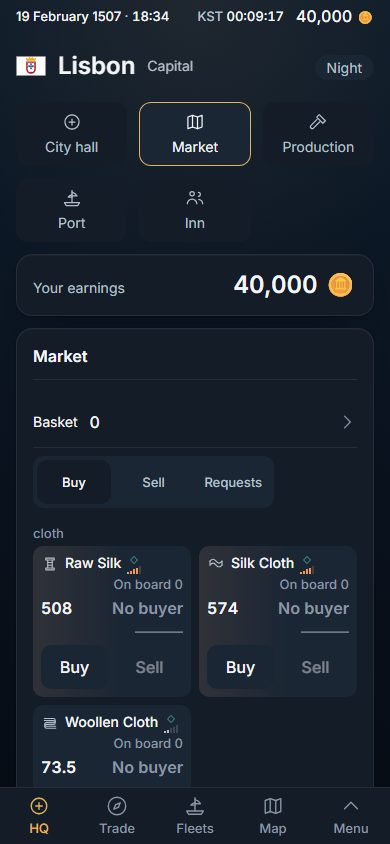
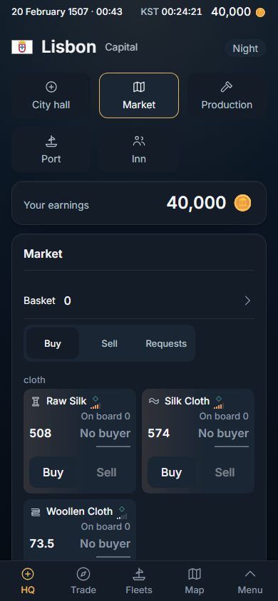

# Trade layout — the city picker keeps its words, and the wide desk uses its left pane (2026-11-11)

Two leftovers of the remaster, named in `2026-11-11-s4-type-and-surface.md` and `2026-11-11-s9-shell-look.md`. Client only; no migration, knob or flag. Built on S5 (#578, merged): it changes the same files.

## What was there (measured before, local world, a new company docked at Lisbon)

**The city picker at 390 px.** Four equal columns: a cell 85 px wide, 41 px of it for the name.

| name | before |
|---|---|
| Lisbon | "Lisbo / n" (2 lines, broken inside the word) |
| Setubal | "Setub / al" (2 lines) |
| Sanlucar de Barrameda | 4 lines, "Sanlu / car de / Barra / meda" |
| 세투바우 | 2 lines |
| 산루카르데바라메다 | 3 lines |

**The wide desk at 1,280 × 800** (the rail, then three panes: 350 · 430 · 350 px, each 626 px tall):

- left pane: two rows, "Route" and "Orders". 101 px of its 626 used.
- centre pane: the city picker (3 rows), ten goods cards two to a row, then "Your cargo" and "Map". 1,036 px of content in 626: it scrolls, and 4 cards stand whole.
- right pane: the line "Press a good." until a good is pressed. 34 px used.

At 1,920 × 1,080 the panes are 350 · 1,038 · 350: the same two rows on the left, the picker and six cards to a row in the centre (513 px of 902 used), the same one line on the right.

**The goods cards.** Every card in a row already had one height (the grid stretches them: 151 px in English, 131 in Korean). What was uneven was inside: a card whose name ran two lines pushed its own prices and buttons down 20 px, and its neighbours' stayed up. At 1,280 every row had its prices at two heights (364 and 384 px in the first row).

## What changed

1. **A grid that keeps its words** (`src/components/ui/tileStyles.ts`, `TileGrid.tsx`: `TileGrid words={3} wordsWide={2}`). The cells stand on equal columns as before, a name turns only at a space (or after its own hyphen), and a cell whose longest word is wider than a column is as wide as that word. Korean names have no spaces, so `word-break: keep-all` keeps them whole. A cell starts one rem under its column and grows back to it, so a line with one long name still holds its full count while the long cell is up to a rem over.
2. **The city picker** (`src/features/command/buysell/TradeBoard.tsx`, `CityChips`): three columns on a phone (the planned fix), two in the wide desk's left pane.
3. **The wide desk's parts** (`src/features/command/buysell/Trade.tsx`): the left pane carries where and what she has (the city picker, Your cargo, Map, Route, Orders); the centre pane carries the goods alone; the right pane is the trade panel, as it was. The three panes themselves did not move by a pixel.
4. **The goods card** (`src/live/TradeCard.tsx`, one class): the head takes the card's spare height, so the prices and the buttons stand at the card's foot, level across a row.

## Measured after

**The city picker**, for every port name the world is seeded with (`data/ports.json`: 249 ports, 248 different names; Korean through the game's own table), put in the picker's own cells:

| glass | column | names wider than a column | widest cell | the line | a word broken | cut |
|---|---|---|---|---|---|---|
| 390, English | 115 px | 10 of 248 (the longest: Machilipatnam, 135 px) | 135 | 358 | 0 | 0 |
| 390, Korean | 115 px | 17 of 248 (the longest: 산타크루스데테네리페, 174 px) | 174 | 358 | 0 | 0 |
| 1,280, English | 156 px | 0 of 248 | 156 | 318 | 0 | 0 |
| 1,280, Korean | 156 px | 2 of 248 (산루카르데바라메다 161, 산타크루스데테네리페 174) | 174 | 318 | 0 | 0 |

At 390 the eight Lisbon chips: every name on one line except "Sanlucar de Barrameda" (three lines, turned at its two spaces) in English; in Korean 산루카르데바라메다 stands whole in a 161-px cell, and its line holds two cells instead of three. The picker is 157 px tall in English (it was 123) and 144 in Korean (it was 107): one more row. The first goods card starts 34 px lower in English and 37 in Korean, and two cards still stand whole above the bar (the floor `tests/layout.spec.ts` holds).

**The wide desk at 1,280 × 800:**

| pane | before | after |
|---|---|---|
| left (350 × 626) | 2 rows, 101 px used | the picker and 4 rows, 391 px used |
| centre (430 × 626) | the picker, 10 cards, 2 rows: 1,036 px, 4 cards whole | 10 cards: 799 px, 6 cards whole |
| right (350 × 626) | "Press a good.", 34 px | the same |

At 1,920 × 1,080: left 395 px used of 902 (it was 105); centre the ten cards in two rows of six and four, 326 px.

**The goods cards:** in every row, at 390, 1,280 and 1,920, in English and Korean, the cards are one height and their prices and Buy buttons stand at one height (the spec measures all three). No sideways scroll at any of the three widths.

## Screenshots

Before and after, in `img/trade-layout/`:

| | before | after |
|---|---|---|
| 390, English |  |  |
| 390, Korean |  |  |
| 1,280, English |  |  |
| 1,280, Korean |  |  |
| 1,920, English |  |  |

## Decided by default (the owner may reverse any of these)

1. **The three panes stay; the parts move.** The owner's 2026-10-19 rule is that every face of the desk stands in the same frame (`tests/desk.inplace.spec.ts` holds the three panes to the same boxes on every face), so Trade may not drop or resize a pane. The simplest use of the width inside that rule: the picker and the four doors on the left, the goods in the centre.
2. **Three columns alone do not keep every name whole, so a long name gets a wider cell.** In three columns at 390 a name has 71 px; 10 English and 17 Korean port names have a word longer than that. The choices were a smaller type (refused: the type scale is S4's), two columns on a phone (one more row again), or letting the one cell be as wide as its word. The last is the one taken: the columns stay equal wherever the names fit.
3. **Two columns in the wide desk's left pane**, not three: the pane is 318 px inside, and three columns there would give a name 62 px, less than on a phone.
4. **A name may turn after its own hyphen** ("Saint-" / "Louis"). That is where the name is already divided; the law is "not inside a word".
5. **The order on the left** is the picker, Your cargo, Map, Route, Orders: the phone's order.
6. **The card's spare height goes under its name**, not between the prices and the buttons, so the foot of every card in a row reads as one line.

## Not done, and why

- **The right pane is still one line ("Press a good.") until a good is pressed.** It is the desk's slot for the trade panel on every face, by the same frame rule. Filling it needs something this slice may not add: new content, a good opened by itself, or the orders moved there (which would take about 100 px of height from the trade panel each time it opens). It is left as it was and named here.
- **At 1,920 the centre pane is 326 px of cards in 902.** Ten goods are ten cards; nothing was added to fill it.
- A best sale's city was cut inside a goods card: fixed in the second part below.
- **The picker's names are measured against the seeded list** (`data/ports.json`), not against the live world's own rows. `tests/db.image.spec.ts` holds the built world to that file; a port added only by a later migration would not be in this measurement.
- `TradeToast.tsx` still centres on the window (another open PR owns it).

## Checks (local, the served build)

`tsc -b`, `eslint .`, `vite build`: clean. `tests/trade.layout.spec.ts` (new, 8 tests: the two widths, two languages, and 1,920 for the cards) passes; it fails on the build before this slice (prices at two heights in every row at 1,280) and with the picker's rule taken out (8 broken names at 390). `tests/command.bestSale.spec.ts` (updated: it read the picker inside the board; it reads it off the face now), `tests/sections.spec.ts`, `tests/duplication.spec.ts`, and the neighbours `command.design`, `desk.terminal`, `desk.inplace`, `command.sellCargo`, `command.buySell`: all pass.

---

# Second part — a best sale's city is printed whole (2026-11-12)

The owner's standing rule: a name is never cut with "…". The goods card cut its best sale's city.

## What was there (measured, the ten Lisbon cards)

The best-sale line was one 18-px line holding the city, the profit and the day line, the city cut with an ellipsis:

| glass | card | room the city got | example |
|---|---|---|---|
| 390 | 175 px | 19 to 36 px | "Matsumae" needs 65: shown as about three letters |
| 1,280 | 191 px | 35 to 52 px | "Hag…", "Momb…" |
| 1,920 | 158 px | 3 to 19 px | one letter, or none |

In English all ten were cut at all three widths; in Korean ten at 390 and 1,920, eight at 1,280.

## What changed

- `src/live/TradeCard.tsx`: the line under the prices is a wrapping line. The city (flag and name) keeps its words by the design system's rule (`KEEP_WORDS_CLASS`, `src/components/ui/tileStyles.ts`: the one rule the city picker's grid uses); the profit and the day line stay together at the right. Where all three fit they stand on one line; in these cards the city takes the first line and the profit and day line the second. A name too long for the flag beside it takes the next line whole.
- The card's four lines (head, prices, best sale, buttons) are rows of the board's own grid (`grid-rows-subgrid`), so in a row of cards each line is one height whatever a neighbour's name does. This replaces the first part's `flex-1` on the head.
- Where a sale can land (Trade) the line holds two lines' height whatever has landed, so a card does not grow when its sale lands (`tests/command.bestSale.spec.ts` holds that). At the HQ Market, which never asks for a sale, it holds the one line the day line needs.

## Measured after

| | before | after |
|---|---|---|
| best-sale cities cut, Trade, 390 / 1,280 / 1,920, English | 10 / 10 / 10 of 10 | 0 / 0 / 0 |
| the same, Korean | 10 / 8 / 10 of 10 | 0 / 0 / 0 |
| every seeded port name (248) put in the cards' lines, 390, 1,280 and 1,920, English and Korean: a word broken, a name cut or outside its card | not measured | 0 |
| Trade card height, English / Korean | 151 / 131 px | 165 / 145 px (+14) |
| HQ Market card height, English / Korean | 151 / 131 px | 147 / 127 px (-4) |
| rows of cards with prices or buttons at two heights, Trade at 1,280 English (before = main before this branch) | 4 of 5 | 0 |
| the same, HQ Market at 1,280 / 1,920 English | 1 / 2 of 6 | 0 / 0 |
| goods cards whole in the centre pane at 1,280 × 800 | 4 (6 after the first part) | 6 |
| goods cards whole above the bar at 390 | 2 | 2 |
| sideways scroll, Trade and HQ Market, three widths | none | none |

The longest name, 산타크루스데테네리페 (130 px), does not fit beside its flag in a 158-px card (142 inside): it stands whole on the line under the flag. The spec found this; the first try put it 16 px outside the card.

| | before | after |
|---|---|---|
| Trade 1,280, English |  |  |
| Trade 1,920, English |  |  |
| Trade 390, Korean |  |  |
| HQ Market 1,280, English |  |  |
| HQ Market 390, English |  |  |

## Decided by default

1. **Two lines, not a wider card.** A card would need about 240 px to hold "Matsumae", its profit and the day line on one line; the centre pane at 1,280 holds two 191-px cards. The card is 14 px taller instead.
2. **The HQ card is 4 px shorter**, not 14 taller: it never shows a sale, so it does not hold a second line for one.
3. **The block's hover title stays** (the whole sentence, for a mouse and a screen reader); the name no longer depends on it.

## Other cuts on a name, found and left

Searched `TradeCard.tsx`, `TradeBoard.tsx` and `TradePanel.tsx` for `truncate`, `text-ellipsis`, `line-clamp`: the best-sale city was the only one. Found next door and left:

- `src/features/command/buysell/CargoBest.tsx:101` (a good's name) and `:173` (a city's name, `cargo-place-name`) carry `truncate`, on the "Your cargo" page. Not one of the three files named for this slice, and that page was not rendered or measured here: it needs its own pass.
- `TradeCard.tsx`: a good's name carries `break-words`. It is never cut; a single word wider than the card would turn inside the word. No good name does at these widths (`tests/desk.terminal.spec.ts`, "names are whole").

## Checks (local, the served build, after the rebase onto main)

`tsc -b`, `eslint .`, `vite build`: clean. `tests/trade.layout.spec.ts` (16 tests now) passes; the new law fails when the city is given an ellipsis again (injected). `sections`, `duplication`, `command.bestSale`, `command.design`, `desk.terminal`, `desk.inplace`, `command.sellCargo`, `command.buySell`, `layout`, `align`, `good.class`, `consistency`, `market.shortTray`: 96 passed.

---

# Third part — the card's lines stay inside a 123-px card (2026-11-12)

`tests/city.phone.spec.ts` ("in Korean, the HQ's six faces at 320×640") failed on this branch with `"안 삼" × "574"` crossing. It passes on main (f04d47b1) and failed on 524d3870, so it was this branch's.

## The cause, measured (HQ Market, Korean, 320 × 640; two cards side by side, 33..156 and 164..287)

| | main | 524d3870 | now |
|---|---|---|---|
| the first card's "안 삼" (No buyer) | 112..148 | 141..177 | 112..148 |
| the second card's price "574" | 172..203 | 172..203 | 172..203 |
| crossing | none | 5 px (172..177), on the same line | none |

The second part made the card a grid so its four lines could share the board's rows. A grid's own column is as wide as its widest line wants; the old flex column was as wide as the card. The buttons line wants 136 px (two 64-px buttons and 8 px between), the card has 107 inside, so the whole column, and the prices line with it, stood 29 px wider than the card and its right end crossed the next card. The same on Trade at 320 (card 140 px: "안 삼" at 124..160, past the 156 edge).

## What changed

- `src/live/TradeCard.tsx`: the card and its middle block have ONE column as wide as the card (`grid-cols-1`, minmax(0, 1fr)).
- `src/live/TradeCard.tsx`: in a card too narrow for a six-figure profit and the 48-px day line together (140 px), the day line gives way (36 to 45 px wide there); the figure never does.
- `tests/trade.layout.spec.ts`: 320 × 640 added to every law (24 tests now), and a new clause in law (3): no word or figure of a card stands past the card's edge. It fails on 524d3870 at 320 in both languages.

## Measured at 320 after (the gap the second part named as not tested)

| | Trade | HQ Market |
|---|---|---|
| card | 140 px, 165 tall (English 166) | 123 px, 147 tall |
| words and figures past the card's edge | 0 | 0 |
| rows with prices or buttons at two heights | 0 | 0 |
| best-sale cities cut, as they stand and with all 248 names put in, both languages | 0 | no sale line there |
| city picker, all 248 names, both languages: broken or cut | 0 | not on that screen |
| sideways scroll | none | none |

## Found and left

- **The Sell button stands past the card's edge at 320 px, on main too.** HQ Market, Korean: the card ends at 156 and the button is 113..177 (21 px past, onto the next card's first 13 px); Trade: 96..160 (4 px past). It is two 64-px buttons in a 107-px line, the same before this slice (measured on main: identical boxes). Nothing reports it: `city.phone` looks for crossing texts, and the button's word does not reach the next card's. Making the buttons fit means changing their padding or stacking them in a narrow card, which is its own decision.

## Checks

`tsc -b`, `eslint .`, `vite build`: clean. `tests/trade.layout.spec.ts`: 24 passed. `tests/city.phone.spec.ts` (the whole file, the failing test included), `command.bestSale`, `desk.terminal`, `command.design`, `consistency`, `good.class`, `market.shortTray`, `sections`, `duplication`: 80 passed.

---

# Fourth part — a press moves nothing at 390 (2026-11-12)

CI's first full browser run on this branch: `tests/desk.layout.spec.ts:62` at 390×844, "opening a good moved the cards": every card 13 px up (529 to 516) when a good's Buy is pressed. This spec was not in the local runs of the first three parts.

## The cause, measured (390 × 844, English)

On a phone the goods cards stand in their own bounded pane, 9 rem = 144 px tall, sized for the 151-px card: its Buy button ended at 143, one pixel inside.

| | main | a5976458 | now |
|---|---|---|---|
| goods card | 151 px | 165 px (the best sale's city on its own line) | 165 px |
| the cards' pane | 144 px | 144 px | 168 px |
| the first row's Buy button, from the pane's top | 99..143 | 113..157: 13 px under the pane's edge | 113..157, inside |
| a press on Buy | nothing moves | the pane scrolls 13 px to show the button (529 to 516) | nothing moves |

Nothing changed height on the press: the picker, the board and the doors had the same boxes before and after. The cards' own pane scrolled, because the pressed button was partly under its edge. A player saw the same thing as the test: the bottom 13 px of Buy and Sell cut off. Korean was not affected (its card is 145 px: the name and "적재 0" share one line).

## The fix

1. `src/features/command/buysell/TradeBoard.tsx`: the pane holds one whole row of cards, 10.5 rem (168 px).
2. That alone made the face 22 px taller than a 390 × 844 glass (739 px of content in 717: `tests/onepage.spec.ts` red, "command scrolls its own Sheet"). So the face had at most 2 px to spare before it.
3. `src/features/command/buysell/Trade.tsx`: on a phone the two doors, Your cargo and Map, stand side by side on ONE line instead of two (44 px back). Half a line has no room for the word "Open" beside "Your cargo" (177 px of words in 171: it would cut the title), so there that door is its title and its chevron; nor for the map's city (the lit cell of the picker right under it). The Map door keeps "Open": alone it read "Map", the nav's own cell, and `tests/consistency.spec.ts` refused it (two controls never share a label). The wide desk's doors are unchanged.

| 390 × 844, English | main | a5976458 | now |
|---|---|---|---|
| the face scrolls its own sheet | no | no | no (739 px in 717 with the taller pane alone; 44 px less with the doors on one line) |
| the cards' pane on the glass | 495..639 | 529..673 | 485..653 |
| the first row's Buy button on the glass | 594..638 | 642..686 | 598..642 |
| card tops before and after a press on Buy | 495, 654 both times | 529 to 516 | 485, 658 both times |

## Decided by default

- **The two phone doors share a line; there the cargo door drops "Open" and the Map door drops its city.** The other ways to find 22 px were a smaller card (the name would be cut again), fewer cities in the picker, or letting the face scroll.

## Found and left

- At 320 × 640 the face is taller than the glass (715 px in 513 on a5976458, 695 now), so there a press scrolls the desk itself to bring the button above the tray (card tops 485 to 303). Not measured on main at 320. No spec holds 320 for this law.

## Checks (local, the final build)

`tsc -b`, `eslint .`, `vite build`: clean. One run of 215 tests, 213 passed: every `desk.*`, `command.*` and `trade.*` spec, `layout`, `wide.layout`, `align`, `city.phone`, `city.page`, `city.audit`, `good.class`, `consistency`, `onepage`, `i18n.keys`, `i18n.ko`, `market.desk`, `market.shortTray`, `drive.market`, `drive.hq`, `requests.hq`, `route.stopface`, `sections`, `duplication`. The 2 that failed are `route.stopface.spec.ts:47` and `:77`, plain-Node word specs that expect English ("All") and get this machine's Korean ("전부"): the known local-only failure, in files this branch does not touch.

The first full run, on the build one step earlier, found one more fault of this part's own: with no word on it the Map door read "Map", the nav cell's label (`consistency.spec.ts`). Fixed above before the final run.

---

# Fifth part — merged with main; the card's two buttons fit a 123-px card (2026-11-12)

CI tests this branch merged with main, and main had moved (#583 took the "Your earnings" card off the HQ, #584, #586). Four reds on the merge, all on the HQ Market. Main (66fafeda) was merged into the branch (a merge commit, no conflicts) and each red was run on a build of main alone and on the merged build.

| red | on main alone | cause |
|---|---|---|
| `city.phone.spec.ts:113`, Korean, 320 × 640 | fails the same way | the card's Sell button over the next card's Buy |
| `hq.design.spec.ts:96`, ko-KR, 320 × 640 | fails the same way | the same pair |
| `market.shortTray.spec.ts:53` at 390 and at 1,280 | fails the same way (10 minutes each) | the spec reads `city-summary`, which main no longer draws |

## The buttons (fixed here: the card is this branch's file)

Measured, HQ Market, Korean, 320 × 640, two cards at 33..156 and 164..287:

| | main | merged, before the fix | now |
|---|---|---|---|
| first card's Buy / Sell | 41..105 / 113..177 | 41..105 / 113..177 | 41..91 / 99..148 |
| second card's Buy | 172..236 | 172..236 | 172..221 |
| Sell over the next card's Buy | 5 px wide (60 px² on the glass) | 5 px wide (80 px²) | none |

This is the fault the third part found and left ("the Sell button stands past the card's edge at 320, on main too"). The boxes were the same before #583 (measured on the earlier main: 41..105 / 113..177, the cards 74 px lower, at 546 instead of 472), and both specs passed then; the specs count only what stands on the glass, so most likely the buttons were under its foot until #583 (67681824) took the earnings card away and the Market moved up. Not proven beyond those two measurements.

`src/live/TradeCard.tsx`: each button fills half the card's line, so its side padding only decides how narrow it can go. At the button's own 16 px a Korean button is 64 px and two are 136 in a 107-px line. At 8 px it is 48 px (over the 44-px reach floor) and two are 104. In every wider card the buttons are the boxes they were. `tests/trade.layout.spec.ts`: the two buttons are back in the law "nothing of a card stands past its edge", at 320, 390, 1,280 and 1,920.

## The short tray spec (main's own, not patched here)

`tests/market.shortTray.spec.ts:65` asks `page.getByTestId('city-summary').innerText()` to read the purse before a buy. No file in `src/` carries that test id since #583 (67681824, which removed the earnings card that carried it), so the locator waits out the whole 600-second test. It fails identically on a build of main alone. It needs main's owner to say where the purse is read now; this branch does not touch it.

## Checks (local, the merged build with the fix)

`tsc -b`, `eslint .`, `vite build`: clean. One run of 326 tests, 321 passed, 5 failed: every `desk.*`, `command.*`, `trade.*`, `hq.*`, `city.*`, `market.*`, `drive.*`, `news.*`, `stats.*` spec, plus `layout`, `wide.layout`, `align`, `good.class`, `consistency`, `onepage`, `shell.polish`, `i18n.keys`, `i18n.ko`, `requests.hq`, `requests.design`, `route.stopface`, `sections`, `duplication`.

The 5:
- `market.shortTray.spec.ts:53` at 390 and 1,280: main's own, above.
- `route.stopface.spec.ts:47` and `:77`: plain-Node word specs that expect English and get this machine's Korean locale.
- `city.goodTrades.spec.ts:40`: timed out once in the full run (36 s, at its resize to 1,280). Run alone it passes on main and on this branch, and 4 times of 4 repeated: a timing miss under load, on the desk's City face, which does not draw this card.

`city.phone` and `hq.design` (the two 320 reds) pass.

---

# Sixth part — two CI reds placed: neither is this branch's (2026-11-12)

Main (3baa2983, with #595 and #596) merged in again, no conflicts. No source change in this part.

What this branch changes in `src/`, against main: `components/ui/TileGrid.tsx`, `tileStyles.ts`, `index.ts` (one export), `features/command/buysell/Trade.tsx`, `TradeBoard.tsx`, `live/TradeCard.tsx`. `TileGrid` without `words` builds the class string it built before, so every other caller (filters, faces) is drawn the same. Stats and the Map draw none of the other five.

## 1. `news.dotSize.spec.ts:169` at 390: "pressing "4 news" moved its chart", 255 to 611

- Run 5 times at 390 on a build of main: 5 passed. On this branch: 5 passed. With the scroll state logged around the press (branch): the chart at y 255 before and after, the Stats scroller at 1,622 before and after.
- The move is not the press. On Stats > Overview the Economy Watch card stands directly above the world chart (`src/features/stats/Overview.tsx:150`, the chart at `:151`) and draws NOTHING until its read lands (`src/features/stats/Watch.tsx:22`, `if (!watch) return null`). Measured at 390: the card is 345 px and the gap under it 12, 357 together.
- Made to happen on a build of MAIN: with the card not yet drawn and the chart scrolled into view, the chart's dots stand at y 269; when the card is drawn they stand at 626, 357 px lower. CI's move was 356.
- So: in CI the watch read landed between the spec's two measurements (it waits up to 10 s for the news card in between). A player sees the same jump whenever that read lands after the page is on the glass.
- Verdict: main's, in files this branch does not touch. The cure is the card holding its place while its read is out (a Skeleton of its height), in `Watch.tsx`.

## 2. `map.merchants.spec.ts:677` at 1,280: `tray-close` detached in a loop for 40 minutes

- Run 3 times on a build of main: 3 passed (17 s each). On this branch: 3 passed. A probe on main that opens a merchant's sheet and two harbours' trays and watches the close button for 15 s each: replaced 0 times, and each closed on the first press.
- Why 40 minutes: the test's own 10, plus the 30 the merchants-on fixture adds (`tests/npcOn.fixture.ts:226`), and the helper's `close.click()` has no timeout of its own (`tests/map.merchants.spec.ts:510`, also `:549` and `:784`), so a button that keeps being replaced is retried until the test's clock runs out.
- What can replace it, read from the code, NOT reproduced: the sheet a pressed hull opens is one of four components chosen by the hull's kind in the current traffic read (`src/features/map/MapScreen.tsx:298-302`, drawn at `:630-664`). A hull that is missing from one traffic read has no kind, so a cargo, navy or pirate hull's sheet falls through to the merchant's sheet (`:657`) and comes back on the next read; each swap is a new tray and a new close button. The traffic read is capped to a window, so a hull at its edge can do this on every beat.
- Verdict: not this branch's (it passes here and on main, and the branch draws nothing on the Map). A flake of main's map under load, with the candidate cause above for whoever owns the map; a bounded `click` in the helper would turn 40 minutes into a sentence.

## Checks (local, the merged build)

`tsc -b`, `eslint .`, `vite build`: clean. One run of the same 326 tests as the fifth part: 323 passed, 3 failed.

- `market.shortTray` (2) passes now: main's #595 repointed it.
- `route.stopface.spec.ts:47` and `:77`: the plain-Node word specs and this machine's Korean locale, as before.
- `city.goodTrades.spec.ts:40`: failed in this full run and in the last one, at the same place (its resize to 1,280, 36 s). Run beside the same neighbours (`align`, `city.audit`, two workers) on a build of MAIN it fails the same way, twelfth test, 36.2 s; alone it passes on both. So it is main's, and it depends on what runs beside it, not on this branch. It exercises the desk's City face, which draws none of this branch's files.

