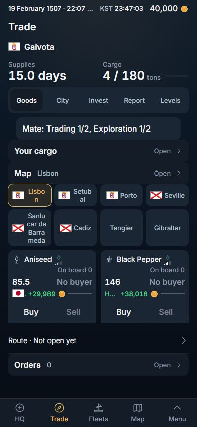
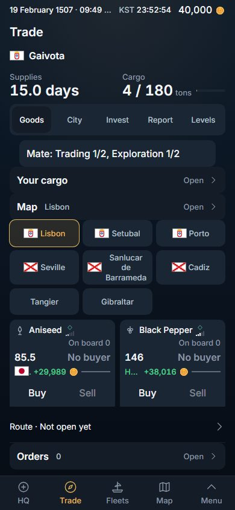
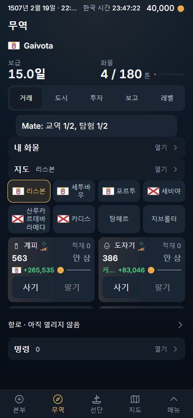
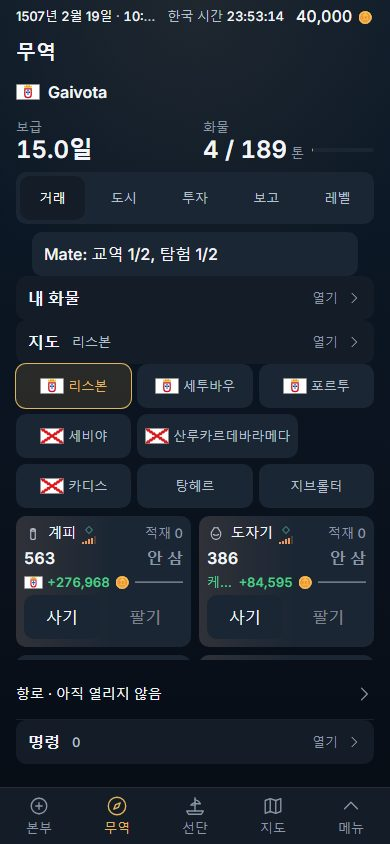
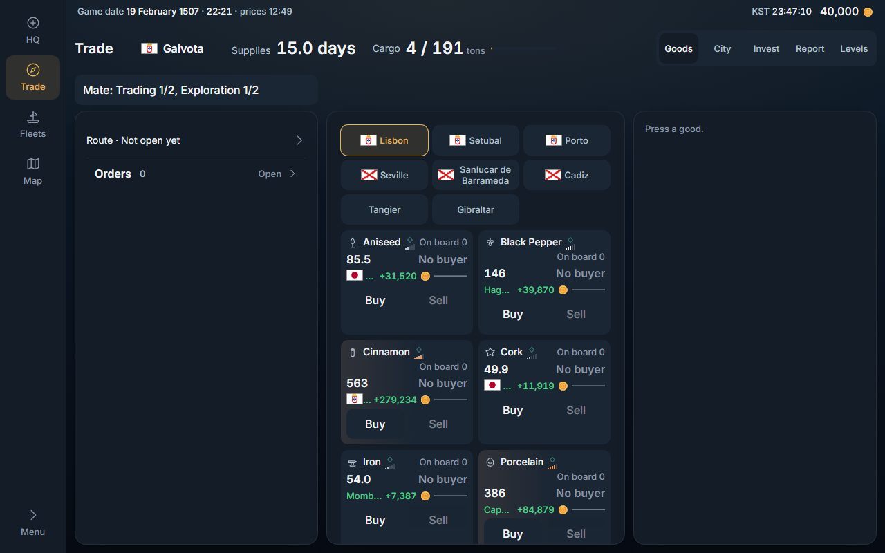
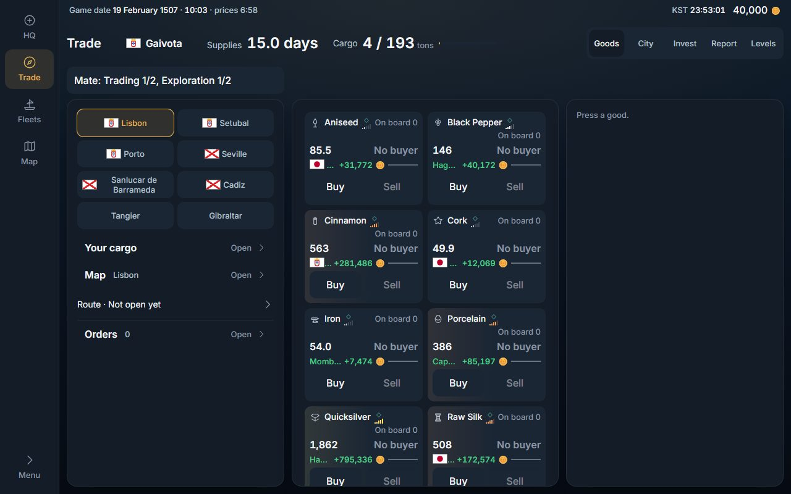
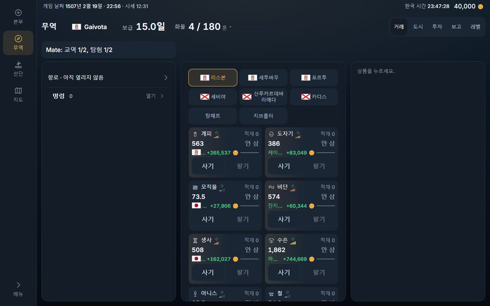
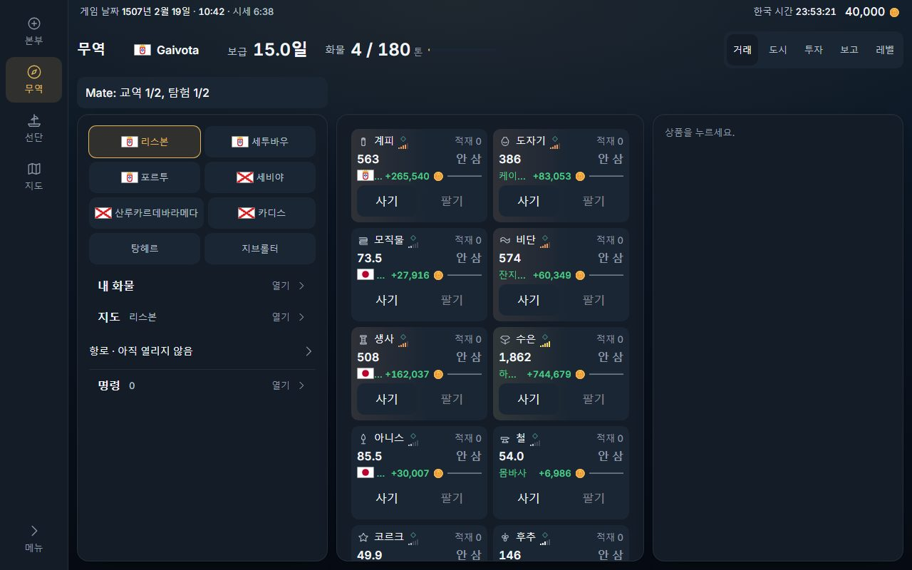
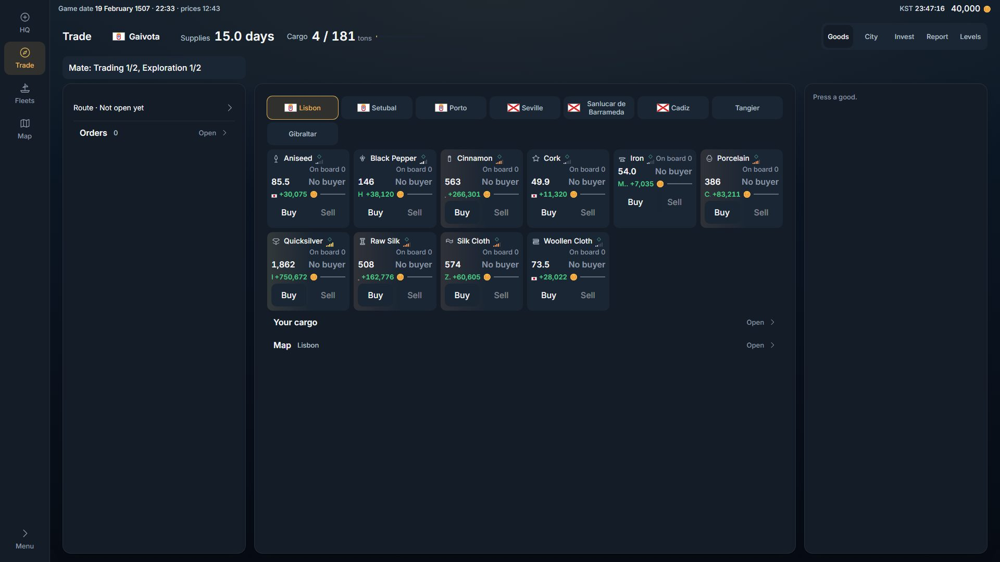
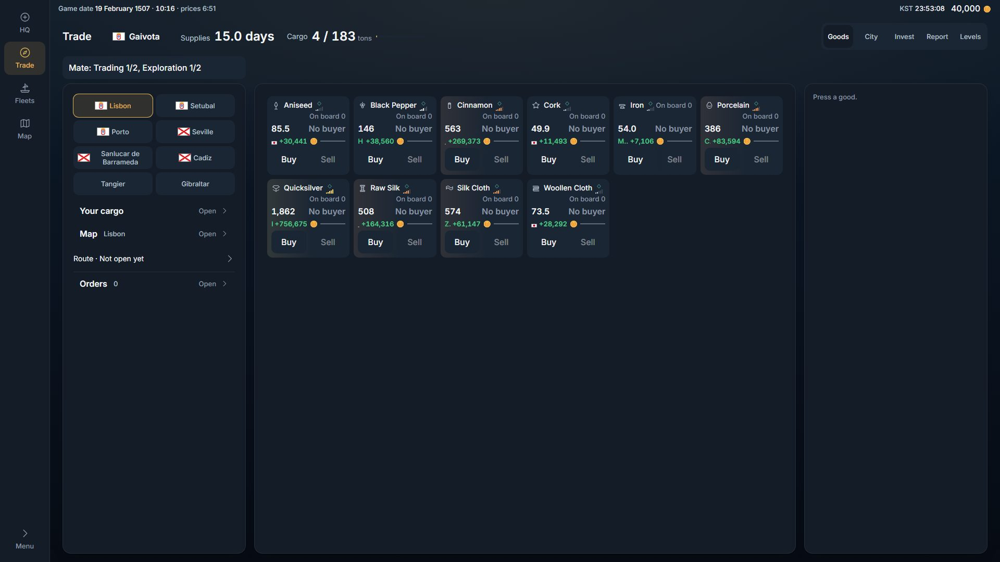

# Trade layout — the city picker keeps its words, and the wide desk uses its left pane (2026-11-11)

Two leftovers of the remaster, named in `2026-11-11-s4-type-and-surface.md` and `2026-11-11-s9-shell-look.md`. Client only; no migration, knob or flag. Stacked on S5 (#578): it changes the same files.

## What was there (measured before, local world, a new company docked at Lisbon)

**The city picker at 390 px.** Four equal columns: a cell 85 px wide, 41 px of it for the name.

| name | before |
|---|---|
| Lisbon | "Lisbo / n" (2 lines, broken inside the word) |
| Setubal | "Setub / al" (2 lines) |
| Sanlucar de Barrameda | 4 lines, "Sanlu / car de / Barra / meda" |
| 세투바우 | 2 lines |
| 산루카르데바라메다 | 3 lines |

**The wide desk at 1,280 × 800** (the rail, then three panes: 350 · 430 · 350 px, each 626 px tall):

- left pane: two rows, "Route" and "Orders". 101 px of its 626 used.
- centre pane: the city picker (3 rows), ten goods cards two to a row, then "Your cargo" and "Map". 1,036 px of content in 626: it scrolls, and 4 cards stand whole.
- right pane: the line "Press a good." until a good is pressed. 34 px used.

At 1,920 × 1,080 the panes are 350 · 1,038 · 350: the same two rows on the left, the picker and six cards to a row in the centre (513 px of 902 used), the same one line on the right.

**The goods cards.** Every card in a row already had one height (the grid stretches them: 151 px in English, 131 in Korean). What was uneven was inside: a card whose name ran two lines pushed its own prices and buttons down 20 px, and its neighbours' stayed up. At 1,280 every row had its prices at two heights (364 and 384 px in the first row).

## What changed

1. **A grid that keeps its words** (`src/components/ui/tileStyles.ts`, `TileGrid.tsx`: `TileGrid words={3} wordsWide={2}`). The cells stand on equal columns as before, a name turns only at a space (or after its own hyphen), and a cell whose longest word is wider than a column is as wide as that word. Korean names have no spaces, so `word-break: keep-all` keeps them whole. A cell starts one rem under its column and grows back to it, so a line with one long name still holds its full count while the long cell is up to a rem over.
2. **The city picker** (`src/features/command/buysell/TradeBoard.tsx`, `CityChips`): three columns on a phone (the planned fix), two in the wide desk's left pane.
3. **The wide desk's parts** (`src/features/command/buysell/Trade.tsx`): the left pane carries where and what she has (the city picker, Your cargo, Map, Route, Orders); the centre pane carries the goods alone; the right pane is the trade panel, as it was. The three panes themselves did not move by a pixel.
4. **The goods card** (`src/live/TradeCard.tsx`, one class): the head takes the card's spare height, so the prices and the buttons stand at the card's foot, level across a row.

## Measured after

**The city picker**, for every port name the world is seeded with (`data/ports.json`: 249 ports, 248 different names; Korean through the game's own table), put in the picker's own cells:

| glass | column | names wider than a column | widest cell | the line | a word broken | cut |
|---|---|---|---|---|---|---|
| 390, English | 115 px | 10 of 248 (the longest: Machilipatnam, 135 px) | 135 | 358 | 0 | 0 |
| 390, Korean | 115 px | 17 of 248 (the longest: 산타크루스데테네리페, 174 px) | 174 | 358 | 0 | 0 |
| 1,280, English | 156 px | 0 of 248 | 156 | 318 | 0 | 0 |
| 1,280, Korean | 156 px | 2 of 248 (산루카르데바라메다 161, 산타크루스데테네리페 174) | 174 | 318 | 0 | 0 |

At 390 the eight Lisbon chips: every name on one line except "Sanlucar de Barrameda" (three lines, turned at its two spaces) in English; in Korean 산루카르데바라메다 stands whole in a 161-px cell, and its line holds two cells instead of three. The picker is 157 px tall in English (it was 123) and 144 in Korean (it was 107): one more row. The first goods card starts 34 px lower in English and 37 in Korean, and two cards still stand whole above the bar (the floor `tests/layout.spec.ts` holds).

**The wide desk at 1,280 × 800:**

| pane | before | after |
|---|---|---|
| left (350 × 626) | 2 rows, 101 px used | the picker and 4 rows, 391 px used |
| centre (430 × 626) | the picker, 10 cards, 2 rows: 1,036 px, 4 cards whole | 10 cards: 799 px, 6 cards whole |
| right (350 × 626) | "Press a good.", 34 px | the same |

At 1,920 × 1,080: left 395 px used of 902 (it was 105); centre the ten cards in two rows of six and four, 326 px.

**The goods cards:** in every row, at 390, 1,280 and 1,920, in English and Korean, the cards are one height and their prices and Buy buttons stand at one height (the spec measures all three). No sideways scroll at any of the three widths.

## Screenshots

Before and after, in `img/trade-layout/`:

| | before | after |
|---|---|---|
| 390, English |  |  |
| 390, Korean |  |  |
| 1,280, English |  |  |
| 1,280, Korean |  |  |
| 1,920, English |  |  |

## Decided by default (the owner may reverse any of these)

1. **The three panes stay; the parts move.** The owner's 2026-10-19 rule is that every face of the desk stands in the same frame (`tests/desk.inplace.spec.ts` holds the three panes to the same boxes on every face), so Trade may not drop or resize a pane. The simplest use of the width inside that rule: the picker and the four doors on the left, the goods in the centre.
2. **Three columns alone do not keep every name whole, so a long name gets a wider cell.** In three columns at 390 a name has 71 px; 10 English and 17 Korean port names have a word longer than that. The choices were a smaller type (refused: the type scale is S4's), two columns on a phone (one more row again), or letting the one cell be as wide as its word. The last is the one taken: the columns stay equal wherever the names fit.
3. **Two columns in the wide desk's left pane**, not three: the pane is 318 px inside, and three columns there would give a name 62 px, less than on a phone.
4. **A name may turn after its own hyphen** ("Saint-" / "Louis"). That is where the name is already divided; the law is "not inside a word".
5. **The order on the left** is the picker, Your cargo, Map, Route, Orders: the phone's order.
6. **The card's spare height goes under its name**, not between the prices and the buttons, so the foot of every card in a row reads as one line.

## Not done, and why

- **The right pane is still one line ("Press a good.") until a good is pressed.** It is the desk's slot for the trade panel on every face, by the same frame rule. Filling it needs something this slice may not add: new content, a good opened by itself, or the orders moved there (which would take about 100 px of height from the trade panel each time it opens). It is left as it was and named here.
- **At 1,920 the centre pane is 326 px of cards in 902.** Ten goods are ten cards; nothing was added to fill it.
- **A best sale's city is still cut inside a goods card** ("Hag…" at 1,280, one letter at 1,920), read whole from the card's title: S5's choice in `TradeCard.tsx`, in a 191-px card. Not part of this slice; it conflicts with the owner's "show full names" and is worth its own decision.
- **The picker's names are measured against the seeded list** (`data/ports.json`), not against the live world's own rows. `tests/db.image.spec.ts` holds the built world to that file; a port added only by a later migration would not be in this measurement.
- `TradeToast.tsx` still centres on the window (another open PR owns it).

## Checks (local, the served build)

`tsc -b`, `eslint .`, `vite build`: clean. `tests/trade.layout.spec.ts` (new, 8 tests: the two widths, two languages, and 1,920 for the cards) passes; it fails on the build before this slice (prices at two heights in every row at 1,280) and with the picker's rule taken out (8 broken names at 390). `tests/command.bestSale.spec.ts` (updated: it read the picker inside the board; it reads it off the face now), `tests/sections.spec.ts`, `tests/duplication.spec.ts`, and the neighbours `command.design`, `desk.terminal`, `desk.inplace`, `command.sellCargo`, `command.buySell`: all pass.
